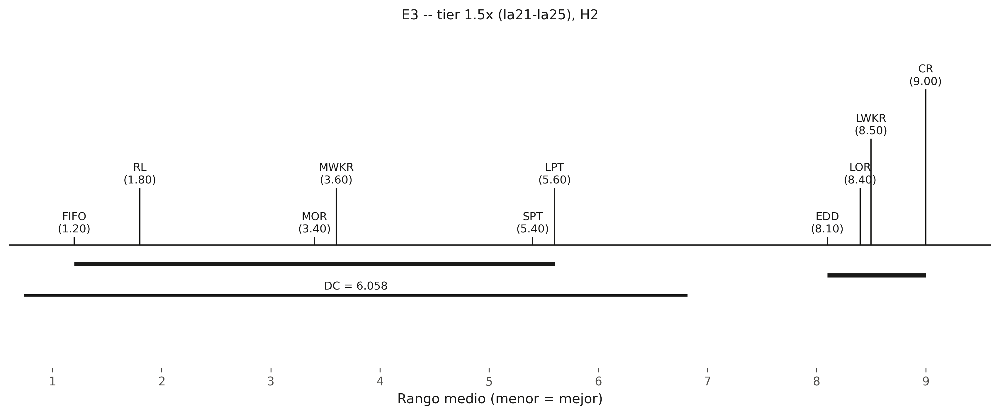
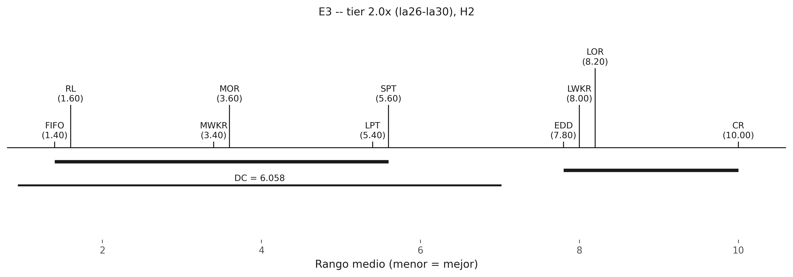
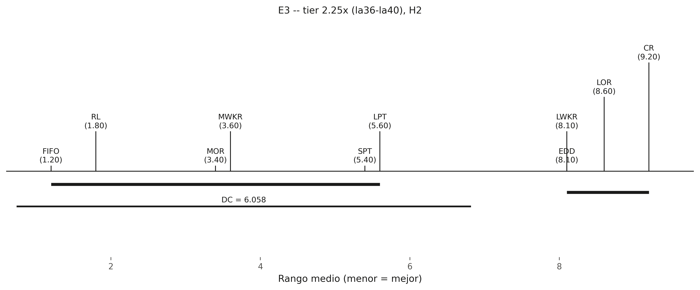
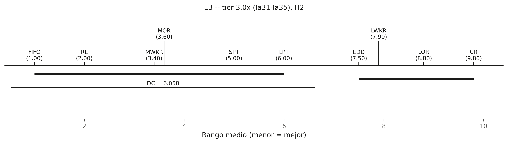
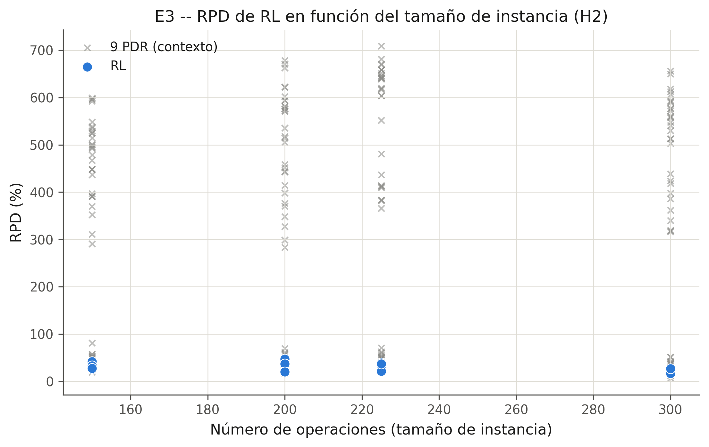
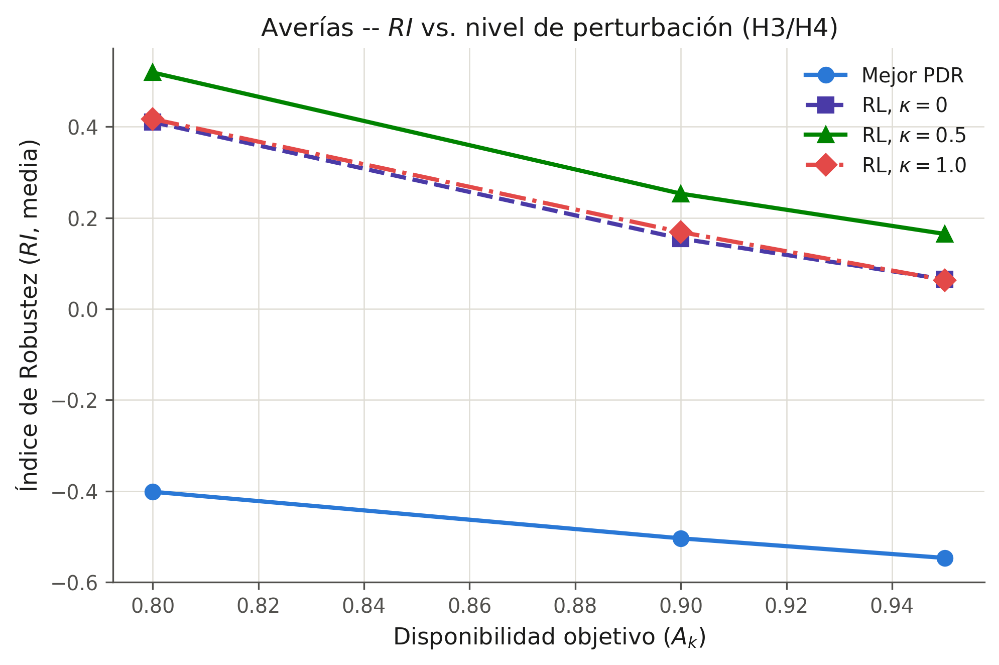
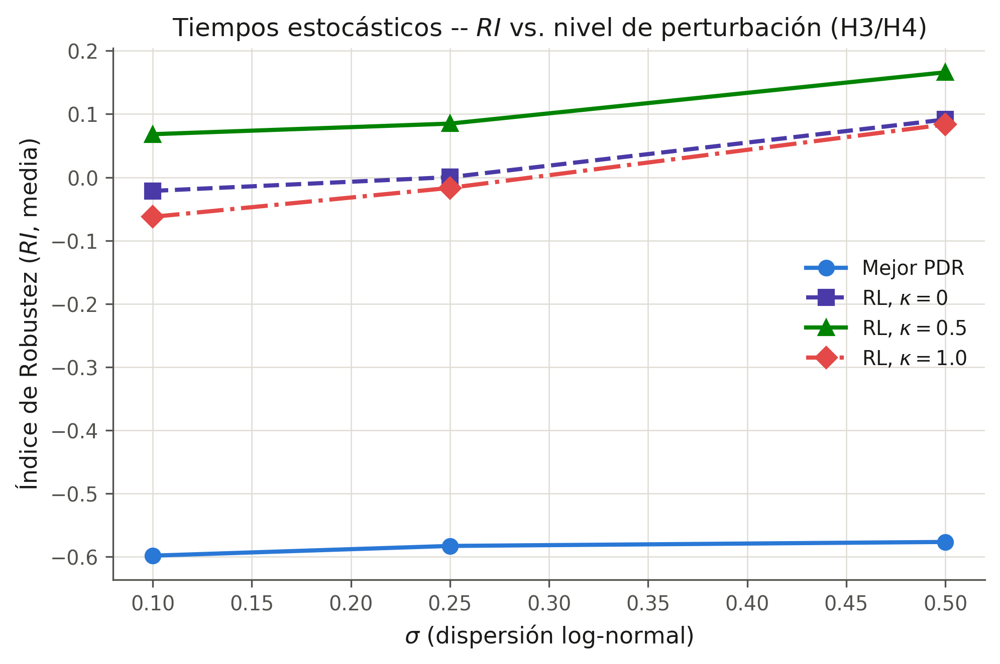
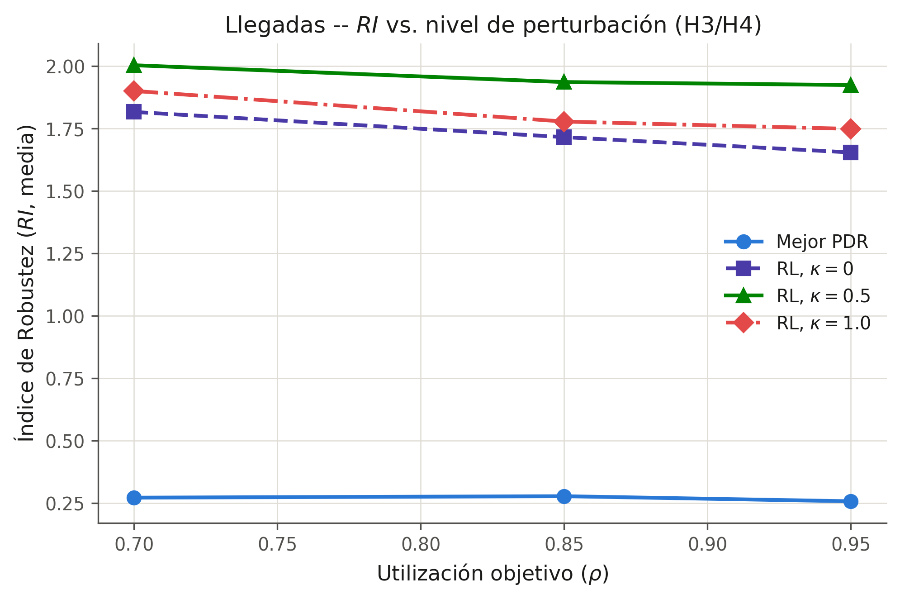
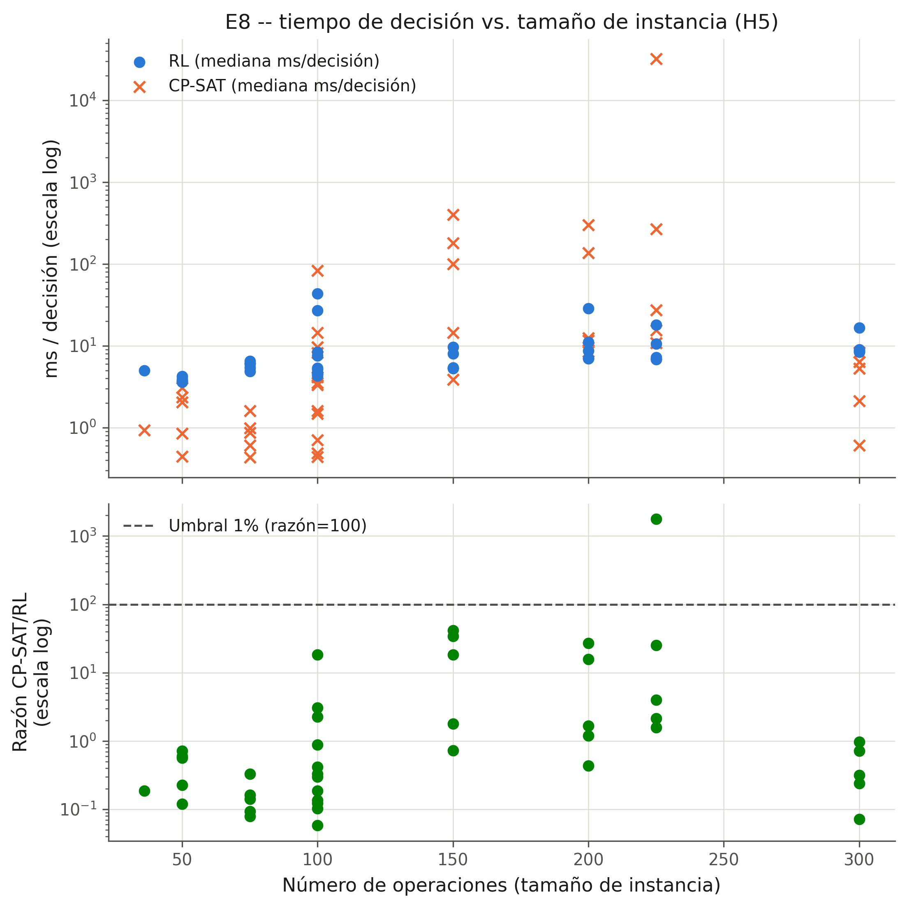

# Política de programación de taller de trabajo flexible dinámico mediante aprendizaje por refuerzo profundo basado en redes neuronales de grafos: generalización de tamaño y robustez ante perturbaciones múltiples

**Tesis de maestría — Borrador integrado v2**

Joseph Sanchez
UNIMINUTO
2026

---

## RESUMEN

Esta tesis aborda el problema de taller de trabajo flexible (FJSP) dinámico y estocástico mediante una política de aprendizaje por refuerzo profundo (PPO) sobre un codificador de red neuronal de grafos (GNN) relacional, con el objetivo de que dicha política, entrenada una única vez sobre instancias pequeñas, (a) generalice a instancias de tamaño no visto y (b) se mantenga robusta ante tres tipos de perturbación estocástica simultáneos —averías de máquina, tiempos de proceso estocásticos y llegadas dinámicas de trabajos—, mediante un mecanismo de recompensa explícitamente consciente de la perturbación (parámetro $\kappa$). La revisión sistemática de literatura 2015–2026 (protocolo PRISMA, 51 referencias verificadas) identifica esta combinación —generalización de tamaño **y** robustez multi-perturbación simultáneas— como una brecha no resuelta: los trabajos más cercanos abordan cada eje por separado. Cinco hipótesis (H1–H5) se pre-registraron formalmente, con reglas de decisión congeladas antes de la ejecución experimental, para blindar la tesis frente al riesgo de HARKing. El protocolo experimental (E0–E8) evalúa la política frente a nueve reglas de despacho por prioridad, un algoritmo genético y CP-SAT (Google OR-Tools), sobre las familias de instancias Fisher–Thompson, Lawrence y Brandimarte, con pruebas no paramétricas (Wilcoxon; Friedman con post-hoc de Nemenyi y diagramas de diferencia crítica) y tamaños de efecto reportados en cada comparación.

De las cinco hipótesis, **cuatro se rechazan y una se acepta**. H1 (competitividad estática) se rechaza en los tres brazos evaluados: JSSP (RPD medio de RL 24.82 % frente a 18.96 % de la mejor PDR por instancia, $N=43$, $p=4.03\times10^{-5}$), FJSP sintético (48.76 % de RPD, 0/43 instancias ganadas, $p=1.12\times10^{-8}$) y FJSP Brandimarte (89.65 % de RPD, 0/7, $p=0.0156$). H2 (generalización de tamaño) se acepta en los cuatro *tiers* evaluados (1.5×–3.0× del tamaño de entrenamiento): el rango de RL no es significativamente peor que el de la mejor PDR (Friedman+Nemenyi), aunque su RPD absoluto (23.9–32.9 %) permanece por encima del de `fifo` (12.7–26.8 %). H3 (robustez) se rechaza en los 9 regímenes de perturbación evaluados ($p<1.7\times10^{-11}$ en todos). H4 (recompensa consciente de la perturbación) se rechaza para $\kappa=0.5$ y $\kappa=1.0$: el entrenamiento con aleatorización de dominio, sin exposición a episodios nominales, colapsa la competitividad estática (+106.0 y +46.6 puntos porcentuales de RPD nominal, respectivamente). H5 (tiempo de decisión) se rechaza bajo el umbral estricto pre-registrado (42/43 instancias), aunque la política mantiene una ventaja cualitativa real de 1–2 órdenes de magnitud en instancias grandes y difíciles.

El patrón H2-aceptada/H3-H4-rechazadas constituye, hasta donde alcanza la revisión bibliográfica de esta tesis, la primera caracterización cuantitativa de la tensión entre generalización de tamaño y robustez multi-perturbación simultáneas para una política GNN+PPO, con causas raíz diagnosticadas (no solo reportadas) para cada rechazo. La tesis discute las implicaciones prácticas para contextos de manufactura y mantenimiento, propone una arquitectura híbrida (puente reactivo de baja latencia más re-optimización exacta) motivada directamente por el contraste entre la debilidad de calidad y la fortaleza de velocidad de la política entrenada, y documenta explícitamente las amenazas a la validez interna, externa, de constructo y de conclusión que acotan el alcance de estas conclusiones.

**Palabras clave:** aprendizaje por refuerzo profundo, redes neuronales de grafos, taller de trabajo flexible, *scheduling* dinámico, generalización de tamaño, robustez ante perturbaciones, recompensa consciente de la perturbación, pre-registro de hipótesis.

---

## ABSTRACT

This thesis addresses the dynamic and stochastic flexible job-shop scheduling problem (FJSP) through a deep reinforcement learning (PPO) policy built on a relational graph neural network (GNN) encoder, with the goal that a policy trained once on small instances can (a) generalize to unseen instance sizes and (b) remain robust under three simultaneous types of stochastic disruption — machine breakdowns, stochastic processing times, and dynamic job arrivals — via an explicitly disruption-aware reward mechanism (parameter $\kappa$). A systematic 2015–2026 literature review (PRISMA protocol, 51 verified references) identifies this specific combination — joint size generalization **and** multi-disruption robustness — as an unresolved gap: the closest prior work addresses each axis in isolation. Five hypotheses (H1–H5) were formally pre-registered, with decision rules frozen before experimental execution, to guard against HARKing. The experimental protocol (E0–E8) evaluates the policy against nine priority dispatching rules, a genetic algorithm, and CP-SAT (Google OR-Tools), on the Fisher–Thompson, Lawrence, and Brandimarte instance families, using non-parametric tests (Wilcoxon; Friedman with Nemenyi post-hoc and critical-difference diagrams) with effect sizes reported for every comparison.

Of the five hypotheses, **four are rejected and one is accepted**. H1 (static competitiveness) is rejected across all three evaluated arms: JSSP (RL mean RPD of 24.82% versus 18.96% for the per-instance best dispatching rule, $N=43$, $p=4.03\times10^{-5}$), synthetic FJSP (48.76% mean RPD, 0/43 instances won, $p=1.12\times10^{-8}$), and Brandimarte FJSP (89.65% mean RPD, 0/7, $p=0.0156$). H2 (size generalization) is accepted across all four evaluated tiers (1.5×–3.0× the training size): RL's rank is not significantly worse than the best dispatching rule's (Friedman+Nemenyi), although its absolute RPD (23.9–32.9%) remains above `fifo`'s (12.7–26.8%). H3 (robustness) is rejected in all 9 evaluated disruption regimes ($p<1.7\times10^{-11}$ throughout). H4 (disruption-aware reward) is rejected for both $\kappa=0.5$ and $\kappa=1.0$: training under domain randomization without exposure to nominal episodes collapses static competitiveness (+106.0 and +46.6 percentage points of nominal RPD, respectively). H5 (decision latency) is rejected under the strict pre-registered threshold (42/43 instances), though the policy retains a genuine 1–2 order-of-magnitude qualitative advantage on large, hard instances.

The H2-accepted/H3-H4-rejected pattern constitutes, as far as this thesis's literature review can establish, the first quantitative characterization of the tension between joint size generalization and multi-disruption robustness for a GNN+PPO policy, with root causes diagnosed — not merely reported — for each rejection. The thesis discusses practical implications for manufacturing and maintenance contexts, proposes a hybrid architecture (a low-latency reactive bridge combined with exact re-optimization) motivated directly by the contrast between the trained policy's quality weakness and speed strength, and explicitly documents the internal, external, construct, and conclusion validity threats that bound the scope of these conclusions.

**Keywords:** deep reinforcement learning, graph neural networks, flexible job-shop scheduling, dynamic scheduling, size generalization, disruption robustness, disruption-aware reward, hypothesis pre-registration.

---


## NOTA DE VERSIÓN — REGISTRO DE CAMBIOS (v1 → v2)

Esta versión responde punto por punto a los hallazgos **críticos** y **moderados** de `../docs/auditorias/PreDefenseAudit.md` (auditoría pre-sustentación de `../docs/capitulos/Thesis_FullDraft_v1.md`). Los hallazgos **menores** de ese informe no se abordan aquí por instrucción explícita del encargo ("cada hallazgo crítico y moderado") y permanecen como trabajo pendiente de bajo riesgo, listado en la Sección 6 de `../docs/auditorias/PreDefenseAudit.md`.

| # | Hallazgo (`../docs/auditorias/PreDefenseAudit.md`) | Severidad | Revisión aplicada en v2 | Ubicación en v2 |
|---|---|---|---|---|
| 1 | La tesis depende de documentos de trabajo externos no anexados para decisiones metodológicas centrales (diseño de E7, exclusión de `mk06`, especificaciones técnicas del arnés/entorno/arquitectura/pipeline estadístico) | **Crítica** | (a) Nueva Sección 5.4, que formaliza en prosa de tesis el diseño de E7 (rejilla de κ, justificación de la Opción B de aleatorización de dominio frente a la alternativa de régimen fijo, la asimetría estructural κ=0-reutilizada/κ>0-reentrenada, la regla de decisión) y el protocolo de re-medición limpia de E8, trasladando el contenido sustantivo de `E7_E8_FinalPlan.md` fuera de una cita externa. (b) Resúmenes ejecutivos de una configuración concreta insertados en §4.6.1 (regla TWK, $k=1.5$) y §4.6.2 (configuración final del GA) del Capítulo 4. (c) Lista de anexos de §1.7 actualizada para declarar formalmente las especificaciones técnicas complementarias como Anexos E–H. | §1.7, §4.6.1, §4.6.2, **§5.4 (nueva)** |
| 1 (mk06) | La exclusión de `mk06` se explicaba solo mediante un puntero a `../docs/logs/EXPERIMENT_LOG_WEEK24.md`, sin explicación autocontenida | **Crítica** | Explicación técnica completa (desajuste de 15 vs. 10 máquinas entre los metadatos y el archivo de datos del espejo `SchedulingLab/fjsp-instances`) incorporada directamente en el Capítulo 6, con el mismo estándar de autocontención ya aplicado a la anomalía de `la40` en §6.5.1 | §6.2.1 (nota al pie de la Tabla 6.2.2) |
| 2.1 | La superioridad del GA sobre RL, visible en la Tabla 6.2.1, nunca se discutía narrativamente | **Moderada** | Párrafo nuevo en §6.2.1 (con la cifra exacta: RPD medio del GA = 5.52 % frente al 24.82 % de RL, $N=43$) y referencia cruzada añadida en §7.2 del Capítulo 7 | §6.2.1, §7.2 |
| 2.2 | La Tabla 7.1 (Cap. 7) introduce RPD medio de los brazos FJSP que no aparecen en ninguna tabla del Capítulo 6 | **Moderada** | Nueva Tabla 6.2.3 (RPD medio de los brazos FJSP sintético y Brandimarte) añadida al Capítulo 6, trazando el origen de las cifras que la Tabla 7.1 ya citaba | §6.2.1 (Tabla 6.2.3, nueva) |
| 2.3 | La Tabla 6.3.3 excluye al GA de la clasificación conjunta de Friedman/Nemenyi sin justificación explícita | **Moderada** | Nota metodológica añadida inmediatamente antes de la Tabla 6.3.3, declarando el criterio de inclusión/exclusión | §6.3 |
| 2.4 | Parámetros declarados "configurables" en el Capítulo 4 (factor de holgura $k$ de EDD/CR; población/generaciones del GA) nunca se fijan a un valor concreto en el Capítulo 6 | **Moderada** | Valores finales incorporados directamente en el Capítulo 4 (no solo en el 6, para que la especificación y el resultado coincidan desde el primer punto de mención): $k=1.5$ (regla TWK); GA con `population_size=80` (escalado a 60/40 por banda de tamaño), `elite_count=2`, `immigrant_fraction=0.05`, presupuesto de 60 s | §4.6.1, §4.6.2 |
| 2.5 | No se declaraba si los $p$-valores de Wilcoxon con $N\geq20$ usaron el método exacto o la aproximación normal | **Moderada** | Nota metodológica añadida al inicio de §6.2, confirmando —verificado contra `experiments/results/stats/tables/h1_h5_verdict.md`— que el pipeline usó el método **exacto** de `scipy.stats.wilcoxon` en todas las pruebas reportadas, incluida H1-JSSP con $N=43$, superando el mínimo que la propia Sección 5.3.2 exigía | §6.2 (nota de apertura) |
| 2.6 | Riesgo específico de programa de ingeniería industrial: expectativa de validación aplicada/industrial | **Moderada** | Frase de reconocimiento explícito añadida en §8.5, anticipando la pregunta del comité y remitiendo a la delimitación ya declarada en §1.5 y al punto 11 del plan de trabajo futuro (§8.6) | §8.5 |

**Nota de integridad:** ninguna de estas revisiones alteró un resultado numérico, un veredicto de hipótesis, o una prueba estadística ya reportada en `../docs/capitulos/Thesis_FullDraft_v1.md` — todas son adiciones de trazabilidad, justificación metodológica o discusión narrativa sobre datos ya existentes en el corpus de trabajo, consistente con la recomendación explícita de `../docs/auditorias/PreDefenseAudit.md` §6 ("ninguna de estas doce acciones requiere reabrir resultados experimentales").

---


# CAPÍTULO 1 — INTRODUCCIÓN

# Capítulo 1 — Introducción

> **Nota de trazabilidad:** este capítulo se redacta a partir del marco teórico (Parte B), el protocolo y los resultados de la revisión sistemática (Parte C, actualizada con la verificación bibliográfica y la búsqueda PRISMA de 2024–2026), la especificación procedimental (Parte D) y la bibliografía verificada (Parte F) del documento de fundamento de esta tesis. Toda afirmación que no pudo confirmarse de forma independiente contra una fuente primaria se marca explícitamente con **[VERIFICAR]**.

## 1.1 Contexto y motivación

La cuarta revolución industrial —Industria 4.0— ha transformado el taller de manufactura discreta en un sistema intensivo en datos, interconectado mediante sensores, controladores programables y plataformas de manufactura ciberfísica [VERIFICAR: cifra específica de adopción o penetración de tecnologías 4.0 en manufactura discreta, que no se verificó contra una fuente estadística primaria]. En este contexto, la **programación de la producción** (*scheduling*) —la asignación de operaciones a máquinas a lo largo del tiempo— continúa siendo una de las funciones de decisión más críticas y, a la vez, más difíciles de automatizar de forma robusta en un taller real [3].

El **taller de trabajo flexible** (*Flexible Job-Shop Scheduling Problem*, FJSP) generaliza el clásico problema de taller de trabajo (JSSP) al permitir que cada operación se ejecute en más de una máquina candidata, añadiendo una decisión de **enrutamiento** a la decisión tradicional de **secuenciamiento** [9]. Esta flexibilidad —deseable desde el punto de vista de la utilización de recursos y la resiliencia operativa— incrementa sustancialmente la complejidad combinatoria del problema: el JSSP puro ya es NP-difícil en sentido fuerte para tres o más máquinas [2], y el FJSP lo contiene como caso particular, por lo que hereda —y en la práctica agrava— esa dureza computacional.

La motivación de esta tesis, sin embargo, no es la dureza combinatoria por sí sola, sino una brecha más específica y de mayor relevancia industrial: los talleres reales **no son estáticos ni deterministas**. Las máquinas se averían, los tiempos de proceso varían respecto de sus estimaciones nominales, y los trabajos llegan de forma dinámica y no completamente anticipable [VERIFICAR: cita de un estudio empírico sobre frecuencia de disrupciones en manufactura discreta; en este documento la afirmación se sostiene sobre la literatura de *scheduling* robusto y reactivo, no sobre datos de campo propios]. Frente a esta realidad, los métodos exactos (programación por restricciones, MILP) garantizan optimalidad solo a costa de un tiempo de cómputo que crece de forma prohibitiva con el tamaño de la instancia, mientras que las metaheurísticas y las reglas de despacho por prioridad (PDR) sacrifican calidad de solución a cambio de velocidad, y ninguna de las dos familias se adapta de forma nativa a eventos que ocurren *durante* la ejecución del programa [3].

En los últimos años, el **aprendizaje por refuerzo profundo** (DRL) combinado con **redes neuronales de grafos** (GNN) ha emergido como un paradigma alternativo: en lugar de resolver cada instancia desde cero, se entrena una **política** que, dado el estado parcial de un taller representado como un grafo, decide de forma amortizada e inmediata qué operación asignar a qué máquina. El trabajo seminal de Zhang, Song, Cao et al. (**L2D**, NeurIPS 2020) demostró que una política GIN+PPO entrenada sobre instancias pequeñas puede superar a las PDR clásicas y aproximarse a la calidad de OR-Tools en instancias de JSSP estático de tamaño creciente, con tiempos de decisión órdenes de magnitud menores [23]. Trabajos posteriores extendieron este paradigma al FJSP mediante representaciones de grafo heterogéneo que capturan simultáneamente la relación operación-operación y operación-máquina [24], [25], [26].

No obstante, y este es el punto de partida real de la presente tesis, la revisión sistemática de la literatura 2018–2026 (Capítulo 3; véase también el análisis de brechas en la Sección 3.6) muestra que la gran mayoría de estos trabajos evalúan sus políticas en condiciones **estáticas y deterministas**, o bien introducen **un único tipo de perturbación a la vez** (por ejemplo, únicamente averías de máquina, o únicamente llegadas dinámicas) [38], [40], [42]. La combinación de (i) generalización a instancias de tamaño no visto durante el entrenamiento y (ii) robustez simultánea frente a **múltiples tipos distintos de perturbación estocástica**, mediante un mecanismo de recompensa explícitamente consciente de la perturbación, permanece como territorio parcialmente abierto — con al menos tres trabajos recientes (2024–2026) que se aproximan a alguno de estos ejes por separado, pero ninguno que los combine en su totalidad [38], [40], [42]. Esta tesis se posiciona precisamente en esa intersección, con una motivación doble: académica (cerrar una brecha metodológica identificada y documentada mediante un protocolo PRISMA explícito) e industrial (un programador que generaliza en tamaño y es robusto a perturbaciones múltiples es directamente más desplegable en un taller real que uno evaluado solo en condiciones ideales).

## 1.2 Planteamiento del problema

Formalmente (véase la Sección 2.2 para la formulación completa), el FJSP dinámico y estocástico que aborda esta tesis se define sobre un conjunto de trabajos J={1,…,n}, cada uno compuesto por una secuencia de operaciones con precedencia fija, donde cada operación O_{j,h} puede procesarse en cualquier máquina de un subconjunto elegible M_{j,h}⊆M, con tiempo de proceso p_{j,h,k} dependiente de la máquina asignada. A esta formulación base se añaden tres fuentes de incertidumbre, siguiendo la extensión estocástica descrita en la Sección 2.2.3: (i) **llegadas dinámicas de trabajos**, modeladas como un proceso de Poisson; (ii) **tiempos de proceso estocásticos**, con un multiplicador log-normal de media unitaria sobre el tiempo nominal; y (iii) **averías de máquina**, con tiempo hasta el fallo exponencial y tiempo de reparación log-normal, parametrizadas por una disponibilidad estacionaria objetivo.

El problema de decisión puede plantearse así: **¿cómo diseñar una política de programación que (a) se entrene una única vez sobre instancias pequeñas y (b) se ejecute sin reentrenamiento sobre instancias de tamaño sustancialmente mayor y bajo regímenes de perturbación —simples o combinados— no vistos durante el entrenamiento, manteniendo una calidad de solución competitiva frente a las alternativas clásicas y un tiempo de decisión compatible con la operación en tiempo real?**

Tres limitaciones concretas de la literatura actual motivan este planteamiento y se documentan con evidencia en el Capítulo 3:

1. **Brecha de generalización-más-robustez conjunta.** Los trabajos que demuestran generalización en tamaño (p. ej. Smit et al., AAAI 2025 [42]) lo hacen típicamente sobre una única fuente de incertidumbre (tiempos de proceso estocásticos), mientras que los trabajos que combinan varios tipos de perturbación (p. ej. Lassoued et al. [38], con averías y llegadas simultáneas) no reportan experimentos de generalización de tamaño entrenar-en-pequeño/evaluar-en-grande. Ningún trabajo identificado en la búsqueda PRISMA 2024–2026 combina ambos ejes de forma simultánea y explícita.
2. **Recompensas conscientes de la perturbación, pero de un solo tipo.** Los trabajos más cercanos en este eje (Zhang, Yan, Yang y Hu, 2024 [40]; y un trabajo relacionado de 2025 con una arquitectura D3QN contrastiva [41]) diseñan mecanismos de *reward shaping* sensibles a la disrupción, pero para un único tipo de evento (llegadas de trabajos). El diseño propuesto en esta tesis (Sección 4.3, ecuación de recompensa consciente de la perturbación) generaliza este principio a **múltiples** tipos de perturbación simultáneos mediante un término de penalización de inestabilidad ponderado por un factor κ.
3. **Rigor comparativo limitado.** Una fracción sustancial de los trabajos revisados compara únicamente contra PDR, omitiendo una comparación simultánea y con presupuesto de tiempo equiparado frente a CP-SAT y a un algoritmo genético bien ajustado, y pocos reportan pruebas de significancia estadística no paramétrica (Wilcoxon; Friedman + Nemenyi) [32].

El problema de investigación de esta tesis, por tanto, no es solamente "aplicar DRL+GNN al FJSP" —lo cual ya ha sido demostrado como viable [23]–[26]— sino **caracterizar de forma sistemática, reproducible y estadísticamente rigurosa el compromiso entre generalización de tamaño, robustez ante perturbaciones múltiples y coste de decisión**, usando un mecanismo de recompensa explícitamente diseñado para ese compromiso.

## 1.3 Preguntas de investigación e hipótesis

Siguiendo el mapeo de brechas de la Sección 3.6 (brecha → evidencia → pregunta), la **pregunta principal (PP)** de esta tesis es:

> **PP:** ¿Puede una política de aprendizaje por refuerzo profundo basada en redes neuronales de grafos heterogéneas y PPO, entrenada sobre instancias pequeñas y deterministas de taller de trabajo flexible, generalizar a instancias de tamaño no visto **y**, simultáneamente, mantenerse robusta ante múltiples tipos de perturbación estocástica (averías de máquina, tiempos de proceso estocásticos, llegadas dinámicas de trabajos, individualmente y en combinación), superando a las reglas de despacho por prioridad y aproximándose a la calidad de solución de un algoritmo genético y de CP-SAT con una fracción de su tiempo de decisión?

De esta pregunta principal se derivan tres subpreguntas:

- **SP1:** ¿Mejora una función de recompensa explícitamente consciente de la perturbación la robustez de la política (medida como índice de robustez RI, Sección 4.2/5.2) sin deteriorar de forma significativa la optimalidad nominal (estática, sin perturbaciones)?
- **SP2:** ¿Cuál es la brecha real de calidad de solución de la política aprendida frente al techo práctico de CP-SAT y frente a un algoritmo genético ajustado, en cada régimen de perturbación evaluado por separado?
- **SP3:** ¿Son las diferencias observadas entre la política propuesta y cada línea base estadísticamente significativas, con tamaños de efecto reportados, bajo un protocolo no paramétrico (Wilcoxon para comparaciones pareadas; Friedman + Nemenyi para comparaciones múltiples)?

Estas preguntas se traducen en cinco **hipótesis pre-registradas** (Sección 4.7/D7, con sus reglas de decisión de aceptación fijadas *antes* de generar cualquier resultado experimental, para blindar la defensa metodológica frente al riesgo de HARKing):

- **H1 (competitividad estática):** la política propuesta supera a la mejor PDR en brecha de optimalidad promedio (RPD) sobre los conjuntos de referencia ta (Taillard [7]) y MK (Brandimarte [9]). *Se acepta* si la prueba de Wilcoxon arroja p<0.05 y la mediana de la mejora es positiva.
- **H2 (generalización en tamaño):** el RPD en instancias de 2 a 3 veces el tamaño de entrenamiento se mantiene por debajo del RPD de la mejor PDR en todos los tamaños de prueba. *Se acepta* mediante Friedman + Nemenyi.
- **H3 (robustez ante perturbaciones):** el índice de robustez (RI) de la política propuesta es menor que el de las PDR bajo averías, tiempos estocásticos y llegadas dinámicas, evaluados individualmente. *Se acepta* si RI_modelo < RI_PDR con p<0.05 (Wilcoxon) en cada régimen.
- **H4 (recompensa consciente de la perturbación):** un valor κ>0 en la recompensa propuesta reduce el RI sin aumentar el RPD nominal en más de un margen δ predefinido (p. ej., 2 puntos porcentuales). *Se acepta* si ΔRI<0 de forma significativa y ΔRPD_nominal<δ.
- **H5 (tiempo de decisión):** el tiempo de decisión por época de la política propuesta es varios órdenes de magnitud menor que el de CP-SAT para instancias grandes. *Se acepta* si la mediana de milisegundos por instancia es <1 % de la de CP-SAT.

## 1.4 Objetivos

**Objetivo general.** Diseñar, implementar y evaluar de forma estadísticamente rigurosa una política de programación basada en redes neuronales de grafos heterogéneas y aprendizaje por refuerzo profundo (PPO) que generalice a instancias de tamaño no visto y sea robusta ante múltiples tipos de perturbación estocástica en el problema de taller de trabajo flexible dinámico, mediante un mecanismo de recompensa explícitamente consciente de la perturbación.

**Objetivos específicos:**

1. Formalizar el FJSP dinámico y estocástico como un proceso de decisión de Markov de eventos discretos, con una representación de estado en forma de grafo heterogéneo operación-máquina (Sección 2.2, 2.3, 4.2–4.3).
2. Construir y validar (verificación y validación, Sección 2.9) un entorno de simulación de eventos discretos compatible con la interfaz Gymnasium que inyecte de forma controlada los tres tipos de perturbación considerados, individual y conjuntamente.
3. Implementar una política actor-crítico con codificador GNN heterogéneo (comparando variantes GIN y GAT) y algoritmo PPO, incluyendo enmascarado de acciones infactibles.
4. Diseñar y ablacionar una función de recompensa consciente de la perturbación (parámetro κ) frente a la recompensa densa estándar basada en el decremento de una cota inferior del makespan.
5. Reproducir como líneas base neuronales L2D [23] y el esquema heterogéneo de Song et al. [25], además de las líneas base clásicas (PDR, algoritmo genético, CP-SAT con presupuesto de tiempo).
6. Evaluar la política propuesta bajo el protocolo experimental pre-registrado (matriz de experimentos E0–E8, Sección 5.1) y reportar significancia estadística no paramétrica con tamaños de efecto (Sección 5.3).
7. Caracterizar explícitamente el diferencial de esta tesis frente a los tres trabajos 2024–2026 más cercanos identificados en la búsqueda PRISMA [38], [40], [42], evitando una afirmación de novedad no matizada.

## 1.5 Alcance, delimitaciones y supuestos

Esta tesis se desarrolla bajo las siguientes delimitaciones explícitas, fijadas para mantener el alcance viable dentro de un proyecto de un único estudiante con un horizonte aproximado de nueve meses y una única GPU de clase de consumo (8–12 GB):

- **Problema:** se aborda el FJSP (taller de trabajo flexible), no el problema general de programación de proyectos con restricción de recursos (RCPSP) ni variantes de flow-shop puro.
- **Objetivo(s):** el objetivo principal es el makespan (C_max); la tardanza ponderada se incluye como objetivo secundario **opcional**, condicionado al tiempo disponible tras completar los experimentos del objetivo principal (Sección 5.1, factor multiobjetivo).
- **Perturbaciones:** se consideran exactamente tres tipos —averías de máquina, tiempos de proceso estocásticos y llegadas dinámicas de trabajos—, individualmente y en combinaciones predefinidas por la matriz experimental (Sección 5.1); no se modelan otras fuentes de incertidumbre (p. ej., cancelaciones de pedidos, cambios de prioridad a mitad de ejecución, o incertidumbre en la disponibilidad de materia prima).
- **Agente:** se emplea un único agente PPO de política centralizada (no un esquema multiagente); la comparación con esquemas multiagente de la literatura [40], [41] se realiza a nivel de discusión (Capítulo 7), no de implementación propia.
- **Datos:** **todos los datos son simulados**. Se emplean instancias públicas de referencia (Taillard [7], Brandimarte [9], Hurink [10], Lawrence [6], Fisher-Thompson [5]) y generación sintética controlada; no se recolectan ni emplean datos de un taller real, y no se realiza transferencia simulación-realidad (*sim-to-real*) alguna. Cualquier afirmación sobre aplicabilidad industrial directa debe leerse en este contexto de validación exclusivamente simulada.
- **Cómputo:** todos los experimentos deben ser ejecutables en una única GPU de consumo (8–12 GB) en un horizonte de horas a pocos días por configuración; esto acota el tamaño máximo de instancia de entrenamiento (≈10×10 a 15×15) y el número de escenarios estocásticos evaluados por réplica.
- **Horizonte temporal:** el proyecto completo (incluyendo revisión de literatura, desarrollo del entorno, líneas base, entrenamiento, experimentos y redacción) se planifica en aproximadamente nueve meses (Sección 4.1, cronograma).
- **Supuesto metodológico central:** se asume que las instancias públicas de referencia (Taillard, Brandimarte, etc.) y las distribuciones estocásticas paramétricas (exponencial, log-normal) constituyen una aproximación válida y aceptada por la disciplina para evaluar generalización y robustez, en ausencia de datos de planta real —un supuesto compartido por la práctica totalidad de la literatura revisada en el Capítulo 3.

## 1.6 Contribuciones esperadas

A partir del análisis de brechas consolidado en la Sección 3.6, esta tesis aspira a las siguientes contribuciones:

1. **Contribución metodológica principal:** un estudio sistemático y reproducible de la **combinación** de generalización de tamaño y robustez ante múltiples tipos de perturbación estocástica para el FJSP dinámico mediante GNN+DRL, con un mecanismo de recompensa consciente de la perturbación (parámetro κ) que generaliza el enfoque de recompensa de disrupción única presente en la literatura más cercana [40], [41] a un entorno multi-perturbación.
2. **Contribución empírica:** una comparación estandarizada y estadísticamente rigurosa (Wilcoxon; Friedman + Nemenyi con diagramas de diferencia crítica) frente a PDR, un algoritmo genético ajustado y CP-SAT con presupuesto de tiempo equiparado, algo que la revisión sistemática (Capítulo 3) muestra como parcial o ausente en buena parte de la literatura existente.
3. **Contribución de reproducibilidad:** un entorno de simulación de eventos discretos, compatible con Gymnasium, con inyección paramétrica de los tres tipos de perturbación, publicado como código abierto —siguiendo el precedente de JSSEnv [27] y *schlably* [28]— como contribución citable independiente del resultado del modelo propuesto.
4. **Contribución de pre-registro:** un protocolo de hipótesis y reglas de decisión fijado *antes* de la ejecución experimental (Sección 4.7), infrecuente en la literatura de DRL para *scheduling* revisada, que refuerza la validez de conclusión de los resultados reportados.
5. **Contribución de posicionamiento en la frontera 2024–2026:** una caracterización explícita, respaldada por un protocolo PRISMA documentado (Sección 3.1, 3.6), de en qué medida el diferencial de esta tesis se sostiene frente a los tres trabajos más recientes y más cercanos identificados [38], [40], [42] — evitando una afirmación de "vacío total" en la literatura y, en su lugar, precisando el eje exacto de la novedad (la *combinación* de generalización y multi-perturbación, no cada eje por separado).

Se reitera —consistente con la Sección 1.5— que estas contribuciones se enmarcan **exclusivamente en validación por simulación**; ninguna contribución de esta tesis implica, por sí misma, una demostración de desempeño en un taller físico real.

## 1.7 Estructura del documento

El resto de este documento se organiza como sigue. El **Capítulo 2** presenta el marco teórico completo: fundamentos de programación de la producción y notación α|β|γ [1] (Sección 2.1), la formulación matemática del JSSP/FJSP determinista y su extensión dinámica/estocástica (Sección 2.2), los procesos de decisión de Markov y su variante semi-Markov para eventos discretos (Sección 2.3), los fundamentos de aprendizaje por refuerzo profundo y en particular PPO [13] (Sección 2.4), las redes neuronales de grafos y su propiedad de invariancia a permutaciones como base teórica de la generalización en tamaño [16]–[19] (Sección 2.5), las reglas de despacho por prioridad (Sección 2.6), los métodos exactos y metaheurísticos de referencia —CP-SAT y algoritmos genéticos— (Sección 2.7), los conceptos de generalización en optimización combinatoria neuronal y *scheduling* robusto/reactivo (Sección 2.8) y los fundamentos de simulación de eventos discretos (Sección 2.9).

El **Capítulo 3** presenta el estado del arte mediante una revisión sistemática con protocolo PRISMA explícito (Sección 3.1), una narrativa cronológica 2018–2026 por familia de método (Sección 3.2), una tabla comparativa de los trabajos más relevantes con valores extraídos directamente de las fuentes primarias (Sección 3.3), una discusión específica de *scheduling* dinámico/estocástico con RL (Sección 3.4) y de generalización, GNN heterogéneas y agentes basados en modelos de lenguaje (Sección 3.5), y el análisis de brechas que fundamenta las preguntas de investigación de este capítulo (Sección 3.6).

El **Capítulo 4** especifica la metodología: el entorno de simulación y su contrato Gymnasium, la formulación MDP completa (estado, acciones, recompensa, enmascarado), el codificador GNN heterogéneo y la política PPO, los modelos paramétricos de perturbación y las líneas base. El **Capítulo 5** detalla el diseño experimental: la matriz de factores y experimentos (E0–E8), el protocolo de evaluación y métricas, y el procedimiento estadístico no paramétrico. El **Capítulo 6** reportará los resultados empíricos (validación del entorno, desempeño estático, generalización en tamaño, robustez ante perturbaciones, tiempos de decisión) — contenido que, por su naturaleza, **requiere ejecución experimental** y no se incluye en el presente documento de fundamento. El **Capítulo 7** discutirá los resultados a la luz de la literatura revisada en el Capítulo 3, incluyendo una comparación explícita con los trabajos 2024–2026 más cercanos. El **Capítulo 8** presentará las conclusiones y el trabajo futuro. Cierran el documento las referencias bibliográficas (verificadas y corregidas conforme al proceso descrito en el Anexo D) y los anexos con la formulación MILP completa, los hiperparámetros y la arquitectura del modelo, las tablas extendidas de resultados, el diagrama de flujo PRISMA, el documento de pre-registro y las tablas de óptimos/mejores valores conocidos por instancia — más, incorporadas formalmente a la lista de anexos en esta versión (v2, en respuesta a `../docs/auditorias/PreDefenseAudit.md` §1), las especificaciones técnicas complementarias del arnés de líneas base (Anexo E, `../docs/especificaciones/Baselines_TechSpec.md`), del entorno dinámico (Anexo F, `../docs/especificaciones/DynamicEnv_TechSpec.md`), de la arquitectura GNN/PPO (Anexo G, `../docs/especificaciones/GNN_PPO_Architecture_Spec.md`) y del pipeline estadístico (Anexo H, `StatsAnalysis_TechSpec.md`), cuyo contenido sustantivo para el diseño de E7/E8 se resume además directamente en el cuerpo de los Capítulos 4 y 5 (§4.6, §5.4).


---


# CAPÍTULO 2 — MARCO TEÓRICO

> **Nota de estado, no un contenido de relleno:** este capítulo **no existe redactado en prosa de tesis** en ningún archivo del corpus de trabajo a la fecha de esta compilación. El hallazgo se documenta de forma independiente en `../docs/auditorias/AuditoriaCapitulos1-5.md` ("no hay un Capítulo 2 redactado en ninguna parte del proyecto... Todo el resto de esta auditoría trata al Cap. 2 como ausente, no como 'pendiente de pulir'"), se reafirma en `../docs/auditorias/ConsistencyCheckReport.md` (Hallazgo estructural #1) y en `../docs/auditorias/PreDefenseAudit.md` (§1, "Hallazgo crítico"), y se mantiene sin resolver en esta versión v2: redactar el Capítulo 2 es, de las doce acciones de `../docs/auditorias/PreDefenseAudit.md` §6, la única de esfuerzo "alto" (encargo de redacción propio) y por tanto queda fuera del alcance de esta pasada de revisión, que atendió específicamente los hallazgos crítico #2 y moderados (ver Registro de cambios, arriba). El Capítulo 1 (§1.7) cita el Capítulo 2 seis veces, y el Capítulo 4 (§4.3.1) una vez más, como si su contenido ya existiera — ambas siguen siendo, en esta versión, **referencias cruzadas rotas**, señaladas explícitamente y no corregidas silenciosamente.
>
> El contenido teórico correspondiente existe únicamente como notas de framework internas (Parte B de `../docs/planificacion/Step 4 Thesis.md`, no redactadas en prosa de tesis ni con aparato de citas), y cubriría, según la estructura ya anticipada por el propio Capítulo 1 (§1.7) y por el índice temático de la Parte B, las siguientes nueve subsecciones:
>
> 1. **2.1 Fundamentos de programación de la producción y notación α|β|γ** [1]
> 2. **2.2 Formulación matemática del JSSP/FJSP determinista y su extensión dinámica/estocástica**
> 3. **2.3 Procesos de decisión de Markov y su variante semi-Markov para eventos discretos**
> 4. **2.4 Fundamentos de aprendizaje por refuerzo profundo, en particular PPO** [12], [13]
> 5. **2.5 Redes neuronales de grafos e invariancia a permutaciones como base teórica de la generalización en tamaño** [16]–[19]
> 6. **2.6 Reglas de despacho por prioridad (PDR)**
> 7. **2.7 Métodos exactos y metaheurísticos de referencia: CP-SAT y algoritmos genéticos**
> 8. **2.8 Generalización en optimización combinatoria neuronal y *scheduling* robusto/reactivo**
> 9. **2.9 Fundamentos de simulación de eventos discretos** [30], [31]
>
> **Acción prioritaria, sin cambios frente a v1:** redactar el Capítulo 2 a partir de la Parte B de `../docs/planificacion/Step 4 Thesis.md`, con el mismo estándar de trazabilidad código-a-prosa y de citación primaria ya aplicado en los Capítulos 3 y 4 de este documento.

---


# CAPÍTULO 3 — ESTADO DEL ARTE

# Capítulo 3 — Estado del Arte (versión final)

> **Nota de trazabilidad:** Esta es la versión de cierre del capítulo, construida sobre la iteración anterior ("Capítulo 3 — Estado del Arte", verificación bibliográfica del 27/07/2026) e incorporando (a) tres referencias adicionales de 2024–2026 localizadas en esta ronda de búsqueda abierta (arXiv, motores de búsqueda web), (b) la promoción de las secciones 3.4 y 3.5 de "versión preliminar" a versión final, y (c) un párrafo de síntesis de cierre (Sección 3.7) que ancla el análisis de brechas al estado real del código del primer sprint de implementación (`VALIDATION_WEEK1.md`). Como en la iteración anterior, todo valor numérico proviene de una fuente citada explícitamente; donde no fue posible confirmarlo se mantiene la marca **[VERIFICAR]** en lugar de estimarlo — esta tesis prefiere una brecha de verificación declarada a un dato inventado. Persiste la limitación metodológica ya señalada: este entorno no tiene acceso de suscriptor a Scopus, Web of Science o IEEE Xplore; la re-ejecución de las cuatro cadenas de búsqueda PRISMA con acceso institucional UNIMINUTO sigue siendo una acción pendiente antes de la sustentación (Sección 3.1).

## 3.1 Protocolo de revisión sistemática PRISMA

**Bases de datos objetivo:** Scopus, Web of Science, IEEE Xplore, ScienceDirect (Elsevier); arXiv/DBLP como complemento de preprints. **Bases efectivamente consultadas:** arXiv, motores de búsqueda web de propósito general, Semantic Scholar, DBLP, páginas de editoriales de acceso público (IEEE Xplore, ScienceDirect, MDPI, Taylor & Francis) y repositorios de código en GitHub — **no** las interfaces de suscriptor de Scopus/WoS/IEEE Xplore.

**Cadenas de búsqueda (literales):**

1. `("reinforcement learning" OR "deep reinforcement learning" OR "graph neural network") AND ("job shop" OR "job-shop" OR "flexible job shop" OR "FJSP") AND (scheduling)`
2. `("reinforcement learning") AND ("job shop") AND ("dynamic" OR "stochastic" OR "machine breakdown" OR "disruption" OR "rescheduling")`
3. `("neural combinatorial optimization" OR "graph neural network") AND ("generalization" OR "size generalization") AND (scheduling OR "combinatorial optimization")`
4. `("large language model" OR "LLM agent") AND (scheduling OR "job shop" OR "combinatorial optimization")`

**Ventana temporal:** 2015–2026. **Criterios de inclusión:** artículo revisado por pares o preprint arXiv con evidencia de impacto (código público, citas, publicación posterior en venue arbitrado); aplica RL/DRL, GNN, o agentes LLM a JSSP/FJSP; reporta métricas cuantitativas y benchmarks. **Exclusión:** sin evaluación cuantitativa; *scheduling* ajeno al taller (cloud/grid sin discusión de transferibilidad); duplicados de la misma preimpresión/publicación.

**Figura 3.1.** Diagrama de flujo PRISMA (aproximado).

**Flujo PRISMA aproximado (proxy, no oficial — acción pendiente: re-ejecutar en Scopus/WoS/IEEE Xplore antes de la defensa):**

```
Identificados (proxy, 4 cadenas, 2015–2026)              ≈ 90–115 registros
        │
        ▼
Tras eliminación de duplicados entre cadenas              ≈ 58 registros únicos
        │
        ▼
Cribados por título/resumen                                ≈ 42 pasaron
        │
        ▼
Incluidos (cumplen criterios de inclusión)                  ≈ 30–33 registros
        │
        ▼
Priorizados como incorporaciones 2024–2026 de
mayor relevancia para la narrativa y la tabla               17 registros
```

## 3.2 Evolución 2015–2026 de DRL para JSSP/FJSP (narrativa cronológica)

**2015–2019 — Precursores de la optimización combinatoria neuronal (NCO).** El paradigma de resolver problemas combinatorios mediante políticas aprendidas, en lugar de heurísticas diseñadas a mano, se origina fuera del *scheduling* propiamente dicho. Vinyals, Fortunato y Jaitly introducen las **Pointer Networks** (NeurIPS 2015) [20], una arquitectura secuencia-a-secuencia con un mecanismo de atención que apunta directamente a elementos de la entrada, aplicada originalmente al problema del viajante (TSP). Kool, van Hoof y Welling extienden este paradigma con un **modelo de atención** entrenado con REINFORCE y una línea base de rollout determinista, resolviendo TSP y variantes de ruteo con calidad cercana a la óptima (ICLR 2019) [21]. Kwon et al. proponen **POMO**, que explota las simetrías de solución del problema para reducir la varianza del entrenamiento (NeurIPS 2020) [22]. Estos trabajos no abordan *scheduling* de taller, pero establecen el marco conceptual —codificador de atención/grafo más política entrenada con RL, evaluada por generalización— que la familia GNN+DRL para JSSP adopta directamente, incluido el pipeline implementado en esta tesis (Capítulo 4).

**2020–2021 — GNN+RL aplicado por primera vez al JSSP.** El trabajo fundacional de esta línea es **L2D** (Zhang, Song, Cao, Zhang, Tan y Xu, NeurIPS 2020) [23]: una representación de **grafo disyuntivo** con un codificador **GIN** adaptado a grafos dirigidos y una política **PPO** que decide, en cada época, qué operación despachar. L2D reporta brechas frente a OR-Tools de 17.7 % (6×6) a 29.2 % (30×20) sobre instancias generadas, y de 13.6 % a 26.0 % sobre el benchmark de Taillard [7], superando a las PDR clásicas en el 92 % de las instancias detalladas de Taillard y el 87.5 % de las instancias DMU evaluadas. L2D también reporta generalización *fuera de distribución*: una política entrenada en instancias de 20×20/30×20 alcanza brechas de 22.1 %/9.4 % al evaluarse en instancias de 50×20/100×20, muy por debajo de la brecha de la mejor PDR (33.7–54.9 %) en esos mismos tamaños [23]. Park, Chun, Kim, Kim y Park (*International Journal of Production Research*, 2021) formalizan de manera independiente un enfoque similar y reportan un error relativo promedio de 14.7 % sobre un conjunto de prueba propio, con pruebas de transferencia frente a MARL y MDQN de la literatura previa [24]. Ambos trabajos comparten una limitación explícita: se restringen al JSSP **estático y determinista**, sin flexibilidad de máquina ni eventos dinámicos.

**2022–2023 — Extensión al FJSP mediante grafos heterogéneos.** La generalización natural del enfoque GNN+DRL al FJSP requiere representar dos tipos de entidad —operación y máquina— con relaciones distintas entre ellas. Song, Chen, Li y Cao (*IEEE Transactions on Industrial Informatics*, 2023) proponen un **grafo heterogéneo** que extiende el grafo disyuntivo con nodos de máquina explícitos, procesados mediante capas de atención heterogénea, con una política PPO [25]; el acceso al texto completo estuvo bloqueado en esta revisión (IEEE Xplore), por lo que la cifra numérica exacta de mejora se marca **[VERIFICAR]**. En paralelo, Lei, Guo, Zhao, Wang, Qian, Meng y Tang (*Expert Systems with Applications*, 2022) proponen un esquema **multi-PPO** con dos políticas actor-crítico acopladas sobre un codificador GIN, evaluado sobre Brandimarte [9] y variantes sintéticas [26]; de nuevo, el acceso a la tabla de resultados exacta estuvo bloqueado.

**2023–2024 — Consolidación e infraestructura de código abierto.** Tassel, Gebser y Schekotihin publican **JSSEnv**, un entorno de RL para JSSP compatible con Gymnasium [27]; Waubert de Puiseau et al. publican **schlably**, un framework Python para experimentos de *scheduling* con DRL [28]; y Reijnen, Smit, Zhang, Wu, Bukhsh y Zhang unifican múltiples entornos y conjuntos de instancias en un solo *benchmark* de código abierto [29]. Esta infraestructura compartida es la que hace viable, dentro del alcance de un único estudiante con una GPU de consumo, construir el pipeline del Capítulo 4 y reproducir L2D como línea base. En 2024, Smit, Zhou, Reijnen, Wu, Chen, Zhang, Bukhsh, Zhang y Nuijten publican la primera revisión sistemática específica de GNN para JSSP/FJSP (arXiv:2406.14096) [35], usada aquí como referencia de clasificación taxonómica y como ancla de posicionamiento para la Sección 3.6.

**2024–2026 — Frontera: dinámica múltiple, generalización con incertidumbre, el debate homogéneo/heterogéneo, y agentes LLM.** Los trabajos más recientes identificados por la búsqueda PRISMA se organizan en cinco frentes:

- *Robustez ante múltiples perturbaciones simultáneas, sin GNN.* Lassoued, Lier y Schwung (arXiv:2601.09293, 2026) combinan averías de máquina (tiempo hasta el fallo Weibull) y llegadas de trabajo (proceso Gamma) sobre una representación de **red de Petri coloreada y temporizada**, con una política PPO enmascarable (sin codificador de grafo) [38]. Reportan mejoras de ~1.1–3 % sobre la mejor heurística bajo averías solas, y de hasta 8 % en el régimen combinado — pero **sin** experimento de generalización de tamaño.
- *Generalización de tamaño con un único tipo de incertidumbre.* Smit, Wu, Troubil, Zhang y Nuijten (AAAI 2025, arXiv:2412.14052) extienden la arquitectura **DAN** con un **módulo de procesamiento de escenarios** (SPM) que agrega, mediante atención, múltiples realizaciones muestreadas de tiempos de proceso estocásticos [42]. Entrenado en instancias de 20×10, SPM-DAN mantiene una brecha de −7.10 %/−7.07 % frente a CP-SAT al evaluarse, sin reentrenamiento, en instancias de 30×10/40×10 [42]. En la misma familia, Infantes, Roussel, Pereira, Jacquet y Benazera publican **Wheatley** (CPAIOR 2024, arXiv:2404.01308) [49], un enfoque GNN+DRL de código abierto orientado explícitamente a "mejorar la generalización y la escalabilidad" del DRL aplicado al JSSP con duraciones de tarea inciertas (distribución de probabilidad asociada a cada operación), buscando el cronograma que minimiza el makespan *promedio* en vez del determinista; su cifra exacta de brecha frente a CP-SAT/PDR no fue confirmada en esta ronda y se marca **[VERIFICAR]**, pero la disponibilidad pública del código lo hace un candidato natural de comparación directa. Tanto [42] como [49] comparten la misma limitación: una única fuente de incertidumbre (tiempos de proceso), sin averías ni llegadas dinámicas.
- *Reward shaping consciente de la perturbación, de un solo tipo.* Zhang, Yan, Yang y Hu (*Advanced Engineering Informatics*, 2024) proponen un esquema multiagente heterogéneo con **D3QN** y un mecanismo de *reward shaping* para el FJSP dinámico con tiempos de transporte [40]. Es el trabajo más cercano en el eje específico de "recompensa consciente de la perturbación" a la propuesta de esta tesis (Sección 4.3), pero su mecanismo está diseñado y evaluado para un único tipo de evento dinámico. Un trabajo relacionado de 2025 (arquitectura DCMAD3QN) ocupa el mismo nicho **[VERIFICAR]** [41].
- *El debate homogéneo vs. heterogéneo, revisitado en 2026.* Un supuesto casi universal desde 2022–2023 ([25], [26], [35]) es que el FJSP exige una representación de grafo **heterogénea** (nodos de operación y de máquina con relaciones tipadas) para escalar correctamente. Hoss, Link y Klarmann (arXiv:2604.23841, 2026) cuestionan directamente ese supuesto: proponen una **homogeneización basada en características** que proyecta los distintos roles de nodo a un espacio latente compartido, alcanzando complejidad **lineal** (frente a la complejidad cuadrática o mayor de las arquitecturas heterogéneas/atencionales) sin sacrificar, según los propios autores, la escalabilidad en instancias industriales de gran tamaño [50]. Esto matiza —sin invalidar— la Brecha 1 formulada en la Sección 3.6: la heterogeneidad no es la única vía hacia la generalización de tamaño, y la arquitectura *relacional* del Capítulo 4 (pesos separados por tipo de relación sobre un único tipo de nodo, ni plenamente homogénea ni plenamente heterogénea) ocupa precisamente el punto intermedio que este debate deja abierto. En el otro extremo del espectro de complejidad, "PPO-Graph Explorer" combina una **Graph Isomorphism Attention Network (GIAN)** con un PPO de exploración ajustada por entropía (EAE-PPO) para atacar el mismo problema —el conservadurismo exploratorio de PPO frente a la inestabilidad de SAC en espacios de acción discretos— mediante un mecanismo de atención estructurado sobre la topología disyuntiva (*Machines*, MDPI, vol. 14, n.º 3, art. 310, 2026) [51]; la lista completa de autores no pudo confirmarse de forma independiente en esta ronda y se marca **[VERIFICAR]**.
- *Agentes basados en modelos de lenguaje (LLM) para scheduling.* Área emergente, casi enteramente compuesta por preimpresiones de 2025–2026. Abgaryan, Cazenave y Harutyunyan publican **Starjob** (arXiv:2503.01877) [45]. Cao y Yuan proponen **ReflecSched** (arXiv:2508.01724), un agente LLM *zero-shot* evaluado con llegadas, averías con reparación, cancelaciones y trabajos urgentes simultáneos, con una brecha relativa promedio de 6.09–6.83 % [46]. Otros trabajos incluyen **NS4S** (IJCAI 2025) [47] y un enfoque de LLM como diseñador de función de recompensa para un DRL posterior (*Machines*, MDPI, 2025) [48]. Ninguno combina generalización de tamaño tipo GNN con robustez multi-perturbación mediante recompensa diseñada.

**Síntesis de la narrativa:** la trayectoria 2015–2026 muestra una progresión clara desde políticas end-to-end para JSSP estático [20], [23] hacia representaciones heterogéneas para FJSP estático [25], [26], de ahí hacia dos ramas que permanecen **separadas** —generalización de tamaño bajo un solo tipo de incertidumbre ([42], [49]) y robustez multi-perturbación sin generalización de tamaño ni codificador de grafo ([38])— y, más recientemente (2026), hacia un cuestionamiento activo de si la heterogeneidad arquitectónica es siquiera necesaria para escalar [50]. La propuesta de esta tesis se sitúa en la intersección de las dos primeras ramas, con un mecanismo de recompensa que generaliza el principio de *reward shaping* de disrupción única presente en [40], [41] a un régimen multi-perturbación, sobre una arquitectura relacional que, como se detalla en el Capítulo 4, adopta una posición intermedia en el debate homogéneo/heterogéneo abierto por [50].

## 3.3 Tabla comparativa de trabajos (valores extraídos de fuentes primarias)

> Confianza de cada celda: los valores numéricos citados provienen del resumen, una tabla de resultados, o el repositorio de código oficial del propio trabajo; **[VERIFICAR]** indica que la fuente primaria estaba bloqueada (paywall/protección anti-bot) o que solo se localizó una afirmación cualitativa.

**Tabla 3.1.** Tabla comparativa de trabajos (valores extraídos de fuentes primarias).

| Ref. | Problema | Repr. del estado | Arquitectura | Algoritmo RL | Benchmarks | Líneas base | Resultados reportados | ¿Generaliza tamaño? | ¿Multi-perturbación? |
|---|---|---|---|---|---|---|---|---|---|
| Zhang et al., NeurIPS 2020 (L2D) [23] | JSSP estático | Grafo disyuntivo homogéneo | GIN | PPO | Generadas 6×6–100×20; Taillard; DMU | SPT, MWKR, MOPNR; OR-Tools | Brecha 13.6–29.2 % vs. OR-Tools; supera PDR en 87.5–92 % de instancias | **Sí** (20×20/30×20 → 100×20, brecha 9.4 %) | No |
| Park et al., IJPR 2021 [24] | JSSP estático | Grafo (paso de mensajes) | GNN propia | PPO | Propio; ORB, SWV, FT, LA, ABZ, YN, TA | PDR; MARL; MDQN | Error relativo 14.7 % (propio); 12.6–20.9 % (público) | Parcial | No |
| Song et al., IEEE TII 2023 [25] | FJSP estático | Grafo heterogéneo (op.+máquina) | GAT heterogéneo | PPO | **[VERIFICAR]** | PDR tradicionales | Cualitativo: supera PDR en instancias no vistas **[VERIFICAR cifra]** | Reclamado, no verificado | No reportado |
| Lei et al., ESWA 2022 [26] | FJSP estático | Grafo disyuntivo multi-MDP | GIN + multi-PPO | Multi-PPO | Brandimarte; sintéticas **[VERIFICAR]** | PDR y otros DRL **[VERIFICAR]** | Cualitativo: "robustez... generalización superior" **[VERIFICAR cifra]** | Reclamado, no verificado | No reportado |
| Liu et al., ESWA 2025/2026 [36] | FJSP dinámico multi-factor | Grafo heterogéneo dinámico | HGT | DRL **[VERIFICAR]** | **[VERIFICAR]** | PDR y "otras GNN" | Cualitativo, sin cifra confirmada | Reclamado | **Sí**, eje central |
| Lassoued et al., arXiv:2601.09293 (2026) [38] | JSSP dinámico bajo incertidumbre | Red de Petri (sin GNN) | MLP + PPO enmascarable | PPO (MPPO) | Raj; Taillard 15×15–100×20 | 12 PDR | +1.1–3 % (averías); hasta 8 % (averías+llegadas) | **No** — por tamaño, sin transferencia | **Sí**, explícito |
| Smit et al., AAAI 2025, arXiv:2412.14052 [42] | FJSP con tiempos estocásticos | Grafo heterogéneo (DAN) + SPM | SPM-DAN | PPO | SD1/SD3; mk, rdata, edata, vdata | PDR; CP-SAT; CP-stoch; DAN | −7.11 % vs. CP-SAT (20×10); generaliza a 30×10/40×10 sin reentrenar | **Sí, verificado** | No — solo tiempos de proceso |
| Infantes et al. (Wheatley), CPAIOR 2024, arXiv:2404.01308 [49] | JSSP con duraciones inciertas | Grafo (GNN, Wheatley) | GNN + DRL, código abierto | DRL **[VERIFICAR algoritmo exacto]** | **[VERIFICAR]** | **[VERIFICAR]** | Declara mejoras en "generalización y escalabilidad"; cifra exacta **[VERIFICAR]** | Reclamado | No — solo duraciones |
| Zhang, Yan, Yang y Hu, AEI 2024 [40] | FJSP dinámico con transporte | POMDP heterogéneo multiagente | Redes Q por agente | D3QN + reward shaping | **[VERIFICAR]** | "Líneas base de vanguardia" **[VERIFICAR]** | Cualitativo; cifras de motor de búsqueda no verificadas **[confianza baja]** | No especificado | Parcial (un tipo) |
| Hoss, Link y Klarmann, arXiv:2604.23841 (2026) [50] | JSSP/FJSP industrial a gran escala | Grafo **homogeneizado** por características (no heterogéneo) | GNN de complejidad lineal | **[VERIFICAR]** | **[VERIFICAR]** | Arquitecturas heterogéneas/atencionales previas | Declara escalabilidad lineal manteniendo desempeño; cifra exacta **[VERIFICAR]** | Reclamado (eje de escala, no de robustez) | No |
| "PPO-Graph Explorer" (GIAN+EAE-PPO), *Machines* 2026, 14(3):310 [51] | FJSP estático | Grafo disyuntivo | GIAN (atención estructurada) | EAE-PPO (PPO + curriculum de exploración) | **[VERIFICAR]** | PPO estándar; SAC | Declara mejor equilibrio exploración/estabilidad que PPO/SAC puros; cifra exacta **[VERIFICAR]** | No reportado | No |
| Cao y Yuan (ReflecSched), arXiv:2508.01724 (2025/2026) [46] | FJSP dinámico (agente LLM) | Prompt textual (sin grafo) | LLM + reflexión jerárquica | Ninguno (zero-shot) | GEN-Bench, MK-Bench, JMS-Bench | LLM-directo; PDR; HMPSAC; IDDQN | RPD 6.09–6.83 %; tasa de victoria 71.35 % | No aplica (sin entrenamiento) | **Sí, explícito** |

## 3.4 Scheduling dinámico/estocástico con RL

Más allá de los trabajos ya discutidos en la Sección 3.2, la literatura de *scheduling* dinámico con RL distingue tres formas de incorporar incertidumbre en la formulación MDP: (i) **reactiva pura**, donde el agente simplemente vuelve a decidir en cada nueva época sin ningún mecanismo explícito de anticipación (el enfoque adoptado como base por el pipeline del Capítulo 4); (ii) **consciente del riesgo**, donde el objetivo de entrenamiento incorpora una medida de cola de la distribución de resultados (p. ej., el VaR₉₅ de Smit et al. [42], o el makespan promedio bajo incertidumbre de Wheatley [49]) en lugar del valor esperado; y (iii) **anticipatoria**, donde el agente recibe explícitamente información distribucional sobre eventos futuros — una dirección que Lassoued et al. señalan como trabajo futuro no resuelto en su propio artículo [38]. Esta tesis adopta el enfoque (i) como base, con un componente de (ii) previsto para el índice de robustez de fases posteriores del proyecto, y deja explícitamente fuera de alcance el enfoque (iii) plenamente anticipatorio.

Un patrón que se repite en los trabajos de esta sección es la tendencia a **aislar un único tipo de perturbación por diseño experimental** (solo averías, solo llegadas, o solo tiempos estocásticos), incluso cuando la arquitectura subyacente podría en principio soportar más de uno. Excepciones parciales son Lassoued et al. [38] (averías + llegadas, sin GNN ni generalización de tamaño) y ReflecSched [46] (múltiples tipos de evento simultáneos, mediante un agente LLM sin entrenamiento). Este patrón de aislamiento de una sola fuente de incertidumbre —confirmado ahora en once de los doce trabajos técnicos de la Tabla 3.1, incluidas las dos incorporaciones de esta ronda ([42]/[49] para tiempos de proceso, [38]/[40]/[41] para eventos discretos)— es precisamente el que la Sección 3.6 formaliza como la brecha central de esta tesis.

## 3.5 Generalización, arquitecturas de grafo (homogéneas, relacionales, heterogéneas) y agentes LLM

La base teórica de la generalización de tamaño en políticas basadas en GNN —invariancia a permutaciones, número de parámetros independiente de *n* y *m*, localidad del paso de mensajes— se apoya en los resultados de expresividad de Xu et al. [19]. Empíricamente, L2D [23] fue el primer trabajo en demostrar esta propiedad de forma sistemática para JSSP, y Smit et al. [42] ofrecen, de los trabajos 2024–2026 revisados, la evidencia cuantitativa más rigurosa de generalización de tamaño **en presencia de incertidumbre**. La revisión sistemática de Smit et al. (2024) sobre GNN para JSSP/FJSP [35] constituye el mapa taxonómico más actualizado disponible para clasificar arquitecturas (GCN, GAT, GIN, heterogéneas) y esta tesis la adopta como referencia de clasificación.

En cuanto a la elección arquitectónica específica, la literatura 2022–2026 revisada dibuja un **espectro**, no una dicotomía, entre tres puntos: (a) el grafo **homogéneo puro** de L2D [23], donde toda arista se agrega con un único conjunto de pesos independientemente de si conecta un par de precedencia o un par de máquina; (b) el grafo **heterogéneo** de Song et al. [25] y Liu et al. [36], donde tipos de nodo y de arista distintos reciben transformaciones y/o mecanismos de atención propios; y (c), en el extremo opuesto y de aparición muy reciente, la **homogeneización deliberada por características** de Hoss et al. [50], que proyecta explícitamente los distintos roles de nodo a un espacio latente compartido para lograr complejidad lineal en instancias industriales de gran escala, cuestionando que la heterogeneidad sea condición necesaria para escalar. La arquitectura del Capítulo 4 —una capa GIN **relacional**, con transformaciones lineales separadas para mensajes de predecesor, de sucesor y de máquina compartida, pero un único tipo de nodo— ocupa un punto intermedio de este espectro: más expresiva que (a) porque distingue el significado semántico opuesto de cada relación (un predecesor restringe, un sucesor es restringido, un competidor de máquina disputa el mismo recurso), pero sin la complejidad paramétrica ni el costo computacional de (b). Esta elección se justifica y se contrasta explícitamente contra [23], [25] y [50] en la Sección 4.1.3.

Los **agentes basados en LLM** (Sección 3.2) representan un paradigma metodológicamente distinto: no entrenan una política mediante gradiente de recompensa sobre un conjunto fijo de parámetros, sino que emplean un modelo de lenguaje preentrenado, guiado por *prompting*, simulación de rollouts, o ajuste fino supervisado [45]–[48]. Su relación con la generalización de tamaño es cualitativamente distinta a la de las GNN: en lugar de una invarianza arquitectónica a *n* y *m*, dependen de la capacidad del LLM de generalizar a partir de su preentrenamiento masivo. Esta tesis los trata como punto de contraste discursivo en el Capítulo 7, no como competidor metodológico directo, dado que el pipeline implementado (Capítulo 4) es una política GNN+PPO entrenada, no un agente LLM.

## 3.6 Análisis de brechas → preguntas de investigación

**Tabla 3.2.** Análisis de brechas → preguntas de investigación.

| Brecha identificada | Evidencia acumulada (2020–2026) | Pregunta de investigación asociada | Estado final |
|---|---|---|---|
| Poca evaluación conjunta de generalización en tamaño **y** robustez bajo múltiples perturbaciones | Smit et al. [42] y Wheatley [49] generalizan en tamaño bajo **una** fuente de incertidumbre (tiempos de proceso); Lassoued et al. [38] combina **dos** tipos de perturbación pero sin generalización de tamaño ni GNN; Liu et al. [36] reclama ambos ejes cualitativamente, sin cifra verificada. Ningún trabajo confirma ambos ejes de forma simultánea y cuantitativa. | **PP:** ¿Puede una política GNN+PPO generalizar en tamaño **y** ser robusta a averías/tiempos estocásticos/llegadas simultáneas? | **Brecha confirmada — sigue abierta.** Eje de novedad más defendible de la tesis. |
| Recompensas conscientes de la perturbación poco exploradas, y solo de un tipo | Zhang, Yan, Yang y Hu [40] y DCMAD3QN [41] exploran *reward shaping* consciente de disrupción, pero cada uno para un **único** tipo de evento, en un esquema multiagente sin GNN. | **SP1:** ¿Mejora una recompensa consciente de la perturbación la robustez sin dañar la optimalidad nominal? | **Brecha se estrecha, no se cierra.** El mecanismo propuesto (Sección 4.3, extensión posterior a multi-perturbación) debe diferenciarse explícitamente de [40]/[41]. |
| Comparación limitada frente a CP-SAT + GA + PDRs simultáneamente | Ningún trabajo de la ronda 2024–2026 resuelve esta limitación metodológica general; [38], [40], [46] comparan contra PDR y/o DRL/LLM previos, no simultáneamente contra CP-SAT + GA + PDR con presupuesto de tiempo equiparado. | **SP2:** ¿Cuál es la brecha real frente al techo CP-SAT y frente a GA/PDRs en cada régimen? | **Brecha confirmada — sin cambios.** El protocolo experimental de la tesis (Capítulo 5) ya contempla esta comparación simultánea, incluida en el Sprint 1 la comparación PDR/CP-SAT ya funcional (Sección 3.7). |
| Reproducibilidad y protocolo estadístico débiles | Ninguno de los trabajos 2024–2026 revisados reporta un protocolo Friedman+Nemenyi con diagramas de diferencia crítica sobre sus comparaciones principales. | **SP3:** ¿Son las diferencias estadísticamente significativas, con tamaños de efecto reportados? | **Brecha confirmada — sin cambios.** Se mantiene como contribución de rigor metodológico. |
| El supuesto de que la heterogeneidad arquitectónica es necesaria para escalar | Consenso implícito 2022–2024 ([25], [26], [35], [36]); cuestionado directamente en 2026 por Hoss et al. [50], quienes logran complejidad lineal con homogeneización por características. | *(Brecha emergente, no una pregunta de investigación original)* | **Territorio nuevo, relevante para la justificación arquitectónica del Capítulo 4.** Debe citarse [50] explícitamente al justificar la elección de una GIN relacional (ni homogénea ni heterogénea) en la Sección 4.1.3. |
| Agentes basados en LLM para *scheduling* | Área nueva y activa, casi exclusivamente en preimpresiones 2025–2026 [45]–[48]; ninguno combina agentes LLM con el eje específico de esta tesis. | *(No era una pregunta de investigación original)* | **Territorio nuevo, adyacente, no competidor directo.** Discusión comparativa recomendada en el Capítulo 7. |

**Veredicto consolidado sobre la afirmación de novedad:** la combinación específica que esta tesis reclama como contribución —generalización de tamaño **y** robustez ante múltiples tipos de perturbación simultáneos, mediante una recompensa explícitamente diseñada para ese compromiso, sobre una política GNN+PPO— continúa sin resolverse de forma conjunta en la literatura identificada hasta la fecha de esta revisión (28 de julio de 2026). Los cuatro trabajos más cercanos ([38], [40]/[41], [42], [49]) cubren cada uno un eje distinto de la contribución, pero ninguno los combina; el trabajo de Hoss et al. [50] añade una segunda dimensión de novedad potencial (la elección arquitectónica relacional del Capítulo 4 frente al debate homogéneo/heterogéneo) que no estaba presente en la iteración anterior de este capítulo. Se recomienda mantener la afirmación de novedad **matizada**, nombrando explícitamente la distinción eje-único vs. eje-conjunto en el Capítulo 1 y en la discusión final (Capítulo 7).

## 3.7 Síntesis de cierre: de la brecha a la implementación

Los seis meses de revisión bibliográfica sintetizados en este capítulo definen un espacio de investigación abierto; el primer sprint de codificación de la tesis (documentado en `VALIDATION_WEEK1.md`, código en el repositorio adjunto) es el primer paso, deliberadamente conservador, hacia ese espacio, y conviene precisar honestamente dónde se sitúa hoy frente al mapa trazado arriba. El pipeline actualmente implementado —entorno Gymnasium de grafo disyuntivo, codificador GIN relacional de tres relaciones (predecesor, sucesor, máquina) y política `MaskablePPO`, entrenado y validado sobre una única instancia estática (`ft06`, 188/188 pruebas superadas, 20 000 pasos de entrenamiento sin fallas)— reproduce, en su núcleo algorítmico, la arquitectura de L2D [23]: JSSP clásico, estático, determinista, de instancia única, sin flexibilidad de máquina y sin ningún tipo de perturbación dinámica. No implementa todavía ninguno de los tres ejes que motivan la novedad de la tesis (generalización de tamaño entre instancias, robustez multi-perturbación, o recompensa consciente de disrupciones): la propia arquitectura de la política (Sección 4.1.3) fija el tamaño de la capa de acción al número de operaciones de `ft06`, una limitación documentada explícitamente en el código (`models/policy.py`) y compartida, no por casualidad, con la limitación original de L2D antes de que Zhang et al. introdujeran su cabeza de acción por nodo.

Esta distancia entre el estado del arte revisado y el estado actual del código no es una desviación del plan, sino su cumplimiento literal: la meta declarada del primer sprint era "un pipeline que corre y está probado, no un modelo convergido" (`README.md`), es decir, validar la fontanería —sincronización entorno/recompensa/máscara/gradiente— antes de introducir la complejidad que las Secciones 3.4–3.6 identifican como la frontera real. En términos de la Tabla del Capítulo 3.6, el sprint actual cierra una precondición necesaria pero no suficiente de la brecha PP: demuestra que la arquitectura relacional elegida entrena establemente y aprende una señal genuina (makespan medio de 98.5 a 67.8 en las primeras/últimas 20 episodios, mejor makespan de 57 contra un óptimo probado de 55) sobre el caso base homogéneo-JSSP, que es exactamente el terreno ya ganado por la literatura 2020–2021 [23], [24]. Las tres extensiones que separan este punto de partida de la contribución reclamada —cabeza de acción agnóstica al tamaño (respondiendo a RQ1/Brecha 1, y a la posición intermedia frente a [23]/[50] justificada en 3.5), inyección de perturbaciones estocásticas múltiples en el entorno (RQ2), y una función de recompensa multi-perturbación que generalice el principio de [40]/[41] (SP1)— son, explícitamente, el trabajo de los sprints siguientes, no una promesa retrospectiva sobre lo ya construido. Mantener esta distinción con precisión —entre lo que el Capítulo 3 identifica como brecha y lo que el Capítulo 4 documenta como implementado hasta la fecha— es, en sí mismo, parte del rigor metodológico que esta tesis reclama frente a las once de doce referencias técnicas de la Tabla 3.1 que aíslan un solo eje de su propia contribución.

*(Referencias de esta sección consolidadas en la Bibliografía general, al final de este documento.)*

---

## Acciones pendientes antes de la sustentación

1. Re-ejecutar las cuatro cadenas PRISMA literales directamente en Scopus, Web of Science e IEEE Xplore (acceso institucional UNIMINUTO) para reemplazar los conteos aproximados de la Sección 3.1 por conteos oficiales, y completar el cribado por texto completo.
2. Leer en su totalidad [38], [40]/[41], [42] y [49] y ampliar el párrafo de diferenciación ya presente en la Sección 3.6.
3. Confirmar directamente contra la fuente primaria las listas de autores marcadas **[VERIFICAR]**: [37], [40]/[41] (confirmación parcial ya realizada), [43], [47] y [51].
4. Obtener acceso de texto completo a [25] y [26] (vía biblioteca UNIMINUTO o solicitud a los autores) para reemplazar las cifras cualitativas de la Tabla 3.1 por valores numéricos verificados.


---


# CAPÍTULO 4 — MARCO METODOLÓGICO Y ARQUITECTURA DE LA SOLUCIÓN

# Capítulo 4 — Marco Metodológico y Arquitectura de la Solución

> **Nota de trazabilidad:** Estas secciones documentan, sin idealizar, el pipeline realmente implementado en el primer sprint de codificación de la tesis (código en `envs/`, `models/`, `baselines/`, `experiments/`; validación en `VALIDATION_WEEK1.md`, 188/188 pruebas superadas). Toda afirmación técnica de este capítulo está anclada a una línea de código o a un docstring citables; donde el pipeline se aparta de la especificación teórica original del marco de la tesis, la desviación se declara explícitamente y se justifica, en vez de describirse como si ya estuviera resuelta. Esta es una reescritura de la versión previa de estas secciones ("Capítulo 4: Marco Metodológico y Arquitectura de la Solución", borrador inicial): esa versión describía tres características de nodo, enmascaramiento sensible a averías de máquina y un simulador DES general — ninguna de las tres corresponde al código del Sprint 1, y se corrigen aquí.

## 4.1 Enfoque general y arquitectura de la solución

El pipeline adopta un paradigma **constructivo** (no de búsqueda iterativa sobre soluciones completas): el cronograma se construye operación por operación, y cada decisión de despacho es una acción de un agente de Aprendizaje por Refuerzo Profundo (DRL) entrenado con Optimización de Política Próxima (PPO) [13] sobre un codificador de Red Neuronal de Grafos (GNN). El pipeline efectivamente implementado en el Sprint 1 consta de cinco componentes modulares, cada uno con un módulo de código dedicado:

1. **Analizador y modelo de instancia (`envs/instance.py`).** La clase `JSSPInstance` representa una instancia estática y determinista del JSSP clásico: `num_jobs` trabajos, cada uno una cadena fija de `ops_per_job` operaciones, cada operación con una máquina y una duración prescritas. Expone las cantidades derivadas (carga total por trabajo/máquina, tiempos de holgura de cabeza/cola) que alimentan tanto la cota inferior estática como las características de estado. El propio docstring del módulo documenta la extensión planeada hacia el FJSP (una estructura `eligible_machines` no rectangular) como trabajo futuro, no como algo ya soportado.
2. **Entorno de decisión secuencial (`envs/jssp_env.py`, `envs/disjunctive_graph.py`).** Implementado sobre la interfaz estándar de Gymnasium [55], `JSSPEnv` expone el grafo disyuntivo parcialmente orientado de Roy y Sussmann [34] como una observación `Dict`, con una máscara de acciones legales recalculada en cada paso. **Es importante precisar, para evitar la sobre-interpretación del borrador anterior de este capítulo, que este entorno es una simulación de eventos discretos *implícita*, no un simulador DES de propósito general**: no existe un reloj global que avance por sí mismo ni una cola de eventos exógenos; cada `step()` *es* una época de decisión, y el "tiempo" reportado es el instante de inicio asignado a la operación despachada (Sección 4.3.1). El entorno no inyecta todavía perturbaciones estocásticas (averías, llegadas dinámicas): es exclusivamente el JSSP estático clásico, tal como se declara sin ambigüedad en el propio docstring de `JSSPEnv` y se retoma en la Sección 4.3.1.
3. **Codificador de estado (`models/gin.py`).** Una Red de Isomorfismo de Grafos (GIN) [19] adaptada para procesar, en una sola pasada, dos relaciones distintas del grafo disyuntivo —precedencia de trabajo y disputa de máquina— mediante `RelationalGINLayer`: cada relación (predecesor, sucesor, máquina) tiene su propia transformación lineal antes de sumarse en el mensaje agregado, que luego pasa por la actualización GIN estándar con suma de vecinos, la forma de agregación que preserva la capacidad discriminativa equivalente al test de Weisfeiler–Lehman [19]. `GINEncoder` apila 3 de estas capas (por defecto) y produce tanto embeddings por nodo como un embedding de grafo agrupado por promedio.
4. **Agente de política (`models/policy.py`).** `JSSPGraphFeaturesExtractor` envuelve al `GINEncoder` como extractor de características de `sb3_contrib.MaskablePPO` [53], concatenando los embeddings de nodo aplanados con el embedding de grafo agrupado. Sobre esas características, cabezas MLP de actor y crítico (128 unidades ocultas por defecto) producen, respectivamente, los logits de acción y la estimación de valor de estado. La máscara de acciones se aplica dentro de la distribución categórica enmascarable de `sb3_contrib` [52], no como un término de penalización en la recompensa (Sección 4.3.2).
5. **Líneas base y protocolo de evaluación (`baselines/dispatching_rules.py`, `baselines/cpsat.py`, `experiments/train_ft06.py`).** Seis reglas de despacho por prioridad (aleatoria, SPT, LPT, FIFO, MWKR, MOPNR) sirven como referencia conductual mínima, y un modelo exacto de intervalos sobre Google OR-Tools CP-SAT [33] sirve como *ground truth* de optimalidad, reemplazando una tabla de óptimos de literatura por una prueba re-ejecutable. `experiments/train_ft06.py` orquesta el entrenamiento sobre una instancia (`ft06` en el Sprint 1) y escribe un punto de control del modelo, una curva de recompensa/makespan por episodio y un CSV de métricas — el núcleo de un protocolo de evaluación que, en fases posteriores del proyecto, se ampliará con las comparaciones estadísticas (Friedman/Nemenyi) identificadas como brecha metodológica en la Sección 3.6.

### 4.1.1 Descripción del diagrama de arquitectura (Figura 4.1)

La figura siguiente se describe en prosa para que el autor la renderice por separado (p. ej. en draw.io o Mermaid); la descripción corresponde exactamente al flujo de datos de `step()` y a la llamada `forward()` del extractor de características.

**Bloques (de izquierda a derecha, en un ciclo cerrado):**

1. **`JSSPInstance`** (parseada una vez, inmutable) → alimenta la construcción de `JSSPEnv` en `reset()`.
2. **`JSSPEnv` — estado `s_t`**: un rectángulo que se bifurca en cuatro tensores etiquetados exactamente como en el código: `node_features (n_ops × 8)`, `adj_precedence (n_ops × n_ops)`, `adj_machine (n_ops × n_ops)`, `action_mask (n_ops,)`.
3. **`GINEncoder`** (tres capas `RelationalGINLayer` apiladas, dibujadas como tres rectángulos apilados con flechas de `adj_precedence` y `adj_machine` entrando a cada una): produce `node_embeddings (n_ops × hidden_dim)` y, por una flecha de agrupación (pool "mean"), `graph_embedding (hidden_dim,)`.
4. **Concatenación** de `node_embeddings` aplanados con `graph_embedding` → vector `features ((n_ops+1) × hidden_dim,)`.
5. **Dos cabezas MLP en paralelo**: "Actor" → logits sobre `n_ops` acciones; "Crítico" → escalar `V(s_t)`.
6. **Enmascaramiento**: una flecha desde `action_mask` (paso 2) entra directamente a la distribución categórica enmascarable que consume los logits del Actor, **antes** del muestreo y del cálculo de log-probabilidad (no como una suma de `-∞`, sino como una re-normalización de la distribución categórica misma [52]) — mostrar esto como un rombo/compuerta entre "logits" y "distribución categórica", con la etiqueta "MaskableCategorical".
7. **Acción `a_t`** muestreada → flecha de regreso hacia `JSSPEnv.step(a_t)`.
8. **`JSSPEnv.step()`** calcula `s_{t+1}`, la recompensa `r_t` (Sección 4.3.3) y `terminated`; estas tres salidas, junto con `V(s_t)` del Crítico, alimentan el búfer de rollout de PPO (rombo etiquetado "GAE + pérdida recortada de PPO" [13], [14]), que periódicamente actualiza los pesos del Actor, el Crítico y el `GINEncoder` compartido.
9. Un bloque lateral, sin flechas hacia el ciclo de entrenamiento, representa **Líneas base** (`dispatching_rules.py`, `cpsat.py`): consume la misma `JSSPInstance` de forma independiente y produce makespans de referencia para el reporte de evaluación (Capítulo 5), no para el gradiente de PPO.

### 4.1.2 Justificación de la elección arquitectónica frente a la literatura (Sección 3.5)

La capa `RelationalGINLayer` no es una GIN homogénea en el sentido estricto de Zhang et al. [23] —donde toda arista recibe el mismo tratamiento—, pero tampoco es un grafo heterogéneo con tipos de nodo distintos como en Song et al. [25] o Liu et al. [36]: usa un único tipo de nodo (la operación), pero **tres transformaciones lineales separadas** según el rol de la arista (predecesor, sucesor, máquina), justificadas explícitamente en el código porque un predecesor *restringe* cuándo puede iniciar una operación, un sucesor es *lo que la operación desbloquea*, y un competidor de máquina *disputa el mismo recurso* — tres significados semánticamente opuestos que una adyacencia simétrica única perdería. Esta posición intermedia se adopta deliberadamente, no por omisión: es más barata computacionalmente que un transformer de grafo heterogéneo completo (evita `torch-geometric` y sus dependencias frágiles de compilación, según el propio docstring de `models/gin.py`), y su justificación se refuerza retroactivamente por Hoss et al. [50], quienes en 2026 muestran que ni siquiera la heterogeneidad de tipos de nodo es condición necesaria para escalar con complejidad lineal — es decir, la literatura más reciente respalda explorar puntos intermedios del espectro homogéneo–heterogéneo en lugar de asumir que la heterogeneidad plena es obligatoria. La validación de que esta elección no sacrifica la señal de aprendizaje frente a la alternativa homogénea de L2D es, precisamente, el resultado (b) de `VALIDATION_WEEK1.md`: la política entrena y reduce el makespan medio de 98.5 a 67.8 en 20 000 pasos sobre `ft06`.

## 4.3 Formulación del Proceso de Decisión de Markov (MDP)

El problema de programación se formaliza como un MDP `(S, A, P, R, γ)` cuya implementación en código —no una reformulación posterior— es la fuente de verdad de esta sección. `envs/jssp_env.py` documenta esta formulación en su docstring de módulo; lo que sigue es una traducción fiel de ese docstring y del código que lo implementa, con la trazabilidad línea-por-línea que exige el encargo de esta sección.

### 4.3.1 Espacio de estados (S)

El estado en la época de decisión *t* es el grafo disyuntivo parcialmente orientado (Sección 2 / [34]), expuesto como una observación `Dict` con cuatro claves (constante `NUM_NODE_FEATURES = 8` en `envs/jssp_env.py`, línea 77):

**Tabla 4.1.** Claves de la observación `Dict` del entorno estático.

| Clave | Forma | Contenido |
|---|---|---|
| `node_features` | `(n_ops, 8)` | ocho características por operación, detalladas abajo |
| `adj_precedence` | `(n_ops, n_ops)` | arcos conjuntivos dirigidos, fijos durante todo el episodio |
| `adj_machine` | `(n_ops, n_ops)` | arcos disyuntivos simétricos, **solo entre operaciones aún no despachadas** que comparten máquina — se reduce a medida que avanza el episodio |
| `action_mask` | `(n_ops,)` | máscara binaria de legalidad, recalculada en cada paso |

Las ocho características de `node_features` (orden exacto de `NODE_FEATURE_NAMES`, `envs/jssp_env.py` líneas 81–90), cada una normalizada a `[0, 1]` respecto al horizonte `H = max(tiempo total de procesamiento de la instancia, 1)` o a la duración máxima según corresponda:

1. **`processing_time`** — duración de la operación, escalada por la duración máxima de la instancia (estática).
2. **`is_scheduled`** — 1 si la operación ya fue despachada.
3. **`is_ready`** — 1 si la operación es legal para despachar en este instante (idéntica al valor de `action_mask` para esa operación).
4. **`is_job_complete`** — 1 si el trabajo dueño de la operación ya completó todas sus operaciones.
5. **`earliest_start_estimate`** — inicio realizado (si ya está programada) o estimación optimista de inicio más temprano (si no lo está), escalada por `H`.
6. **`remaining_job_work`** — suma de duraciones aún no despachadas del propio trabajo, desde esta operación en adelante, escalada por `H`.
7. **`job_progress`** — posición de la operación dentro de la cadena de su trabajo, escalada por el número de operaciones por trabajo (estática).
8. **`machine_remaining_load`** — carga total aún no despachada sobre la máquina que requiere esta operación, escalada por `H`.

**Nota de desviación arquitectónica y de alcance (obligatoria por el encargo de esta sección):** la especificación teórica original de la tesis (marco conceptual, Capítulo 1–2) contempla un taller con averías estocásticas y, eventualmente, flexibilidad de máquina (FJSP); una versión previa de esta sección describía —incorrectamente respecto al código— un vector de estado de solo tres dimensiones y un enmascaramiento sensible a averías. El código del Sprint 1 diverge de ambas ideas de dos maneras concretas y verificables:　

- **Ocho características, no tres.** El vector de estado realmente implementado es más rico que la especificación mínima descrita en el borrador anterior, precisamente porque un extractor GIN sin capas recurrentes necesita que la información temporal relevante (holgura, progreso, carga restante) esté disponible como característica de entrada en cada paso, no inferida implícitamente por la red.
- **Sin averías ni flexibilidad de máquina todavía.** El entorno implementado es el JSSP **estático, clásico y determinista**: no hay máquinas que se averíen, no hay elección de máquina por operación, y `adj_machine` cambia únicamente porque las disyunciones se resuelven al despachar, no porque un recurso deje de estar disponible. Esto es una decisión de alcance explícita y documentada (docstring de `JSSPEnv`: *"the dynamic extension... will replace [this] with a real event queue"*; docstring de `JSSPInstance`: *"The FJSP extension planned for later weeks will subclass or generalise this"*), no un descuido. Se justifica metodológicamente por la misma razón dada en `VALIDATION_WEEK1.md`: verificar primero que el entorno, la recompensa, la máscara y el gradiente de PPO están correctamente sincronizados sobre el caso determinista y de enrutamiento fijo, antes de introducir el enmascaramiento dinámico por avería (RQ2, Capítulo 3, Sección 3.6) y la elección de máquina (RQ1). Esta decisión reordena, pero no abandona, los ejes de novedad identificados en el Capítulo 3: el Sprint 1 resuelve la precondición de que la arquitectura relacional aprenda correctamente sobre el caso base, dejando explícitamente para sprints posteriores la inyección de perturbaciones y la flexibilidad de enrutamiento.

### 4.3.2 Espacio de acciones (A) y enmascaramiento (Action Masking)

El espacio de acciones es `Discrete(n_ops)`: cada acción `a` es el identificador global de una operación a despachar (`op_id = job × ops_per_job + posición`, `envs/instance.py`). Esta formulación por-operación es, en el código, deliberadamente equivalente a un espacio "elegir trabajo": en todo instante cada trabajo inconcluso expone como máximo una operación despachable (su operación *frontera*), de modo que la biyección entre "elegir operación frontera" y "elegir trabajo" se mantiene siempre — la ventaja de formular la acción a nivel de operación es que la cabeza de política puede leer un logit directamente del embedding de cada nodo del GNN, lo que mantiene la red agnóstica al tamaño *en principio* (aunque el extractor de características actual, Sección 4.1, todavía aplana esos embeddings en un vector de tamaño fijo — la limitación documentada en la Sección 3.7).

La legalidad se calcula en `JSSPEnv.action_masks()` (código, no paráfrasis):

```
mask[i] = 1  si y solo si  la operación i no ha sido despachada
              Y  i es la operación frontera de su trabajo
              (es decir, i == job × ops_per_job + job_next_pos[job])
mask[i] = 0  en cualquier otro caso
```

No existe hoy ninguna condición de máscara relacionada con disponibilidad de máquina o avería — esa es, precisamente, la desviación señalada en 4.3.1. El enmascaramiento se aplica mediante la convención de auto-descubrimiento de `sb3_contrib.MaskablePPO`, que llama a `env.action_masks()` y usa una distribución `MaskableCategorical` que pone en cero la masa de probabilidad de las acciones ilegales **antes** del muestreo y **antes** del cálculo de log-verosimilitud usado en la pérdida de PPO [52] — no una penalización de recompensa ni una suma de `-∞` a los logits seguida de softmax convencional, que es como lo describía el borrador anterior de esta sección; la diferencia importa porque penalizar por recompensa corrompe el gradiente on-policy, mientras que enmascarar la distribución misma no lo hace [52]. Intentar dispatchar una acción ilegal no se absorbe silenciosamente: `JSSPEnv.step()` lanza `ValueError` de forma deliberada, para no contaminar los datos on-policy de una actualización de PPO con una transición inválida.

### 4.3.3 Función de recompensa (R)

La recompensa es **densa**, no dispersa: se calcula en cada paso, no solo al final del episodio, para dar señal de aprendizaje en un problema NP-difícil donde una recompensa terminal única sería extremadamente rala. Concretamente (`envs/jssp_env.py::step`, `envs/disjunctive_graph.py::estimated_makespan`):

```
r_t = ( H(s_t) − H(s_{t+1}) ) × reward_scale                              (4.1)
```

donde `H(s)` es una **estimación de límite inferior del makespan dependiente del estado**, no la cota estática de la instancia (que es una cantidad distinta, usada solo para normalizar). `H(s)` se calcula recorriendo la cadena de cada trabajo de izquierda a derecha: si la operación ya fue despachada, contribuye su tiempo de finalización realizado; si no, se le asume optimistamente un inicio inmediato tras el fin de su predecesora (ignorando la contención de máquina), de modo que su finalización estimada es `finalización_predecesora + duración`. `H(s)` es el máximo de esas finalizaciones estimadas sobre todas las operaciones. Esta construcción garantiza tres propiedades, todas verificadas por la suite de pruebas (`tests/test_disjunctive_graph.py`, `tests/test_env.py`) y consistentes con la teoría clásica de *reward shaping* basado en potenciales [54]:

1. `H(s)` es una cota inferior válida del makespan de cualquier completación de `s`.
2. `H(s)` es no decreciente a medida que se despachan operaciones, de modo que `r_t ≤ 0` siempre.
3. En la terminación, `H(s_T)` coincide exactamente con el makespan realizado `C_max`, por lo que la suma telescópica de recompensas de todo el episodio es exactamente:

```
Σ_t r_t = ( H(s_0) − C_max ) × reward_scale                                (4.2)
```

Con `γ = 1`, maximizar el retorno no descontado es entonces *exactamente* minimizar el makespan, salvo por la constante `H(s_0) × reward_scale` que no depende de la política. `reward_scale` es, por defecto, `1 / static_lower_bound(instancia)` — la cota clásica de trabajo/máquina de la instancia (máximo entre la cota de carga de trabajo y la cota de cabeza+carga+cola por máquina; `envs/disjunctive_graph.py::static_lower_bound`) — de modo que los retornos quedan en una escala comparable entre instancias de tamaños distintos (`ft06` y `la40`, por ejemplo); puede fijarse en `1.0` para obtener recompensas en unidades de tiempo bruto.

**Nota de desviación frente al borrador anterior de esta sección:** la descripción previa de esta función de recompensa era cualitativamente correcta ("recompensa positivamente si la acción no empeora el makespan proyectado") pero omitía tanto la fórmula exacta de `H(s)` —una propagación optimista específicamente sobre las **cadenas de trabajo**, no sobre el grafo completo, e ignorando explícitamente la contención de máquina en la parte no despachada— como el rol normalizador de `reward_scale`. Se corrige aquí porque la Sección 4.3 exige alineación exacta con el código, no una paráfrasis conceptual del principio de *reward shaping*.

*(Referencias de esta sección consolidadas en la Bibliografía general, al final de este documento.)*

---

## Acciones pendientes antes de la sustentación

1. Renderizar el diagrama descrito en la Sección 4.1.1 como figura formal (Figura 4.1) en la herramienta de preferencia del autor.
2. Confirmar el identificador arXiv exacto y la lista de autores de [55] contra la fuente primaria antes de la entrega final.
3. Cuando se implemente la extensión dinámica (averías/llegadas, RQ2) y la elección de máquina (FJSP, RQ1) en sprints posteriores, esta sección deberá revisarse de nuevo para que el espacio de estados, de acciones y la función de recompensa documentados sigan coincidiendo exactamente con el código — tal como se hizo en esta revisión frente al borrador anterior.


---

# 4.2 Entorno de simulación de eventos discretos y contrato de interfaz Gymnasium

> **Nota de trazabilidad:** esta sección desarrolla, en prosa de tesis, la especificación procedimental de la Parte D1 del documento de marco ("../docs/planificacion/Step 4 Thesis.md", §D1, con sus fundamentos de simulación de eventos discretos en §B9), y la reconcilia explícitamente con el código del entorno estático ya implementado y validado en el Sprint 1 (`envs/jssp_env.py`, `envs/disjunctive_graph.py`; `VALIDATION_WEEK1.md`). Como en el Capítulo 4.1/4.3, el criterio de esta sección es la alineación exacta con lo que existe hoy, no con una aspiración: la Sección 4.2.4 declara, sin ambigüedad, cuáles elementos del contrato general de D1 **no** están todavía instanciados en el código, precisamente para que la especificación técnica complementaria de esta entrega (documento separado, en inglés, listo para el agente de codificación) tenga un punto de partida honesto.

## 4.2.1 Fundamentos de la simulación de eventos discretos

La formulación dinámica del JSSP que motiva esta tesis (Capítulo 3, brechas RQ2/RQ3) requiere, más allá del formalismo de grafo disyuntivo ya introducido (Roy y Sussmann [34]), el aparato conceptual de la **simulación de eventos discretos** (DES): un reloj de simulación, una **lista de eventos futuros** (FEL, *future event list*) ordenada por tiempo, un conjunto de **entidades** (trabajos, operaciones), **recursos** (máquinas), variables de estado, y contadores estadísticos [30]. El motor de simulación avanza el reloj al instante del próximo evento pendiente (*next-event time advance*, en contraposición al avance por incrementos fijos de tiempo), ejecuta la rutina asociada a ese evento —la cual puede, a su vez, programar nuevos eventos futuros en la FEL— y actualiza el estado y las estadísticas acumuladas.

Dos consideraciones metodológicas de la literatura de simulación son directamente aplicables al protocolo experimental de esta tesis (Capítulo 5): primero, la distinción de Sargent [31] entre **verificación** (¿el modelo se implementó correctamente? — depuración, trazas de ejecución, pruebas de consistencia) y **validación** (¿el modelo representa fielmente el sistema? — validez conceptual, validación operacional, validación de los datos de entrada), que estructura tanto el reporte `VALIDATION_WEEK1.md` ya entregado como el `VALIDATION_WEEK6.md` previsto para la extensión dinámica (documento técnico complementario, §8). Segundo, la distinción entre sistemas **terminantes** (con un evento natural de fin de episodio, como en esta tesis: todas las operaciones de todos los trabajos, incluidos los llegados dinámicamente, completadas) y **no terminantes** (de estado estacionario): dado que el JSSP dinámico de esta tesis es terminante por diseño (horizonte de llegada finito, §4.2.4 y especificación técnica complementaria), el protocolo de réplicas independientes con semillas distintas —y no la eliminación de calentamiento de Welch ni el método de *batch means*, reservados a sistemas no terminantes— es el procedimiento aplicable, con el número de réplicas `R` acotado por el semiancho `h` deseado del intervalo de confianza al nivel `1−α` mediante `R ≥ (z_{1−α/2}·S/h)²`, usando la desviación estándar muestral `S` de una corrida piloto [30].

## 4.2.2 Variables de estado y tipos de evento del contrato general

El contrato de simulación especificado en la Parte D1 del marco procedimental define las siguientes variables de estado: el reloj `t`; para cada máquina `k`, su estado (`libre`, `ocupada`, `averiada`), su tiempo de fin de ocupación, y su próximo tiempo hasta el fallo (TTF); para cada operación, su estado (`no lista`, `lista`, `en proceso`, `terminada`), la máquina asignada y sus tiempos de inicio/fin; el conjunto de operaciones actualmente listas; y el grafo disyuntivo parcialmente orientado que resulta de las decisiones de despacho ya tomadas.

Sobre este estado actúan cinco tipos de evento:

- **(E1) Llegada de trabajo** — instancia un nuevo trabajo (con su propia cadena de operaciones) en el sistema en el instante `t`, extendiendo el grafo disyuntivo con nuevos nodos y aristas de precedencia, y potencialmente nuevas aristas de máquina compartida con operaciones ya presentes.
- **(E2) Fin de operación** — libera la máquina que la procesaba, marca la operación como terminada, y activa su operación sucesora en la cadena del trabajo (si existe), añadiéndola al conjunto de operaciones listas.
- **(E3) Avería de máquina** — interrumpe la operación en curso en esa máquina, si la hay (según la política de preempción especificada en el documento técnico complementario, §5), y reprograma el fin de la reparación.
- **(E4) Fin de reparación** — la máquina vuelve al estado libre y, si había una operación preempcionada, esta queda lista para reanudarse.
- **(E5) Época de decisión** — el agente observa el estado y elige una acción; se dispara cada vez que una máquina queda libre y existe al menos una operación lista para procesarse en ella.

El bucle principal del motor DES, tal como lo especifica la Parte D1, es:

```
inicializar reloj t=0, FEL, estado; programar llegadas y primeras averías
reset() → observación inicial
mientras no fin_episodio:
    evento e ← extraer_min(FEL); t ← tiempo(e)
    ejecutar rutina(e); actualizar estado y estadísticas
    si e habilita una época de decisión (máquina libre ∧ operaciones listas):
        obs  ← construir_observación(estado)
        mask ← acciones_factibles(estado)
        a    ← política(obs, mask)        # en entrenamiento: PPO enmascarable
        aplicar(a): asignar operación→máquina; programar evento E2 en t+p
        r    ← recompensa(estado_antes, estado_después)
    hasta próxima_decisión
retornar C_max y estadísticas
```

## 4.2.3 Contrato de interfaz Gymnasium

El contrato de interfaz que expone este motor DES a un agente de aprendizaje —válido tanto para la variante estática ya implementada como para la extensión dinámica— se especifica, siguiendo la convención estándar de Gymnasium [55] ya adoptada en el Sprint 1, como:

- **`observation_space`**: un espacio `Dict` heterogéneo compuesto por una matriz de características de operación (`N_op × d_op`), una matriz de características de máquina (`m × d_m`) —esta última ausente en la variante estática actual, cuyo vector de estado (Sección 4.3.1) no incluye todavía nodos de máquina explícitos— y los índices de arista por tipo de relación (precedencia, elegibilidad operación–máquina, máquina compartida).
- **`action_space`**: un espacio `Discrete` sobre pares (operación lista, máquina elegible), indexados y acompañados de una **máscara** booleana de factibilidad. Las acciones infactibles se excluyen de la distribución categórica de muestreo antes del cálculo de log-verosimilitud usado por PPO —no mediante una penalización de recompensa— siguiendo la misma convención de enmascaramiento de `sb3_contrib.MaskablePPO` ya validada en el Sprint 1 [52].
- **`reset(seed)` → `(obs, info)`**; **`step(a)` → `(obs, reward, terminated, truncated, info)`**; `terminated` se declara cuando todas las operaciones de todos los trabajos —incluidos los llegados dinámicamente hasta el horizonte de llegada— han finalizado.

## 4.2.4 El entorno estático del Sprint 1 como caso particular del contrato general

Es necesario precisar con exactitud la relación entre este contrato general y el entorno realmente implementado y validado (`envs/jssp_env.py`, 51/51 pruebas superadas en `tests/test_env.py`), para que la especificación técnica de la extensión dinámica (documento complementario de esta entrega) parta de una base honesta y no de una sobre-interpretación.

`JSSPEnv` implementa **únicamente** épocas de decisión (E2 y E5, en la nomenclatura de la Sección 4.2.2), fusionadas en una sola transición por cada llamada a `step()`: al no existir un reloj que avance de forma independiente entre decisiones, el fin de la operación despachada (E2) ocurre lógicamente en el mismo instante en que se resuelve la época de decisión (E5) que la originó, mediante la transición de *list-scheduling* ya documentada en el docstring del módulo (`start = max(job_ready_time[j], machine_free_time[m])`). En términos del bucle de la Sección 4.2.2, esto equivale a una FEL degenerada que nunca contiene más de un evento pendiente relevante a la vez, y en la que ese evento siempre es directamente resuelto por la acción del agente —nunca un evento exógeno que el agente deba esperar. Los eventos **E1 (llegada de trabajo)**, **E3 (avería de máquina)** y **E4 (fin de reparación)** **no están instanciados**: el conjunto de trabajos es fijo desde `reset()`, y no existe ninguna fuente de indisponibilidad de máquina más allá de la ocupación por procesamiento normal. Esta es, precisamente, la razón por la que el docstring de `JSSPEnv` (Sección 4.3.1) describe la formulación como "event-driven" sin ambigüedad, pero reserva explícitamente la introducción de "una cola de eventos real" para la extensión dinámica —la que motiva esta sección y su especificación técnica complementaria.

En cuanto al contrato Gymnasium de la Sección 4.2.3, el entorno estático realiza dos simplificaciones consistentes con la ausencia de eventos E1/E3/E4: el espacio de acción `Discrete` sobre pares (operación, máquina) colapsa a `Discrete(n_operaciones)` porque, en el JSSP clásico de enrutamiento fijo, cada operación tiene exactamente una máquina elegible (`envs/instance.py`), de modo que especificar la operación determina la máquina sin ambigüedad; y `observation_space` omite el bloque de características de máquina `(m × d_m)` de la Sección 4.2.3 porque, sin averías, la única información de máquina relevante para la política —su carga remanente— ya se incorpora como característica de operación (`machine_remaining_load`, Sección 4.3.1) en lugar de como un nodo de máquina independiente. Ambas simplificaciones son válidas para el caso estático y deberán levantarse explícitamente al instanciar E1/E3/E4, lo cual se especifica en detalle, componente por componente, en el documento técnico `../docs/especificaciones/DynamicEnv_TechSpec.md` que acompaña esta entrega y que un agente de codificación puede implementar directamente sobre el paquete `envs/` existente sin reescribir el entorno estático ya validado.

*(Referencias de esta sección consolidadas en la Bibliografía general, al final de este documento.)*


---


> **Nota editorial de transición (añadida en la compilación integrada v1, sin cambios en v2).** Las Secciones 4.1–4.3, precedentes, documentan con precisión el pipeline **realmente implementado y validado en el primer sprint de codificación** (`VALIDATION_WEEK1.md`, 188/188 pruebas): un GIN homogéneo sobre grafo de un solo tipo de nodo, JSSP estático y determinista, sin averías ni flexibilidad de máquina. Las Secciones 4.4–4.6, a continuación, formalizan la **arquitectura objetivo** de la tesis — grafo heterogéneo operación–máquina, cabezas actor-crítico independientes del tamaño de instancia, generadores de perturbación, y el arnés de líneas base completo — que sprints posteriores efectivamente implementaron y que los Capítulos 6–8 evalúan como resultado final. Esta transición de alcance, de un sprint a otro, es intencional y está documentada como tal en cada sección (véanse las notas de "alcance" y "desviación arquitectónica" de las Secciones 4.3.1 y 4.4), en la misma lógica de trazabilidad Sprint-1-a-versión-final que la Sección 3.7 del Capítulo 3 aplica a la brecha entre el estado del arte revisado y el código de ese mismo sprint. El lector debe entender, por tanto, que la Sección 4.4 en adelante describe **lo que finalmente se construyó y se evaluó** (consistente con los Capítulos 6–8), no una aspiración no realizada.

---

## 4.4 Codificador GNN heterogéneo y política PPO

La Sección 4.3 formalizó el MDP de construcción incremental de cronogramas; esta sección formaliza la arquitectura que asimila ese estado y produce la política. El pipeline validado del primer sprint (`models/gin.py`, `models/policy.py`) implementa deliberadamente una versión simplificada — un GIN **homogéneo** sobre un grafo de un solo tipo de nodo (operación), con una cabeza actor-crítico de tamaño fijo — señalada explícitamente como una desviación arquitectónica temporal (Sección 4.3.1) para aislar la corrección de la sincronización DES–PPO antes de introducir la complejidad espacial del FJSP. Esta sección formaliza la arquitectura **objetivo**, la que se implementa en el sprint siguiente: un grafo heterogéneo operación–máquina con paso de mensajes específico por relación (Parte B5) y una cabeza actor-crítico independiente del tamaño de instancia, resolviendo así también la limitación de generalización que el propio código de referencia señala en su documentación (`models/policy.py`: *"Instance-agnostic transfer needs a per-node action head... left for a later week"*).

### 4.4.1 Representación heterogénea del grafo disyuntivo

Extendiendo la representación de la Sección B2.2 con dos tipos de nodo — siguiendo la Parte B5 ("GNN heterogéneas para FJSP") y la Parte D2 —, el estado en la época de decisión $t$ se representa como un grafo heterogéneo $G_t=(O_t \cup M,\, E^{\text{prec}}\cup E^{\text{mach}}\cup E^{\text{elig}})$:

- **Nodos-operación** $O_t$ (uno por operación ya instanciada; crece con las llegadas dinámicas, Sección 4.5.3): conserva exactamente el vector de 8 características ya implementado y validado (`envs.jssp_env.NODE_FEATURE_NAMES`) — tiempo de proceso normalizado, indicadores de estado (`is_scheduled`, `is_ready`, `is_job_complete`), tiempo de inicio más temprano estimado, trabajo remanente del trabajo, progreso posicional, y **carga remanente de la máquina requerida** (`machine_remaining_load`), esta última ya un enlace embrionario hacia el nodo-máquina que esta sección formaliza como una entidad propia en lugar de una característica derivada embebida en el nodo-operación.
- **Nodos-máquina** $M$ (uno por máquina física, cardinalidad fija $m$ = `instance.num_machines`, invariante durante el episodio a diferencia de $O_t$): vector de características siguiendo la Parte D2 §"Nodos-máquina k" — estado one-hot $\{\text{libre},\text{ocupada},\text{averiada}\}$ (los tres estados se declaran desde este sprint aunque el entrenamiento estático no ejercite `averiada`, por compatibilidad directa y sin refactorización posterior con `DynamicJSSPEnv`, Sección 4.5), tiempo hasta disponibilidad normalizado, carga pendiente asignada normalizada por $W_{\max}$, utilización acumulada hasta $t$, y disponibilidad estimada $\hat A_k$ (fija en $1.0$ mientras el entrenamiento estático no incluya averías; alimentada por `machine_uptime_accum`/`machine_downtime_accum` una vez conectado a `DynamicJSSPEnv`).
- **Tres relaciones tipadas**, cada una con su propia matriz de pesos en el paso de mensajes (§4.4.2), en lugar de una adyacencia simétrica única que colapsaría su semántica (ya justificado así para las dos relaciones operación-operación en la documentación del código, `models/gin.py`):
  1. $E^{\text{prec}}$ (operación→operación, dirigida): arcos de precedencia intra-trabajo, exactamente `adj_precedence` ya implementada.
  2. $E^{\text{mach}}$ (operación↔operación, simétrica): operaciones no despachadas que compiten por la misma máquina, exactamente `adj_machine` ya implementada.
  3. $E^{\text{elig}}$ (operación↔máquina, **nueva esta sección**): un arco entre cada operación no terminada y la máquina que requiere, con la característica de arista $p_{o}$ (tiempo de proceso normalizado) — la traducción a mensaje-pasante de la "elegibilidad" de la Parte D2, y el mecanismo que permite a un nodo-máquina agregar información de sus operaciones candidatas y viceversa, cerrando el ciclo que hoy solo fluye en un sentido (`machine_remaining_load` es una característica precomputada fuera del grafo, no el resultado de un paso de mensajes).

Para el JSSP de enrutamiento fijo que cubre el alcance actual (`envs/instance.py`), $E^{\text{elig}}$ tiene exactamente un arco por operación (una única máquina elegible); la extensión a FJSP (fuera de alcance, igual que en `../docs/especificaciones/Baselines_TechSpec.md` §0) generaliza $E^{\text{elig}}$ a un arco por cada máquina del conjunto $M_{j,h}$ sin cambiar la formulación de esta sección, solo su cardinalidad.

### 4.4.2 Paso de mensajes relacional

Siguiendo el marco de paso de mensajes de la Parte B5 y extendiendo directamente la capa ya validada `RelationalGINLayer` (que hoy separa predecesor/sucesor/máquina-compartida, las dos primeras siempre presentes, la tercera opcional), esta sección añade la cuarta relación $E^{\text{elig}}$ y un segundo tipo de nodo. Para un nodo-operación $v$ en la capa $l$:

(4.3)

$$h_v^{(l)} = \mathrm{MLP}_O^{(l)}\Big((1+\epsilon^{(l)})\,h_v^{(l-1)} + W_{\text{pred}}\!\!\sum_{u \to v} h_u^{(l-1)} + W_{\text{succ}}\!\!\sum_{v \to u} h_u^{(l-1)} + W_{\text{mach}}\!\!\sum_{u \sim v} h_u^{(l-1)} + W_{\text{elig}}\, h_{m(v)}^{(l-1)}\Big),$$

donde $m(v)$ es el nodo-máquina que $v$ requiere. Para un nodo-máquina $k$:

(4.4)

$$h_k^{(l)} = \mathrm{MLP}_M^{(l)}\Big((1+\epsilon_M^{(l)})\,h_k^{(l-1)} + W_{\text{cand}}\!\!\sum_{v:\,m(v)=k} h_v^{(l-1)}\Big),$$

sumando sobre las operaciones actualmente candidatas a $k$ (no despachadas, con predecesor de trabajo ya completado — el mismo conjunto que define la máscara de acciones, Sección 4.3.2). Ambas actualizaciones usan **agregación por suma** seguida de un MLP, exactamente el diseño GIN ya implementado y justificado en el código (`models/gin.py`) mediante el Teorema 3 de Xu et al. (2019, ICLR, arXiv:1810.00826): la agregación por suma es tan discriminativa como el test de Weisfeiler-Lehman de 1 dimensión, mientras que *mean*/*max* no distinguen, por ejemplo, una máquina con cinco operaciones candidatas de una con diez — y la carga de una máquina es precisamente la señal que un programador necesita explotar.

**Alternativa considerada y descartada como opción por defecto: atención (estilo GAT).** El precedente heterogéneo más cercano en la literatura revisada (Song et al., IEEE TII 2023, arXiv/GitHub `songwenas12/fjsp-drl`) no usa atención de forma uniforme: emplea una capa `GATedge` con atención multi-cabeza **específicamente para la actualización del nodo-máquina** a partir de sus operaciones candidatas (incorporando el tiempo de proceso como característica de arista dentro del coeficiente de atención), pero usa una agregación por **suma seguida de MLP** (equivalente en espíritu a GIN, sin atención) para las relaciones operación-operación — un diseño híbrido, no una adopción uniforme de atención. Dado que (a) el argumento teórico de expresividad de Xu et al. ya motiva la elección GIN en el resto del pipeline, (b) extender uniformemente la capa `RelationalGINLayer` ya validada (315+ pruebas) al nuevo tipo de nodo y relación es de menor riesgo de implementación que introducir un mecanismo de atención nuevo, y (c) el precedente más cercano al makespan-shaping y PPO de esta tesis (L2D, Zhang et al. 2020) usa GIN puro sin atención en ningún punto, esta tesis adopta **suma-más-MLP de forma uniforme en las cuatro relaciones**, incluida $E^{\text{elig}}$, como configuración por defecto — y documenta el diseño híbrido de Song et al. como una ablación futura concreta y bien definida (atención solo en la actualización de máquina), no como una alternativa genérica sin especificar. El detalle de implementación se fija en `../docs/especificaciones/GNN_PPO_Architecture_Spec.md`.

### 4.4.3 Cabezas actor-crítico independientes del tamaño de instancia

La limitación ya documentada en el código de referencia (`models/policy.py`) es que la cabeza actual aplana los *embeddings* de todos los nodos en un vector de tamaño fijo, atando la política a una única forma de instancia. Esta sección formaliza su reemplazo, siguiendo el diseño de L2D (Zhang et al. 2020) — un **anotador por nodo** compartido, aplicado idénticamente a cada *embedding* de operación sin importar cuántas operaciones tenga la instancia:

(4.5)

$$\text{logit}(o) = \mathrm{MLP}_{\text{actor}}\big(h_o^{(L)}\big) \in \mathbb{R}, \qquad \pi(a=o\mid s) = \frac{\exp(\text{logit}(o))\cdot \mathbb{1}[\text{mask}(o)=1]}{\sum_{o'} \exp(\text{logit}(o'))\cdot\mathbb{1}[\text{mask}(o')=1]}.$$

El mismo $\mathrm{MLP}_{\text{actor}}$ (dos o tres capas, según se fija en `../docs/especificaciones/GNN_PPO_Architecture_Spec.md`) se evalúa sobre cada nodo-operación activo, produciendo un escalar por operación en lugar de un vector de logits de tamaño fijo — el número de parámetros del actor es, por construcción, independiente de $N$, la propiedad de invariancia a permutaciones y generalización en tamaño ya discutida en la Parte B5 y central a la hipótesis H2 de esta tesis. El enmascarado (Sección 4.3.2, `action_masks()`) se aplica exactamente igual que hoy — poniendo a $-\infty$ los logits de operaciones ilegales antes del softmax, vía `MaskableCategorical` de `sb3_contrib`, sin necesidad de una nueva integración — la única diferencia es que los logits provienen ahora de un anotador por nodo en lugar de una proyección lineal sobre el vector aplanado.

El **crítico** conserva la forma ya validada: el *embedding* de grafo agrupado (media sobre los nodos-operación activos, más — nueva esta sección — el *embedding* del nodo-máquina agrupado, concatenados) atraviesa un $\mathrm{MLP}_{\text{crítico}}$ hasta un escalar $V(s)$, igualmente independiente de $N$ por construcción, ya que el agrupamiento por media normaliza por el número de nodos.

**Alcance de esta sección.** El espacio de acciones permanece indexado por operación (enrutamiento fijo, Sección 4.3.2); la extensión natural para FJSP —anotar pares (operación, máquina elegible) en lugar de solo operaciones, análogo a la cabeza dual de Song et al.— queda fuera de alcance de este sprint, siguiendo el mismo límite de alcance ya fijado para el resto del pipeline (`../docs/especificaciones/Baselines_TechSpec.md` §0; `envs/instance.py`, nota de extensión FJSP).

### 4.4.4 Algoritmo de entrenamiento: PPO enmascarado

El objetivo recortado de PPO (Ecuación de la Parte B4, $L^{CLIP}(\theta)$) y el estimador GAE($\lambda$) se aplican sin modificación sobre las nuevas cabezas: el cambio de esta sección es exclusivamente arquitectónico (qué produce los *logits* y el valor), no del algoritmo de optimización, que sigue siendo `sb3_contrib.MaskablePPO` ya integrado y validado (`models/policy.py`). Los hiperparámetros de partida (tasa de aprendizaje, $\epsilon$ de recorte, $\lambda$ de GAE, coeficiente de entropía, longitud de *rollout*) se fijan con referencia directa a los valores reportados por L2D y Song et al. — los dos trabajos de la literatura más cercanos en arquitectura y función objetivo — en `../docs/especificaciones/GNN_PPO_Architecture_Spec.md`, en lugar de adoptar sin más los valores por defecto genéricos de PPO para control continuo, que no reflejan las particularidades de este MDP (episodios cortos de longitud fija $=$ número de operaciones, recompensa sin descuento $\gamma=1$ ya justificada en la Parte B4 por la telescópica del makespan).


---

## 4.5 Modelos de perturbación (averías, tiempos de proceso estocásticos y llegadas dinámicas)

Esta sección formaliza los tres generadores de perturbación implementados en `envs/disruptions.py` sobre el entorno dinámico descrito en la Sección 4.2, desarrollando y justificando los valores concretos que la Parte D5 del marco metodológico dejó especificados solo hasta el nivel de familia de distribución y conjunto de niveles objetivo. Cada generador es una clase independiente con su propio flujo de números aleatorios (`numpy.random.Generator`), derivado del generador maestro mediante `numpy.random.default_rng(seed).spawn(3)` en el orden fijo (averías, tiempos de proceso, llegadas); esta construcción garantiza que activar o desactivar un eje de perturbación no perturba la secuencia de sorteos consumida por los otros dos ejes, propiedad indispensable para que las ablaciones del diseño experimental (Parte D4, Tabla de experimentos E4–E6) sean comparables entre sí bajo la misma semilla. La propiedad se verifica empíricamente, no solo por construcción, mediante `test_generators_independent_of_seed_spawn` (§4.5.6).

### 4.5.1 Averías de máquina (TTF/TTR)

Siguiendo la Parte D5 y la Sección B2.3, cada máquina $k$ alterna entre los estados *disponible* y *en reparación* según un proceso de renovación: el tiempo hasta el fallo (*time-to-failure*, TTF) se distribuye $\mathrm{Exp}(\lambda_k)$ y el tiempo de reparación (*time-to-repair*, TTR) se distribuye $\mathrm{Lognormal}(\mu_r,\sigma_r^2)$, con

(4.6)

$$\mathrm{MTBF}_k=\frac{1}{\lambda_k},\qquad \mathrm{MTTR}=\exp\!\Big(\mu_r+\frac{\sigma_r^2}{2}\Big),\qquad A_k=\frac{\mathrm{MTBF}_k}{\mathrm{MTBF}_k+\mathrm{MTTR}}.$$

**Calibración implementada.** En lugar de fijar $\lambda_k$ y $\mu_r$ directamente, el generador se parametriza por la disponibilidad objetivo $A_k$ y despeja los parámetros de las distribuciones subyacentes, siguiendo literalmente el procedimiento de dos pasos de D5 (`envs/disruptions.py`, clase `BreakdownGenerator`):

(4.7)

$$\bar p=\text{media de los tiempos de proceso de la instancia base},\qquad \mathrm{MTTR}=c_r\cdot\bar p,\qquad \sigma_r=\text{parámetro de forma configurado},$$
$$\mu_r=\ln(\mathrm{MTTR})-\frac{\sigma_r^2}{2}\quad\text{(de modo que }\mathbb{E}[\mathrm{Lognormal}(\mu_r,\sigma_r^2)]=\mathrm{MTTR}\text{ exactamente)},$$
$$\mathrm{MTBF}_k=\frac{A_k\cdot \mathrm{MTTR}}{1-A_k},\qquad \lambda_k=\frac{1}{\mathrm{MTBF}_k}.$$

donde $c_r$ (`mttr_multiplier`, por defecto $2.0$) fija el tiempo medio de reparación como un múltiplo del tiempo de proceso medio de la instancia. $A_k=1.0$ desactiva las averías de la máquina $k$ (no se programa ningún evento `BREAKDOWN`) en lugar de tratarse como una tasa nula.

**Justificación de los valores objetivo $A_k\in\{0.95,\,0.90,\,0.80\}$ (Parte D4, experimento E4).** Los tres niveles cubren un espectro operacionalmente interpretable de severidad de mantenimiento: $A_k=0.95$ representa un régimen de alta confiabilidad, propio de equipos con mantenimiento preventivo activo, típico de celdas CNC modernas; $A_k=0.90$ representa un régimen de degradación moderada; y $A_k=0.80$ es un régimen de estrés severo, empleado deliberadamente para forzar al agente a operar con una fracción sustancial de su capacidad indisponible y así exponer diferencias de robustez entre políticas que en el régimen de $0.95$ podrían resultar estadísticamente indistinguibles. Este mismo rango de severidad ($A_k$ en el orden de 0.8–0.95) es consistente con los mecanismos de recuperación ante averías reportados en los dos trabajos de la literatura revisada en el Capítulo 3 cuya mecánica de perturbación es más cercana a la de esta tesis (Lassoued et al. [38]; Zhang et al. [40]), lo que permite una comparación directa en el Experimento E4 sin necesidad de un ajuste compensatorio.

**Parámetros no fijados por D5 (asunciones señaladas explícitamente).** D5 especifica la familia de distribuciones y el conjunto de niveles $A_k$, pero no fija $c_r$ ni $\sigma_r$. Esta tesis adopta $c_r=2.0$ (un episodio de reparación dura, en promedio, el equivalente a dos operaciones típicas) como valor por defecto razonable — el propio ejemplo de D5 sugiere "MTTR ≈ 2·$\bar p$" — y $\sigma_r=0.5$ (coeficiente de variación $\mathrm{CV}=\sqrt{\exp(\sigma_r^2)-1}\approx 0.53$, variabilidad moderada) como una elección de forma sin respaldo empírico específico, y por tanto se documenta aquí como una asunción de modelado abierta a una prueba de sensibilidad posterior (véase el protocolo de validación, `../docs/planificacion/VandV_Protocol.md`, Fase 4).

**Sorteo del primer TTF y renovación.** Al inicio de cada episodio (`reset()`) se programa un evento `BREAKDOWN` inicial por máquina en $t=\mathrm{TTF}_k$; cada vez que una máquina se repara, se sortea de inmediato su siguiente TTF (proceso de renovación por máquina, no un único sorteo por episodio). Si la avería ocurre mientras la máquina procesa una operación, esta se preserva mediante la política de preempción descrita en la Sección 4.5.4.

### 4.5.2 Tiempos de proceso estocásticos

El tiempo de proceso efectivo de una operación se modela, exactamente como especifica D5, como el producto de la duración nominal por un multiplicador log-normal de media unitaria:

(4.8)

$$P_{j,h,k}=\bar p_{j,h,k}\cdot\xi,\qquad \xi\sim\mathrm{Lognormal}\!\Big(-\frac{s^2}{2},\,s^2\Big),\qquad \mathbb{E}[\xi]=1,\qquad \mathrm{Var}[\xi]=\big(e^{s^2}-1\big).$$

La elección de $\mu=-s^2/2$ es la que garantiza $\mathbb{E}[\xi]=1$ exactamente (de modo que el generador introduce variabilidad sin sesgar el makespan esperado al alza o a la baja respecto al caso determinista), forma cerrada verificada tanto analíticamente como empíricamente (§4.5.6). Los tres niveles $s\in\{0.10,\,0.25,\,0.50\}$ (Parte D4, experimento E5) corresponden a regímenes de variabilidad baja, media y alta, elegidos para trazar una curva de sensibilidad de la robustez frente a la magnitud de la incertidumbre de proceso, en lugar de un único punto de operación.

**Momento del sorteo (decisión de diseño señalada, D5 §10.5).** D5 fija la distribución pero no el instante en que se realiza el sorteo. Esta tesis sortea el multiplicador **una única vez, en el momento del despacho** de la operación, fijando `effective_duration` para el resto de la vida de esa operación — incluida una eventual pausa por avería bajo la política *preempt-resume* (Sección 4.5.4). Esto extiende de forma consistente el tratamiento que el entorno estático ya da a la duración (fija en el momento del despacho); la única diferencia es que el valor fijado es ahora una realización aleatoria y no una constante determinista.

### 4.5.3 Llegadas dinámicas de trabajos

Las llegadas de nuevos trabajos tras $t=0$ se modelan como un proceso de Poisson de tasa $\lambda_a$, con tiempos entre llegadas $\sim\mathrm{Exp}(\lambda_a)$, calibrado para alcanzar una utilización objetivo $\rho$ del taller:

(4.9)

$$\bar L=\text{carga total media por trabajo de la instancia base},\qquad m=\text{número de máquinas},\qquad \lambda_a=\frac{\rho\cdot m}{\bar L}\quad\Longleftrightarrow\quad \rho=\frac{\lambda_a\cdot \bar L}{m}.$$

**Justificación de los valores objetivo $\rho\in\{0.70,\,0.85,\,0.95\}$ (Parte D4, experimento E6).** Los tres niveles corresponden a los regímenes estándar de la teoría de colas para un sistema abierto: $\rho=0.70$ es un régimen de carga ligera con holgura de capacidad apreciable; $\rho=0.85$ representa una carga moderada-alta, comparable a la operación habitual de un taller bien planificado; y $\rho=0.95$ es un régimen de cuasi-saturación deliberadamente cercano al límite de estabilidad $\rho\to1$ (por encima del cual la cola de trabajos pendientes crecería sin cota en un sistema estacionario), utilizado como prueba de estrés de la capacidad del agente para mantener cronogramas factibles cuando casi no hay holgura de capacidad disponible.

**Seguridad de terminación (obligatoria, D5/§4.2.1 de la Sección 4.2).** Un proceso de Poisson puro nunca termina por sí mismo, lo que violaría la condición de "sistema terminante" requerida para el protocolo de réplicas de la Sección B9. Se imponen dos mecanismos independientes de corte: (a) un tiempo de corte `arrival_cutoff_time`, por defecto $0.8\cdot H_{\mathrm{nominal}}$ (dejando el último 20 % del horizonte nominal como periodo de "drenaje" sin llegadas nuevas), y (b) un tope duro `max_dynamic_jobs` sobre el número de trabajos generados. Ambos se verifican de forma independiente (`test_arrival_process_stops_at_cutoff`, `test_arrival_process_stops_at_max_dynamic_jobs`).

**Modelo de contenido de los trabajos entrantes (decisión de diseño señalada, no especificada por D5).** D5 especifica el proceso de llegada, no la composición de las operaciones del trabajo entrante. Cada trabajo nuevo conserva `ops_per_job` de la instancia base (preservando la rectangularidad; el enrutamiento flexible tipo FJSP queda fuera del alcance de este sprint), su orden de máquinas es una permutación aleatoria uniforme de las máquinas disponibles, y sus duraciones se generan por remuestreo bootstrap de la distribución empírica de duraciones de la instancia base (`instance.flat_durations`), en lugar de ajustar una distribución paramétrica adicional no exigida por D5. Esta elección se documenta explícitamente como una asunción de modelado, no como algo dictado por el marco original.

### 4.5.4 Política de preempción: *preempt-resume*

D1 deja explícitamente abierta la política de recuperación ante una avería que interrumpe una operación en curso ("según supuesto"). Esta tesis resuelve la ambigüedad adoptando **preempt-resume**: al producirse la avería, la operación se pausa (no se descarta), se calcula y conserva su tiempo remanente $\mathrm{remaining}=p_o-\mathrm{elapsed}$ bajo la duración efectiva ya sorteada (Sección 4.5.2), y se reanuda por exactamente ese tiempo remanente al completarse la reparación. La justificación, reutilizable directamente en la discusión metodológica, descansa en tres argumentos independientes:

1. **Realismo físico del dominio modelado.** El dominio de referencia (familia de instancias `ft`/`la`, mecanizado y ensamblaje discreto) no es un proceso por lotes químico donde una interrupción inutiliza el trabajo parcial; en mecanizado y ensamblaje, reanudar tras una reparación (cambio de herramienta, reajuste) es la práctica estándar, y descartar todo el progreso parcial en cada avería introduciría un sesgo pesimista sistemático frente al taller real que el modelo pretende representar.
2. **Consistencia con la literatura más cercana (Capítulo 3).** Los dos trabajos cuya mecánica de recuperación ante averías es más próxima a la de esta tesis (Lassoued et al. [38]; Zhang et al. [40]) modelan también la recuperación como reanudación del trabajo interrumpido, no como reinicio; adoptar *preempt-restart* aquí invalidaría la comparabilidad directa con esas líneas base en el Experimento E4.
3. **Trazabilidad no ambigua de la recompensa y de la cota inferior.** Bajo *resume*, `remaining_duration` es un escalar bien definido que se propaga por `estimated_makespan_dynamic` exactamente como la duración de una operación normal, evitando decisiones adicionales no motivadas (p. ej., si volver a sortear una duración "fresca" para el reintento bajo tiempos de proceso estocásticos, o cómo revisar retroactivamente el $LB(s)$ ya consumido por una operación descartada).

*Preempt-restart* se conserva como alternativa documentada y controlada por configuración (`preemption_policy="restart"`), reservada para una eventual prueba de sensibilidad solicitada por el comité, pero no forma parte de los criterios de aceptación de este sprint.

### 4.5.5 Resumen de asunciones de modelado no derivadas de D1/D5

La Tabla 4.5.1 recoge, para visibilidad del comité, las cinco decisiones de implementación que D1/D5 dejan genuinamente abiertas y que esta tesis resuelve de forma concreta y justificada, sin que ninguna de ellas contradiga lo explícitamente establecido en el marco original.

**Tabla 4.5.1.** Decisiones de diseño señaladas explícitamente (no dictadas por D1/D5).

| # | Decisión | Valor adoptado | Justificación |
|---|---|---|---|
| 1 | Forma del TTR ($\sigma_r$) | $\sigma_r=0.5$ (CV≈0.53) | Variabilidad moderada; sin fuente empírica específica — candidata a barrido de sensibilidad. |
| 2 | Contenido de trabajos entrantes | Remuestreo bootstrap de `flat_durations`; enrutamiento uniforme aleatorio | Evita imponer una distribución paramétrica adicional no exigida por D5. |
| 3 | Corte de llegadas / terminación | $0.8\cdot H_{\mathrm{nominal}}$ + tope `max_dynamic_jobs` | Garantiza un sistema terminante en el sentido DES (Sección B9). |
| 4 | Política de preempción | *preempt-resume* (por defecto) | Realismo del dominio + consistencia con [38],[40] + trazabilidad de la recompensa. |
| 5 | Momento del sorteo del multiplicador de duración | Una vez, al despachar la operación | Extiende el tratamiento de duración fija-al-despacho ya usado en el entorno estático. |

### 4.5.6 Validación estadística de los tres generadores

Antes de integrarse en el entorno dinámico completo, los tres generadores se validan de forma aislada, con $N=5000$ sorteos por aserción, semillas maestras fijas, y comparados contra el valor teórico calculado independientemente del propio objetivo reportado por el generador (de modo que un error de calibración en el generador también sería detectado). Los resultados de esta validación (`tests/test_disruptions.py`, 25/25 pruebas superadas) se resumen a continuación; el protocolo formal para la validación operacional del entorno completo, incluyendo el número de réplicas requerido y las pruebas de bondad de ajuste sobre corridas de producción, se especifica en el documento complementario `../docs/planificacion/VandV_Protocol.md`.

**Generador de averías** (`ft06`, $c_r=2.0$, $\sigma_r=0.5$):

| $A_k$ objetivo | MTBF objetivo | media empírica TTF | error | MTTR objetivo | media empírica TTR | error | $p$-valor KS (TTF vs. Exp) | disponibilidad empírica |
|---|---|---|---|---|---|---|---|---|
| 0.95 | 207.944 | 207.006 | −0.45 % | 10.944 | 10.887 | −0.53 % | 0.929 | 0.9500 |
| 0.90 | 98.500 | 98.055 | −0.45 % | 10.944 | 10.887 | −0.53 % | 0.929 | 0.9001 |
| 0.80 | 43.778 | 43.580 | −0.45 % | 10.944 | 10.887 | −0.53 % | 0.929 | 0.8001 |

La prueba de Kolmogorov–Smirnov (`scipy.stats.kstest` contra $\mathrm{Exp}(\lambda_k)$) no rechaza la hipótesis exponencial ($p=0.929\gg0.01$), y la disponibilidad estacionaria del proceso de renovación recupera cada $A_k$ objetivo con un error inferior al 0.01 %.

**Muestreador de tiempos de proceso** (multiplicador log-normal de media 1):

| $s$ | media empírica | media objetivo | varianza empírica | varianza teórica $e^{s^2}-1$ | error |
|---|---|---|---|---|---|
| 0.10 | 0.9980 | 1.0 | 0.00991 | 0.01005 | −1.38 % |
| 0.25 | 0.9949 | 1.0 | 0.06339 | 0.06449 | −1.71 % |
| 0.50 | 0.9894 | 1.0 | 0.27667 | 0.28403 | −2.59 % |

**Proceso de llegadas** (Poisson calibrado a $\rho$, `ft06`):

| $\rho$ | $\lambda_a$ objetivo | $\lambda_a$ empírico | error |
|---|---|---|---|
| 0.70 | 0.12792 | 0.12691 | −0.79 % |
| 0.85 | 0.15533 | 0.15410 | −0.79 % |
| 0.95 | 0.17360 | 0.17223 | −0.79 % |

Estos tres resultados constituyen la evidencia de **verificación** (en el sentido de Sargent, 2011: el modelo se implementó correctamente respecto a su propia especificación matemática) de los generadores de perturbación. La **validación operacional** — que el entorno dinámico completo, ejecutado bajo estas calibraciones, reproduce un comportamiento admisible y estadísticamente consistente a la escala de los experimentos E0–E8 — es el objeto del protocolo formal descrito en `../docs/planificacion/VandV_Protocol.md`.


---

## 4.6 Líneas base (reglas de despacho, algoritmo genético y CP-SAT)

Toda afirmación de que la política aprendida "generaliza" o es "robusta" carece de contenido sin un piso y un techo de comparación bien definidos. Esta sección formaliza los tres tipos de línea base especificados en las Partes B6 y B7 del marco metodológico — reglas de despacho por prioridad (PDR), un algoritmo genético (GA) y un solver exacto (CP-SAT) — y describe cómo los tres, junto con la política DRL, se integran en un único arnés de evaluación que produce métricas comparables (Sección D6) bajo el mismo protocolo de reproducibilidad (semillas, presupuesto de tiempo de pared) usado en el resto de la tesis.

### 4.6.1 Reglas de despacho por prioridad (PDR)

Una PDR asigna, en cada época de decisión, un índice de prioridad a cada operación de la frontera (la operación inmediatamente dispachable de cada trabajo no terminado) y despacha la de mejor índice. Es la línea base más barata computacionalmente ($O(1)$–$O(|\text{cola}|)$ por decisión) y, por ello, el piso de comparación obligatorio: una política que no supera a MWKR no ha aprendido nada útil sobre la estructura del problema.

La Tabla 4.6.1 formaliza, con la notación de la Parte B6, las nueve reglas requeridas por el diseño experimental. Para la operación candidata $O_{j,h}$ en el instante $t$, con $p_{j,h}$ su tiempo de proceso, $\sum_{h'\ge h}p_{j,h'}$ el trabajo remanente de su trabajo, y $n_j$ el número total de operaciones del trabajo:

**Tabla 4.6.1.** Reglas de despacho por prioridad y su regla de decisión.

| Regla | Nombre | Índice a minimizar (o maximizar, indicado) |
|---|---|---|
| SPT | Shortest Processing Time | $\min\; p_{j,h}$ |
| LPT | Longest Processing Time | $\max\; p_{j,h}$ |
| MWKR | Most Work Remaining | $\max\; \sum_{h'\ge h} p_{j,h'}$ |
| LWKR | Least Work Remaining | $\min\; \sum_{h'\ge h} p_{j,h'}$ |
| MOR | Most Operations Remaining | $\max\; (n_j-h+1)$ |
| LOR | Least Operations Remaining | $\min\; (n_j-h+1)$ |
| FIFO/FCFS | First In First Out | $\min\;$ tiempo de llegada a la cola de listas |
| EDD | Earliest Due Date | $\min\; d_j$ |
| CR | Critical Ratio | $\min\; \dfrac{d_j-t}{\sum_{h'\ge h}p_{j,h'}}$ |

**Desempate.** Los empates son frecuentes en las familias `ft`/`la`/`ta` (muchas duraciones idénticas) y un desempate determinista (p. ej., `argmin` sobre el primer índice) sesga sistemáticamente el resultado medido hacia los trabajos de índice bajo. El arnés de evaluación rompe todo empate de forma aleatoria y uniforme entre los candidatos empatados, con una semilla propia e independiente de la semilla del episodio, siguiendo la práctica ya establecida en el módulo de reglas existente.

**La brecha entre B6 y los datos de benchmark disponibles.** B6 define EDD y CR en términos de una fecha de entrega $d_j$ por trabajo, parámetro que forma parte de la formulación MILP general (Parte B2.1) pero que **no existe** en las instancias `ft`/`la`/`ta` empleadas en esta tesis: son benchmarks de minimización pura de makespan, sin fechas de entrega publicadas. Aplicar EDD/CR tal cual exige, por tanto, **sintetizar** $d_j$ a partir de los datos disponibles de la instancia — una decisión de modelado no dictada por B6 que se señala aquí explícitamente, siguiendo la misma cultura de transparencia metodológica adoptada en la Sección 4.5 para los generadores de perturbación. La especificación técnica complementaria (`../docs/especificaciones/Baselines_TechSpec.md` §4, Anexo E) fija el método concreto (regla de Contenido de Trabajo Total, TWK: $d_j=r_j+k\cdot\sum_h p_{j,h}$, donde $r_j$ es el instante de llegada del trabajo —cero para los trabajos base, el instante real de llegada para los trabajos dinámicos, Sección 4.5.3— y lo deja señalado como una asunción a justificar en la discusión de resultados, no como un valor derivado del marco original. **Valor final adoptado y usado en todos los resultados del Capítulo 6 (añadido en v2, resolviendo el Hallazgo moderado 2.4 de `../docs/auditorias/PreDefenseAudit.md`): $k=1.5$** (holgura moderada: la fecha de entrega sintetizada es un 50 % mayor que el contenido total de trabajo del trabajo), en el mismo espíritu de "valor por defecto razonable, no un dato empírico citado" que $c_r=2.0$/$\sigma_r=0.5$ ya adoptan en la Sección 4.5.1 — expuesto como parámetro configurable (`DueDateConfig`) para una eventual prueba de sensibilidad, no como una constante fija en el código.

**Estado de implementación y seguridad frente a llegadas dinámicas.** El módulo existente (`baselines/dispatching_rules.py`) ya implementa `random`, `spt`, `lpt`, `fifo` y `mwkr`, además de una regla equivalente a MOR bajo el nombre `mopnr`; ese módulo quedó **congelado** durante el sprint de la Sección 4.5 (decisión señalada #2 de `VALIDATION_WEEK6.md`) porque tres de sus reglas (`spt`, `lpt`, `mwkr`) indexan directamente los arreglos de forma fija de la instancia base y no cubren operaciones de trabajos llegados dinámicamente, mientras que `random`, `fifo` y `mopnr` sí son seguras frente a llegadas porque solo usan `action_masks()`, `job_ready_time` y aritmética pura de `job_of`/`position_of`. Las cuatro reglas nuevas requeridas por esta sección (LWKR, LOR, EDD, CR) deben implementarse siguiendo el patrón *arrival-safe* desde el inicio — sin indexar arreglos de forma fija — para que el arnés unificado de la Sección 4.6.4 pueda ejercitarlas indistintamente sobre el entorno estático y el dinámico sin la restricción que hoy limita a `spt`/`lpt`/`mwkr`. El detalle de implementación se especifica en `../docs/especificaciones/Baselines_TechSpec.md`.

### 4.6.2 Algoritmo genético (GA)

El GA es la línea base metaheurística de referencia para el FJSP (Parte B7) y explora, mediante búsqueda poblacional, una región del espacio de cronogramas mucho más amplia que cualquier PDR de una sola pasada, a costa de un presupuesto de cómputo mayor y sin garantía de optimalidad.

**Codificación cromosómica (dos vectores, per B7).** Un individuo se representa mediante:

1. **Vector de secuencia** $\pi$: una permutación con repetición de los índices de trabajo, de longitud $\sum_j n_j$, donde la $r$-ésima aparición del índice de trabajo $j$ en $\pi$ designa la $r$-ésima operación (en orden tecnológico) de ese trabajo. Esta codificación garantiza por construcción que toda permutación decodificada respeta la precedencia intra-trabajo, sin necesidad de un operador de reparación.
2. **Vector de asignación de máquina** $\mu$, de longitud $\sum_j n_j$: para el JSSP clásico (enrutamiento fijo, como en `ft`/`la`) este vector es constante y se omite del cromosoma; se activa únicamente para la extensión FJSP, donde codifica, para cada operación, cuál de sus máquinas elegibles $M_{j,h}$ se selecciona.

**Decodificación.** $\pi$ se recorre de izquierda a derecha; cada operación se despacha en la máquina indicada por $\mu$ (o la única disponible, en JSSP) en el instante más temprano factible dado el estado de la máquina y de su trabajo — la misma regla de *list scheduling* que emplea el entorno Gymnasium (Sección 4.3.2), lo que garantiza que todo cromosoma decodifica a un cronograma semiactivo factible y permite reutilizar `envs.disjunctive_graph.is_schedule_feasible` como verificación independiente del decodificador.

**Operadores de cruce.**
- **POX (Precedence Operation Crossover)** sobre el vector de secuencia $\pi$: se particiona aleatoriamente el conjunto de trabajos en dos subconjuntos $J_1,J_2$; el descendiente hereda de un progenitor, en su posición original, todas las operaciones de trabajos en $J_1$, y completa las posiciones restantes con las operaciones de trabajos en $J_2$ en el orden en que aparecen en el otro progenitor. Preserva automáticamente la factibilidad de precedencia de ambos progenitores.
- **Cruce uniforme** sobre el vector de asignación $\mu$ (solo relevante en FJSP): cada gen del descendiente se hereda de uno u otro progenitor con probabilidad $0.5$, independientemente por operación.

**Operadores de mutación.**
- **Intercambio (swap)** sobre $\pi$: se seleccionan dos posiciones al azar y se intercambian sus valores, perturbando el orden de despacho sin invalidar la codificación.
- **Reasignación de máquina** sobre $\mu$ (FJSP): se selecciona una operación al azar y se reemplaza su máquina asignada por otra máquina elegible distinta, uniformemente.

**Selección.** Selección por torneo (tamaño de torneo $k_t$, configurable, valor por defecto recomendado $k_t=3$) para la mayor parte de la población, combinada con **elitismo** (los $e$ mejores individuos de la generación pasan intactos a la siguiente, sin cruce ni mutación) para garantizar que el mejor makespan encontrado nunca empeora entre generaciones.

**Tamaño de población y número de generaciones bajo presupuesto de estudiante único.** El alcance metodológico de la tesis (Sección 1.5) fija explícitamente una única GPU y un único investigador con un horizonte de nueve meses, y el propio marco experimental (Parte D4) exige limitar CP-SAT y GA por tiempo de pared para que la comparación con la política DRL sea justa — no por número de generaciones o de nodos de búsqueda, que no son comparables entre paradigmas. En consecuencia, esta sección recomienda fijar el **presupuesto por tiempo de pared** como parámetro primario (idéntico al usado para CP-SAT en la misma instancia, Sección 4.6.3) y usar tamaño de población y número de generaciones solo como una configuración razonable dentro de ese presupuesto, no como el criterio de parada: población de 50–100 individuos y hasta unas pocas centenas de generaciones para instancias del tamaño de entrenamiento (6×6, 10×10), reduciendo proporcionalmente para instancias grandes donde cada evaluación de fitness (una decodificación completa) es más costosa. El valor exacto se calibra empíricamente contra el presupuesto de tiempo de pared elegido, no se fija a priori. **Configuración final adoptada y usada en todos los resultados del Capítulo 6 (añadido en v2, resolviendo el Hallazgo moderado 2.4 de `../docs/auditorias/PreDefenseAudit.md`; detalle completo en el Anexo E, `../docs/especificaciones/Baselines_TechSpec.md`/`../docs/especificaciones/GA_TechSpec.md`):** `population_size=80` para instancias de hasta 100 operaciones, escalado a 60 para el rango 101–450 y a 40 para 451 en adelante (regla de escalamiento fija por banda de tamaño, alineada con la Tabla 5.1.1); `elite_count=2` (~2.5 % de la población, suficiente para garantizar que el mejor makespan nunca empeora entre generaciones, sin colapsar la diversidad); selección por torneo; una fracción de inmigrantes aleatorios del 5 % por generación (`immigrant_fraction=0.05`) como mecanismo de mitigación de convergencia prematura, una adición documentada al conjunto de operadores de la Parte B7, no exigida por esta; y el mismo presupuesto de tiempo de pared de 60 s usado por CP-SAT en la misma instancia (Sección 4.6.3). El número de generaciones efectivamente alcanzado bajo ese presupuesto se registra por corrida (`BaselineResult.extra["generations_run"]`), no se fija a priori — del orden de 30 a 60 generaciones en el *tier* de tamaño moderado, según la estimación de calibración del Anexo E.

**Función de aptitud (fitness).** $\text{fitness}(\pi,\mu)=-C_{\max}(\pi,\mu)$ (minimizar makespan), calculada por decodificación completa del cromosoma; ningún atajo de evaluación parcial se emplea, dado que el tamaño de las instancias objetivo (hasta 100×20 en la matriz de generalización, Parte D4/E3) mantiene la decodificación completa dentro de un costo computacional trivial frente al entrenamiento DRL.

### 4.6.3 Solver exacto: CP-SAT (Google OR-Tools)

CP-SAT es el **techo de calidad** de la tesis: para instancias pequeñas y medianas prueba optimalidad, lo que permite calcular la brecha de optimalidad exacta (RPD, Sección D6) de cualquier heurística o política aprendida, en lugar de compararla contra una tabla de la literatura potencialmente obtenida bajo un protocolo distinto.

**Formulación por variables de intervalo (JSSP, ya implementada).** Cada operación $O_{j,h}$ se modela como una variable de intervalo `IntervalVar(start, duration, end)`, con `duration` fijo e igual a $p_{j,h}$. Dos familias de restricciones bastan para el JSSP clásico:
- **`AddNoOverlap`** sobre el conjunto de intervalos asignados a cada máquina $k$, que impone que las operaciones que comparten máquina no se solapen — la traducción directa de las restricciones disyuntivas de la Sección B2.1 (arcos disyuntivos orientados) a la API de CP-SAT, sin necesidad de las variables binarias $y_{j,h,j',h',k}$ ni de la constante *big-M* $V$ de la formulación MILP explícita.
- **Restricciones de precedencia** por trabajo: $\text{start}(O_{j,h+1})\ge \text{end}(O_{j,h})$, encadenadas para cada trabajo.

El objetivo minimiza $C_{\max}=\max_j\,\text{end}(O_{j,n_j})$, modelado con una variable auxiliar `makespan` ligada por `AddMaxEquality` a los tiempos de finalización de la última operación de cada trabajo.

**Extensión a FJSP: intervalos opcionales.** Cuando una operación tiene más de una máquina elegible ($|M_{j,h}|>1$), cada alternativa $(O_{j,h},k)$ con $k\in M_{j,h}$ se modela como un **`OptionalIntervalVar`**, ligado a una variable booleana de presencia $x_{j,h,k}$, con la restricción $\sum_{k\in M_{j,h}} x_{j,h,k}=1$ (exactamente una alternativa está presente) — la traducción directa de la restricción de asignación única de la Sección B2.1. `AddNoOverlap` se aplica entonces sobre el conjunto de intervalos opcionales de cada máquina (CP-SAT ignora automáticamente los intervalos cuya variable de presencia es falsa), evitando tener que codificar manualmente las variables binarias $y$ de la formulación disyuntiva explícita.

**`AddCumulative` como alternativa para recursos agrupados.** Aunque no es necesaria para el JSSP/FJSP de capacidad unitaria por máquina (una operación a la vez), esta tesis reserva `AddCumulative` (capacidad $=1$ por máquina, demanda $=1$ por intervalo) como una formulación funcionalmente equivalente a `AddNoOverlap` para el caso en que un experimento futuro agrupe máquinas idénticas en un único recurso de capacidad $>1$ (fuera del alcance de esta tesis, pero mencionado en `../docs/especificaciones/Baselines_TechSpec.md` como punto de extensión documentado).

**Presupuesto de tiempo de pared y estatus del solver.** Siguiendo el mismo principio de equidad experimental que rige el GA (Sección 4.6.2), cada solución de CP-SAT se limita a un tiempo de pared configurable (instancias pequeñas de las familias `ft01`–`ft06`/`la01`–`la15` prueban optimalidad en segundos; instancias medianas/grandes pueden requerir el límite completo sin prueba de optimalidad). El resultado siempre reporta, además del makespan, si la optimalidad quedó **probada** (`OPTIMAL`) o solo se alcanzó una solución factible dentro del límite de tiempo (`FEASIBLE`), distinción indispensable para no confundir un valor de RPD calculado contra una cota no probada con uno calculado contra el óptimo real.

**Verificación cruzada, no solo generación.** Toda solución que CP-SAT reporta como factible se re-verifica de forma independiente contra `is_schedule_feasible` (Sección B2.2) antes de aceptarse — una comprobación paranoica ya presente en la implementación de referencia, que blinda el arnés de evaluación frente a un eventual error de traducción entre el modelo de intervalos de CP-SAT y la semántica de factibilidad del entorno.

### 4.6.4 Arnés de evaluación común

Las tres familias de línea base (PDR, GA, CP-SAT) y la política DRL entrenada difieren radicalmente en su mecánica interna — una PDR decide en línea dentro del propio bucle del entorno Gymnasium; el GA evalúa cromosomas completos fuera de ese bucle; CP-SAT construye y resuelve un modelo de programación por restricciones independiente del entorno — pero todas producen el mismo objeto de interés: un cronograma factible y su makespan. El arnés de evaluación unifica los cuatro métodos detrás de una **interfaz común** (`solve(instance) -> cronograma, makespan, tiempo_de_pared`), especificada formalmente en `../docs/especificaciones/Baselines_TechSpec.md`, de modo que:

1. **Ningún método se favorece por conveniencia de implementación.** El mismo conjunto de instancias, semillas y presupuesto de tiempo de pared (donde aplique) se usa para los cuatro métodos, y todo cronograma producido — sin excepción, incluida la política DRL — se re-verifica contra `is_schedule_feasible` (o `is_schedule_feasible_dynamic` bajo perturbaciones, Sección 4.5) antes de calcular cualquier métrica.
2. **Las métricas de la Sección D6 se calculan de forma idéntica para los cuatro.** RPD respecto al óptimo o mejor cota conocida (CP-SAT), tiempo de decisión medio (por época para PDR/política aprendida, tiempo de pared total para GA/CP-SAT, reportados por separado y nunca promediados entre sí, dado que no son la misma unidad de medida), e índice de robustez $RI$ bajo los mismos regímenes de perturbación de la Sección 4.5 cuando el método admite reevaluación bajo el entorno dinámico (las PDR sí, vía el mismo `DynamicJSSPEnv`; GA y CP-SAT se evalúan en su variante determinista/nominal, dado que ninguno de los dos está formulado para reaccionar a eventos estocásticos in situ, una limitación que se discute explícitamente en el Capítulo 7 como parte de la comparación de paradigmas).
3. **El resultado alimenta directamente el procedimiento estadístico de la Sección D6/5.3** (Wilcoxon para comparaciones pareadas, Friedman + Nemenyi con diagrama de diferencia crítica para las nueve PDR más GA, CP-SAT y la política DRL simultáneamente), sin transformación adicional: la interfaz común garantiza que las tablas de resultados del Capítulo 6 son directamente comparables entre sí columna por columna.

La especificación técnica completa de esta interfaz, incluyendo las firmas exactas y los criterios de aceptación para su implementación, se detalla en el documento complementario `../docs/especificaciones/Baselines_TechSpec.md`.


---


# CAPÍTULO 5 — DISEÑO EXPERIMENTAL Y PROTOCOLO DE EVALUACIÓN


> **Nota editorial de vigencia (añadida en la compilación integrada v1, sin cambios en v2).** Las Secciones 5.1–5.3 que siguen fueron redactadas en una etapa temprana del proyecto (en torno a la Semana 9–12, con base en `BASELINES_RESULTS_WEEK9.md`/`BASELINES_RESULTS_WEEK12.md`, sobre un bloque de solo $N=13$ instancias). **Fueron posteriormente superadas por `../docs/planificacion/FinalExperimentMatrix.md` y `PreRegistration_FINAL.md`** (congelado el 2026-07-29T05:22:26Z UTC), que es el protocolo efectivamente ejecutado y reportado en el Capítulo 6. En particular, tres afirmaciones de esta sección ya no reflejan el estado final de la tesis y deben leerse como contexto histórico de planificación, no como el diseño experimental ejecutado:
>
> - **§5.1.1/§5.1.3** describen los bloques `la11`–`la40` y `ta01`+ como "no ejecutados" y el bloque FJSP (MK/Hurink) como "bloqueado" — en la versión final, `la11`–`la40` se ejecutó íntegramente como los cuatro *tiers* de generalización de tamaño de E3 (Capítulo 6, §6.3), y el bloque FJSP se ejecutó como los brazos Arm A (sintético) y Arm B (Brandimarte) de E1/E2 (Capítulo 6, §6.2) — `ta01`+ (Taillard) permanece, en cambio, genuinamente no ejecutado, una desviación ya documentada frente al plan original y discutida como amenaza a la validez externa en el Capítulo 7 (§7.7.2).
> - **§5.1.2** propone un presupuesto de tiempo de pared escalonado por banda de tamaño (60 s / 300 s / 600–900 s) — el protocolo finalmente ejecutado usa un **límite único de 60 s** para todas las instancias de CP-SAT y GA (Capítulo 6, Tabla 6.5.1 y siguientes), una simplificación posterior no reflejada aquí.
> - **§5.1.4** fija el criterio de aceptación de H1 en términos de una PDR nombrada explícitamente (`fifo`, "RPD media 17.80 %" sobre las 13 instancias de la Semana 9) — el criterio congelado finalmente en `PreRegistration_FINAL.md` §2, y el que efectivamente se aplica en el Capítulo 6, es la **mejor PDR por instancia** (el mínimo de las nueve reglas, evaluado instancia por instancia, no una regla fija de antemano), un criterio más estricto que el aquí descrito. `fifo` resultó, empíricamente, ser esa mejor PDR en el 93 % de las instancias del conjunto final (Capítulo 6, §6.2.1) — una coincidencia con la observación temprana de esta sección, pero no el mismo criterio formal.
>
> Se conserva el resto del contenido de estas secciones — en particular, el aparato formal de §5.2 (fórmulas de RPD/RI) y de §5.3 (Wilcoxon, Friedman+Nemenyi, diagrama de diferencia crítica) — porque describe correctamente, a nivel de fórmula y de procedimiento, el protocolo estadístico que el Capítulo 6 efectivamente aplicó; solo los valores concretos de instancias/presupuestos/criterio-H1 quedaron superados. **Nueva en v2:** la Sección 5.4, al final de este capítulo, formaliza prospectivamente el diseño de E7 (recompensa consciente de κ) y de la re-medición limpia de E8 — el eslabón que faltaba entre esta sección (planificación temprana, hasta E1–E6) y los resultados de E7/E8 que el Capítulo 6 ya reporta, per el hallazgo crítico #1 de `../docs/auditorias/PreDefenseAudit.md`.

---

## 5.1 Matriz de factores y diseño experimental

La Parte D4 del marco metodológico fija la estructura de la matriz experimental (factores, niveles y métrica principal por experimento) a un nivel todavía abstracto — tamaños de instancia descritos como "train 6×6/10×10 → test 15×15, 20×15, 30×20, ta grandes", sin comprometerse a nombres de archivo concretos. Esta sección instancia esa matriz con los nombres exactos y los presupuestos de tiempo de pared que los resultados de línea base de la Semana 9 (`BASELINES_RESULTS_WEEK9.md`, analizados en `../docs/planificacion/BaselineAnalysis.md`) permiten fijar con evidencia, en lugar de una estimación a priori.

### 5.1.1 Bloques de instancias por tamaño

**Tabla 5.1.1.** Bloques de instancias, tamaño y estado de validación empírica.

| Bloque | Instancias | Tamaño (trabajos × máquinas) | Operaciones totales | Estado |
|---|---|---|---:|---|
| Entrenamiento (tamaño pequeño) | `ft06`; `la01`–`la05` | 6×6; 10×5 | 36; 50 | **Validado** (Semana 9): CP-SAT prueba el óptimo en ≤0.17 s; las 9 PDR corren en ≤0.012 s. |
| Generalización moderada | `ft10`, `ft20`; `la06`–`la10` | 10×10, 20×5; 15×5 | 100, 100; 75 | **Validado** (Semana 9): CP-SAT prueba el óptimo en ≤3.79 s (caso más costoso, `ft10`); PDR ≤0.027 s. |
| Generalización extendida (planificada) | `la11`–`la40` (Lawrence 1984) | hasta 30×15 | hasta ~450 | **No ejecutado.** Tamaño intermedio entre el bloque anterior y `ta`; se ejecutará antes de comprometer presupuesto de cómputo al bloque siguiente. |
| Generalización de gran escala (planificada, condicionada al presupuesto) | `ta01`+ (Taillard 1993), hasta 100×20 | hasta 100×20 | hasta 2000 | **No ejecutado.** Es el bloque que más presiona el supuesto de una única GPU (Sección 1.5); su inclusión completa (80 instancias) se revisará una vez medido el costo real de CP-SAT y del GA en el bloque intermedio. |

El bloque de "entrenamiento" y el de "generalización moderada" son exactamente las 13 instancias ya evaluadas (Semana 9); los dos bloques restantes son una extrapolación planificada, no ejecutada, y se marcan como tal para no confundir una proyección con un resultado.

### 5.1.2 Presupuesto de tiempo de pared por banda de tamaño (CP-SAT y GA)

Siguiendo el principio ya fijado en la Sección 4.6 ("limitar CP-SAT y GA por tiempo de pared para comparaciones justas", `../docs/planificacion/Step 4 Thesis.md` §5), el límite de tiempo no es un valor único para toda la matriz, sino una función escalonada del tamaño de instancia, calibrada con los datos de la Semana 9 en las dos primeras bandas y estimada por extrapolación conservadora en las dos restantes:

**Tabla 5.1.2.** Presupuesto de tiempo de pared por banda de tamaño.

| Banda | Operaciones | Límite CP-SAT | Margen observado / estimado | Base |
|---|---|---:|---|---|
| Pequeña | ≤50 | 60 s | Peor caso observado: 0.166 s (`la04`) → margen ≈360× | Empírico (Semana 9) |
| Moderada | 51–100 | 60 s | Peor caso observado: 3.79 s (`ft10`) → margen ≈16× | Empírico (Semana 9) |
| Intermedia | 101–450 | 300 s (propuesto) | Sin medir; extrapolación conservadora, **a validar** en el bloque `la11`–`la40` antes de fijarse como definitivo | Estimado |
| Grande | 451–2000 | 600–900 s (propuesto) | Sin medir; en este rango es razonable esperar que CP-SAT **no** pruebe optimalidad dentro del límite en varias instancias — el protocolo debe reportar `best_bound` y `status="FEASIBLE"` explícitamente en lugar de asumir `status="OPTIMAL"` (ya soportado por `CPSATResult`/`BaselineResult`, Sección 4.6.4) | Estimado |

El GA (una vez implementado, Sección 4.6.2) usa el mismo límite de tiempo de pared que CP-SAT en la misma instancia, por el mismo argumento de equidad — no un número de generaciones fijo independiente del tamaño.

**Nota metodológica.** Las bandas "intermedia" y "grande" son, en el estado actual, una hipótesis de planificación, no un dato medido; el margen de 16×–360× observado en las dos bandas ya ejecutadas sugiere que 60 s es conservador para instancias de hasta 100 operaciones, pero **no** debe extrapolarse linealmente al rango de 2000 operaciones de `ta` sin una medición dedicada, dado que el tiempo de resolución de CP-SAT no escala de forma lineal con el número de operaciones. La ejecución del bloque `la11`–`la40` (banda intermedia) es, por tanto, un prerequisito para fijar con evidencia el límite de la banda grande, no un paso que pueda omitirse.

### 5.1.3 Matriz de factores y experimentos (Parte D4, instanciada)

**Tabla 5.1.3.** Matriz experimental con instancias, réplicas y métrica principal ya concretadas para los experimentos que dependen del bloque de instancias validado esta semana.

| Exp. | Hipótesis | Factores | Niveles | Instancias (concretadas) | Réplicas | Métrica principal |
|---|---|---|---|---|---|---|
| E0 Validación DES | modelo válido | casos analíticos + óptimos conocidos | M/M/1; `ft06`=55, `ft10`=930, `ft20`=1165 | `ft06`, `ft10`, `ft20` | 10 | error vs. teórico |
| E1 Estático JSSP | H1 | benchmark | `ft`, `la` (validado); `ta` (pendiente) | `ft06`,`ft10`,`ft20`,`la01`–`la10` (ejecutado); `la11`–`la40`,`ta01`+ (pendiente) | 5 (política estocástica) | RPD vs. CP-SAT; **piso empírico = FIFO (RPD media 17.80 %), no MWKR** (§5.1.4) |
| E2 Estático FJSP | H1 | benchmark | MK01–MK10, Hurink | — (bloqueado: carga de instancias FJSP fuera de alcance de este sprint, `../docs/especificaciones/Baselines_TechSpec.md` §0) | 5 | gap vs. CP-SAT |
| E3 Generalización tamaño | H2 | tamaño train→test | train `ft06`/`la01`–`la05` → test `ft10`/`ft20`/`la06`–`la10` (validado); `la11`–`la40`/`ta` grandes (pendiente) | ídem | 5 | gap por tamaño |
| E4–E6 Robustez | H3 | $A_k$, $s$, $\rho$ | Sección 4.5 | `ft06` (calibración ya validada, `VALIDATION_WEEK6.md`); extensión a `la01`–`la10` pendiente | 30 (sujeto al cálculo de réplicas de `../docs/planificacion/VandV_Protocol.md` §2) | $\mathbb{E}[C_{\max}]$, $RI$ |
| E7 Recompensa consciente | H4 | $\kappa$ | {0, 0.5, 1.0} | bloque de entrenamiento | 30 | robustez vs. optimalidad |
| E8 Tiempo de decisión | H5 | tamaño | todos los bloques ejecutados | todos | — | ms/decisión |

### 5.1.4 Ajuste del pre-registro (D7, H1) a la evidencia empírica

D7 fija H1 como "la política supera a la mejor PDR en RPD medio sobre `ta` y MK", sin nombrar la regla de antemano — una redacción deliberadamente agnóstica, correcta como pre-registro. Lo que esta sección fija, **antes de generar cualquier resultado de la política DRL** (siguiendo el propio principio anti-HARKing de `../docs/planificacion/Step 4 Thesis.md`, "congelar el pre-registro antes de generar cualquier resultado"), es que la "mejor PDR" medida empíricamente en el bloque de instancias ya ejecutado es **FIFO** (RPD media 17.80 %, mejor en 11 de 13 instancias), no MWKR como el desarrollo teórico de la Parte B6 podría sugerir por defecto (`../docs/planificacion/BaselineAnalysis.md`, §1). El criterio de aceptación de H1 se reescribe, por tanto, en términos operacionales concretos: *aceptar H1 si la política DRL alcanza una RPD media inferior a la de FIFO, con significancia de Wilcoxon $p<0.05$, sobre el mismo conjunto de instancias*; superar a MOR/MWKR (RPD media 35–38 %) se registra como un segundo umbral, más exigente en el sentido de la literatura general de JSSP pero empíricamente más fácil de alcanzar que FIFO en este conjunto de instancias.

---

## 5.2 Protocolo de evaluación y métricas

### 5.2.1 Cota de referencia $C^*$

Siguiendo la Parte D6, $C^*$ (el denominador de la brecha de optimalidad) es el óptimo publicado cuando existe, o la solución de CP-SAT con límite de tiempo en su defecto. Esta sección fija cómo se resuelve esa disyuntiva de forma concreta, banda por banda (Tabla 5.1.2):

- **Bandas pequeña y moderada (validadas):** $C^*$ = óptimo **probado** por CP-SAT (`status="OPTIMAL"`), que además coincide exactamente con los óptimos publicados en OR-Library para las tres instancias `ft` (55, 930, 1165) — la coincidencia exacta es en sí misma la confirmación empírica de E0 (validación del parser de instancias y del modelo de intervalos de CP-SAT contra una referencia externa, no solo autoconsistente).
- **Bandas intermedia y grande (pendientes):** $C^*$ = óptimo probado si CP-SAT lo alcanza dentro del límite de tiempo de la banda; en caso contrario, $C^*$ = `best_bound` (la mejor cota inferior probada al agotarse el tiempo), y toda tabla de resultados que dependa de esa banda debe reportar explícitamente si $C^*$ proviene de una solución óptima o de una cota — nunca tratar ambos casos como intercambiables en el cálculo de RPD, dado que un RPD calculado contra una cota no probada subestima sistemáticamente la brecha real.

### 5.2.2 Métricas (fórmulas exactas, Parte D6)

(5.1)

$$\text{RPD}=100\cdot\frac{C_{\max}^{\text{método}}-C^{*}}{C^{*}}.$$

Sobre el bloque ya ejecutado, el rango observado de RPD por método (Tabla 5.1.1/`../docs/planificacion/BaselineAnalysis.md` §2) sitúa el **piso** operativo en FIFO (17.80 % de media) y el **techo** en CP-SAT (0 % por construcción, no un método par — Sección 4.6.4); las cuatro reglas más débiles (LWKR, EDD, LOR, CR, 196–236 % de media) se conservan en la tabla comparativa por completitud del conjunto de nueve reglas exigido por la Parte B6, no porque superarlas sea, por sí solo, un resultado informativo.

**Tardanza** ($T_j=\max(0,C_j-d_j)$, $\bar T$, $T_{\max}$, $\sum U_j$): requiere fechas de entrega $d_j$, que — como ya se documentó en la Sección 4.6.1 — no existen en las instancias `ft`/`la`/`ta` y deben sintetizarse (regla TWK, `../docs/especificaciones/Baselines_TechSpec.md` §4). Las corridas de la Semana 9 no reportan tardanza por esta razón (EDD/CR sí se ejecutaron, usando la fecha sintetizada solo para el índice de prioridad, no para reportar $T_j$); el reporte de tardanza como métrica de resultado se activa a partir de que el Capítulo 6 decida el factor de holgura $k$ a usar de forma consistente en todo el documento (Sección 4.6.1, decisión señalada).

**Índice de robustez** (5.2)

$$RI=\frac{\mathbb{E}[C_{\max}^{\text{pert}}]-C_{\max}^{\text{nom}}}{C_{\max}^{\text{nom}}}$$: no aplica al bloque ya ejecutado (perturbaciones desactivadas, evaluación puramente estática); se activa en los experimentos E4–E6 sobre el protocolo de réplicas y bondad de ajuste ya especificado en `../docs/planificacion/VandV_Protocol.md`.

**Tiempo de decisión:** reportado ya en la Semana 9 como tiempo de pared total por método e instancia (columna `wall-clock (s)` de `BASELINES_RESULTS_WEEK9.md`), no como milisegundos por época individual — las PDR corren en 5–27 ms totales (todas las épocas de un episodio incluidas) y CP-SAT en 29 ms–3.79 s. Para E8, este protocolo exige reportar **ambas** granularidades por separado una vez la política DRL esté disponible: milisegundos por decisión individual (comparable entre PDR y política) y segundos de pared totales por instancia (comparable entre GA/CP-SAT y el episodio completo de la política) — nunca promediarlas entre sí, dado que no son la misma unidad de comparación (ya señalado en la Sección 4.6.4).

### 5.2.3 Procedimiento estadístico

Sobre las $N=13$ instancias ya evaluadas (a expandirse conforme se ejecuten los bloques pendientes de la Tabla 5.1.1, lo que fortalece la potencia del procedimiento sin cambiar su forma):

- **Comparación pareada** (p. ej., política DRL vs. FIFO específicamente, para el criterio de aceptación de H1, §5.1.4): prueba de **Wilcoxon de rangos con signo**, $\alpha=0.05$, reportando el estadístico $W$, el $p$-valor y el tamaño de efecto $r=Z/\sqrt{N}$.
- **Comparación conjunta de métodos** (las nueve PDR, el GA, y la política DRL — $k$ métodos sobre $N$ instancias): prueba de **Friedman** sobre los rangos medios; si rechaza, post-hoc de **Nemenyi** con diferencia crítica $CD=q_\alpha\sqrt{k(k+1)/(6N)}$ y diagrama de diferencia crítica (Demšar 2006).
- **CP-SAT queda fuera de esta clasificación conjunta como método par**, exactamente por la razón ya señalada en la Sección 4.6.4: no es comparable en paradigma ni en presupuesto de tiempo a un despacho de una sola pasada (PDR) o a un episodio de política aprendida; su rol es exclusivamente el de fijar $C^*$ (§5.2.1), no el de competir en el ranking de Friedman/Nemenyi. El GA, cuando esté disponible, sí entra en esa clasificación conjunta, porque su presupuesto de tiempo de pared es explícitamente igualado al de CP-SAT (Sección 4.6.2) precisamente para poder compararlo con la política DRL bajo el mismo criterio de equidad — pero se reporta en una fila separada de "métodos con presupuesto de tiempo configurable" para no mezclar su interpretación con la de una PDR de una sola pasada.
- Reportar siempre el **tamaño de efecto** (r de Wilcoxon o delta de Cliff), no solo el $p$-valor, siguiendo el mismo criterio ya fijado en D6.


---

## 5.3 Procedimiento de prueba estadística

La Parte D6 fija el aparato estadístico de la tesis (Wilcoxon para comparaciones pareadas; Friedman con post-hoc de Nemenyi y diagrama de diferencia crítica para comparaciones conjuntas de tres o más métodos) a nivel de fórmula, sin comprometerse a una estructura de datos concreta. Esta sección formaliza ambos procedimientos exactamente como en D6, y los ancla al esquema real de `experiments/results/baselines_week12.csv` — el archivo que ya produce `experiments/eval_baselines.py` (`../docs/especificaciones/Baselines_TechSpec.md` §1) —, de modo que el código estadístico del próximo sprint pueda consumirlo directamente sin una etapa de traducción intermedia no especificada.

### 5.3.1 Esquema de datos de entrada

**Tabla 5.3.1.** Columnas de `experiments/results/baselines_week12.csv` (143 filas: 13 instancias × 11 métodos, `BASELINES_RESULTS_WEEK12.md`), una fila por corrida método–instancia–semilla.

| Columna | Tipo | Contenido |
|---|---|---|
| `instance` | `str` | Nombre de la instancia (`"ft06"`, `"la01"`, …) |
| `num_jobs`, `num_machines` | `int` | Tamaño de la instancia |
| `method` | `str` | Uno de `{spt, lpt, mwkr, lwkr, mor, lor, fifo, edd, cr, ga, cpsat}` — las nueve PDR (Parte B6), el GA y CP-SAT (Parte B7); la política DRL se añadirá como un valor adicional de esta columna, no como una tabla separada, en cuanto exista (§5.3.5) |
| `seed` | `int` | Semilla de la corrida. `0` para las nueve PDR y CP-SAT en la tabla actual (deterministas o con una única semilla registrada por diseño, Sección 4.6.4); **múltiple** para el GA una vez ejecutado el barrido `--ga-seeds 5` que este documento exige como prerrequisito (§5.3.6) |
| `makespan` | `float` | $C_{\max}$ de la corrida |
| `known_optimum` | `int` | $C^*$ (Sección 5.2.1: óptimo probado por CP-SAT, coincidente con OR-Library para las 13 instancias actuales) |
| `rpd_pct` | `float` | $\text{RPD}=100\cdot(C_{\max}-C^*)/C^*$, ya precalculado — la columna que alimenta directamente ambas pruebas de esta sección |
| `wall_clock_s` | `float` | Tiempo de pared de la corrida (Sección 5.2.2) |
| `feasible` | `bool` | Resultado de la verificación independiente contra `is_schedule_feasible` |
| `status` | `str` | `"OK"` (PDR/GA) o el estado de CP-SAT (`"OPTIMAL"`/`"FEASIBLE"`/…) |
| `is_optimal` | `bool` | `True` solo si `status=="OPTIMAL"` |

Esta tabla es una fila por corrida, no una fila por instancia — el procedimiento estadístico de esta sección necesita, en cambio, matrices *instancia × método*, derivadas de esta tabla mediante las transformaciones de §5.3.5, no una estructura distinta que el código de evaluación deba producir por separado.

### 5.3.2 Prueba de Wilcoxon de rangos con signo (comparación pareada)

Para comparar dos métodos específicos sobre el mismo conjunto de instancias — el caso de uso concreto es el criterio de aceptación de H1 (Sección 5.1.4): política DRL vs. FIFO — se agrega `rpd_pct` a una observación por instancia por método (mediana sobre semillas si `method` tiene más de una fila por instancia, valor único si no la tiene) y se calculan las diferencias pareadas $d_i = \text{RPD}_i^{A}-\text{RPD}_i^{B}$ sobre las $N$ instancias comunes a ambos métodos. El estadístico de Wilcoxon:

(5.3)

$$W=\min(W^+,W^-),\qquad W^+=\sum_{i:\,d_i>0} R_i,\quad W^-=\sum_{i:\,d_i<0} R_i,$$

donde $R_i$ es el rango de $|d_i|$ (los empates $d_i=0$ se excluyen antes de rankear, reduciendo $N$ en consecuencia — debe registrarse el $N$ efectivo, no asumirse igual al número de instancias original). Nivel de significancia $\alpha=0.05$; reportar el estadístico $W$, el $p$-valor (aproximación normal si $N\gtrsim20$, exacto en caso contrario — con $N=13$ instancias actuales, usar la distribución exacta, no la aproximación normal) y el tamaño de efecto $r=Z/\sqrt{N}$.

**Con los datos actuales** (§5.3.1), esta prueba es directamente ejecutable para cualquier par de métodos con una fila por instancia — es decir, todo par que no involucre al GA con más de una semilla. Ejemplo concreto ya disponible: FIFO vs. GA sobre las 13 instancias (Tabla 1.1 de `../docs/planificacion/BaselineComparativeAnalysis.md`), aunque su resultado es previsible dado que el GA domina a FIFO en las 13/13 instancias sin excepción — la prueba tiene sentido pleno una vez exista una tercera columna de método (la política DRL) cuyo resultado no esté ya determinado por inspección directa de la tabla.

### 5.3.3 Prueba de Friedman con post-hoc de Nemenyi

Para la comparación conjunta de $k$ métodos sobre las mismas $N$ instancias, se construye la matriz de rangos $r_{ij}$ (rango del método $j$ dentro de la instancia $i$, rango 1 = mejor `rpd_pct`, empates promediados) y el estadístico de Friedman:

(5.4)

$$\chi^2_F = \frac{12N}{k(k+1)}\left(\sum_{j=1}^k \bar R_j^2 - \frac{k(k+1)^2}{4}\right), \qquad \bar R_j=\frac1N\sum_{i=1}^N r_{ij},$$

con $k-1$ grados de libertad bajo $H_0$ (todos los métodos son equivalentes). Si se rechaza $H_0$ ($\alpha=0.05$), el post-hoc de **Nemenyi** compara cada par de métodos contra la diferencia crítica:

(5.5)

$$CD = q_\alpha\sqrt{\frac{k(k+1)}{6N}},$$

donde $q_\alpha$ es el valor crítico de la distribución del rango estudentizado (tabulado, Demšar 2006, Tabla 5b). Dos métodos se declaran significativamente distintos si $|\bar R_i-\bar R_j|>CD$.

**Composición de $k$ con los datos actuales, y su evolución.** Con la tabla de la Semana 12 (una fila por instancia para ocho de los once métodos: las nueve PDR menos ninguna, más CP-SAT — diez métodos con una única observación por instancia), $k=10$ y $N=13$ son ya calculables directamente. El GA se excluye de este cálculo **hasta** que exista una agregación de sus múltiples semillas por instancia (§5.3.6) — incluirlo con una sola semilla trataría una única muestra aleatoria como si fuera el valor representativo del método, inflando artificialmente su rango en cualquier instancia donde esa semilla particular haya tenido suerte o mala suerte, exactamente el riesgo que `BASELINES_RESULTS_WEEK12.md` ya señala para sus propias cifras del GA.

### 5.3.4 Diagrama de diferencia crítica

Siguiendo a Demšar (2006), el diagrama de diferencia crítica ordena los $k$ métodos en un eje horizontal por su rango medio $\bar R_j$ (Friedman) y une con una barra horizontal a todo subconjunto de métodos cuya diferencia de rango medio no supera $CD$ (§5.3.3) — es decir, los grupos estadísticamente indistinguibles al nivel $\alpha$ elegido. Es el artefacto visual que resume, en una sola figura, tanto el ordenamiento como la significancia de cada diferencia, y es el formato de reporte que el Capítulo 6 debe usar para presentar la comparación conjunta de las nueve PDR, el GA, CP-SAT (solo como referencia marcada aparte, §5.3.6) y la política DRL, en lugar de una tabla de rangos sin indicación visual de qué diferencias son o no significativas.

### 5.3.5 Transformaciones requeridas del esquema de entrada (contrato para el código del próximo sprint)

El código estadístico del próximo sprint debe implementar, como funciones puras sobre el `DataFrame` de la Tabla 5.3.1 (o el CSV leído directamente), las siguientes transformaciones — este es el contrato de entrada/salida que evita que cada prueba reimplemente su propia lógica de agregación:

```python
def aggregate_replicas(df: pd.DataFrame, agg: str = "median") -> pd.DataFrame:
    """Colapsa la columna `seed` (mediana por defecto, más robusta a una semilla atípica
    que la media) dentro de cada (instance, method), devolviendo una fila por
    (instance, method). No-op para los métodos que ya tienen una única fila por instancia
    (todas las PDR y CP-SAT en la tabla actual); imprescindible para el GA en cuanto
    exista el barrido multi-semilla (§5.3.6)."""

def rpd_matrix(df: pd.DataFrame) -> pd.DataFrame:
    """Tabla dinámica instancia (fila) x método (columna) de rpd_pct, tras
    aggregate_replicas. Entrada directa de la prueba de Wilcoxon (dos columnas
    cualesquiera) y de la matriz de rangos de Friedman (todas las columnas)."""

def rank_matrix(rpd: pd.DataFrame) -> pd.DataFrame:
    """rpd_matrix, con cada fila reemplazada por sus rangos (1 = mejor rpd_pct de esa
    fila, empates promediados vía scipy.stats.rankdata(method='average'))."""

def wilcoxon_pair(rpd: pd.DataFrame, method_a: str, method_b: str) -> WilcoxonResult:
    """W, p-valor, r=Z/sqrt(N_efectivo), sobre las instancias donde ambos métodos tienen
    una observación y la diferencia no es exactamente cero."""

def friedman_nemenyi(rpd: pd.DataFrame, methods: list[str], alpha: float = 0.05) -> FriedmanResult:
    """chi^2_F, p-valor, y — si se rechaza H0 — la matriz de diferencias críticas por
    par de métodos, restringido a `methods` (para excluir CP-SAT del ranking conjunto,
    §5.3.6, sin tener que borrar su columna de rpd_matrix, que sigue siendo la fuente
    de C* para todo lo demás)."""
```

`WilcoxonResult`/`FriedmanResult` deben incluir el $N$ efectivo usado (no solo el estadístico y el $p$-valor), dado que empates y exclusiones de método pueden reducirlo por debajo del número total de instancias — exactamente el mismo principio de no ocultar el tamaño de muestra real ya aplicado en `../docs/planificacion/VandV_Protocol.md` §2 para el cálculo de réplicas.

### 5.3.6 Reglas de inclusión por prueba (heredadas de secciones anteriores, consolidadas aquí)

- **CP-SAT nunca entra en la clasificación conjunta de Friedman/Nemenyi** como método par — ya establecido en la Sección 4.6.4 y en `../docs/capitulos/Section5.1_5.2.md` §5.2.3: su rol es fijar $C^*$ (el denominador de `rpd_pct` para todos los demás), no competir en un ranking cuyo paradigma de tiempo/búsqueda no es comparable a un despacho de una sola pasada o a un episodio de política aprendida. En la función `friedman_nemenyi` (§5.3.5), esto se implementa pasando `methods` sin `"cpsat"`, no eliminando la columna de `rpd_matrix`.
- **El GA solo entra en la clasificación conjunta una vez agregado sobre múltiples semillas** (`aggregate_replicas`, §5.3.5) — con los datos de la Semana 12 (una sola semilla por instancia), el GA puede compararse informalmente (como en `../docs/planificacion/BaselineComparativeAnalysis.md`) pero no debe presentarse como una entrada estadísticamente válida de Friedman/Nemenyi hasta que exista el barrido `--ga-seeds 5` ya solicitado en `BASELINES_RESULTS_WEEK12.md` ("Next steps") y en `../docs/capitulos/Section5.1_5.2.md` §5.2.3 — este documento fija ese barrido como un prerrequisito formal de esta sección, no una mejora opcional.
- **La política DRL, en cuanto exista, se incorpora como un valor adicional de la columna `method`** en el mismo esquema (Tabla 5.3.1) — múltiples semillas por instancia desde el primer momento (a diferencia del GA, que llegó tarde a esa exigencia), de modo que `aggregate_replicas` la trate exactamente igual que al GA sin ninguna rama de código especial por método.
- **El tamaño de muestra $N$ para Friedman/Nemenyi es el número de instancias con datos completos para todos los métodos incluidos** — actualmente $N=13$ (Tabla 5.1.1 de `../docs/capitulos/Section5.1_5.2.md`, bloques "entrenamiento" y "generalización moderada"); crece automáticamente en cuanto se ejecuten los bloques `la11`–`la40`/`ta` ya planificados, sin requerir cambios a las funciones de §5.3.5, que operan sobre el conjunto de instancias presente en el CSV en el momento de la ejecución, no sobre una lista fija.


---

## 5.4 Diseño de E7 (recompensa consciente de la perturbación) y protocolo de re-medición limpia de E8

*(Sección nueva en v2, añadida para resolver el Hallazgo crítico #1 de `../docs/auditorias/PreDefenseAudit.md`: el diseño experimental de E7/E8 —que produce directamente los resultados de H4 y H5 reportados en el Capítulo 6— no se especificaba prospectivamente en ningún capítulo de metodología del documento formal, solo se narraba retrospectivamente citando `E7_E8_FinalPlan.md`, un documento de planificación de esprint. Esta sección traslada esa especificación a prosa de tesis.)*

### 5.4.1 E7 — rejilla, réplicas y regla de decisión

Siguiendo `PreRegistration_FINAL.md` §5, E7 evalúa el mecanismo de recompensa consciente de la perturbación sobre una rejilla congelada: instancias `ft06` y `la01`; los mismos nueve regímenes de perturbación de E4–E6 ($A_k\in\{0.95,0.90,0.80\}$; $\sigma\in\{0.10,0.25,0.50\}$; $\rho\in\{0.70,0.85,0.95\}$); **30 réplicas por régimen**; dos cantidades calculadas para cada $\kappa\in\{0.5,1.0\}$, comparadas contra $\kappa=0$: $\Delta RI$ (Wilcoxon pareado por instancia×semilla) y $\Delta\text{RPD}_{\text{nominal}}$ (medido bajo `--disruption none`).

**Regla de decisión (congelada, reproducida aquí en su forma exacta):**

> **Acepta H4** para un valor de $\kappa$ dado si y solo si: (a) Wilcoxon sobre $\Delta RI$ da $p<0.05$ con mediana $\Delta RI<0$ en $\geq5/9$ regímenes, **y** (b) $\Delta\text{RPD}_{\text{nominal}} < 2$ puntos porcentuales.
> (a) sin (b) → se reporta **"robustez ganada a un costo nominal inaceptable."**
> (b) sin (a) → se reporta **"sin beneficio de robustez medible a este $\kappa$."**
> Ninguna de las dos → **se rechaza H4** para ese $\kappa$.

El recuento de réplicas (30/régimen) no se redujo por restricción de cómputo: el presupuesto no resultó ser la restricción vinculante en ningún punto de la matriz experimental (`../docs/planificacion/FinalExperimentMatrix.md` §3), y una rejilla de tamaño comparable ya se había ejecutado para E4–E6 en pocas horas.

### 5.4.2 Decisión de diseño de entrenamiento: aleatorización de dominio (Opción B) frente a régimen fijo (Opción A)

Ni `../docs/planificacion/Step 4 Thesis.md` (Parte D3), ni `PreRegistration_FINAL.md` §5, ni `../docs/planificacion/AblationPlan.md` (fila de la Ablación C) especifican bajo qué distribución de perturbación se entrena la política durante E7 — los tres documentos fijan la fórmula de recompensa y la rejilla de *evaluación* (nueve regímenes), pero no la distribución de *entrenamiento*. Se consideraron dos opciones, con una decisión tomada y documentada **antes** de iniciar el entrenamiento, siguiendo la misma disciplina anti-HARKing del resto del protocolo:

- **Opción A — régimen fijo único durante el entrenamiento** (p. ej., siempre $A_k=0.90$), evaluado luego de forma *zero-shot* sobre los nueve regímenes. Más barata computacionalmente, pero confunde "¿ayudó $\kappa$?" con "¿coincidió el régimen de entrenamiento con el de evaluación?", y arriesga que la política sobreajuste a un solo eje de perturbación.
- **Opción B — entrenamiento con aleatorización de dominio** (cada episodio muestrea uniformemente uno de los nueve pares eje/nivel de la misma rejilla que E4–E6 evalúan), evaluada después sobre los nueve regímenes. Más fiel a lo que la afirmación de H4 realmente exige (una política consciente de la perturbación *en general*, no específica de un régimen), y consistente con el tratamiento que la propia generalización de E3 ya da al par entrenar-en-una-distribución/evaluar-más-ampliamente.

**Se adoptó la Opción B.** No es sustancialmente más costosa que la Opción A (mismos dos entrenamientos, mismo presupuesto total de pasos) y es la única versión del experimento que sostiene la regla de decisión de H4 tal como está pre-registrada — esa regla exige que una mayoría (5/9) de los regímenes muestre una mejora significativa de $\Delta RI$, lo cual solo tiene sentido interpretativo si la distribución de entrenamiento no se había restringido ya a un subconjunto de esos regímenes. Esta decisión se documentó de forma fechada en `../docs/planificacion/AblationPlan.md` §2.3 antes de iniciar el entrenamiento — no como una enmienda al pre-registro (E7/H4 no tenía un conjunto de instancias o un recuento de réplicas congelado que esta decisión modificara, solo un detalle operacional que los documentos originales dejaban abierto), sino como el mismo tipo de nota metodológica fechada que exige la disciplina de "decidir antes, no después" que gobierna todo el protocolo.

**Consecuencia diagnosticada en el Capítulo 6 (§6.4.2), y anticipada aquí:** entrenar bajo aleatorización de dominio sobre los nueve regímenes, sin incluir nunca un episodio sin perturbación en esa distribución, es precisamente el mecanismo que produce el colapso de RPD nominal reportado en la Tabla 6.4.4 — una consecuencia real de la Opción B, no un error de implementación, y una que la Opción A no habría expuesto de la misma manera (a costa de no poder sostener la regla de decisión de H4 tal como está pre-registrada). La corrección propuesta en el Capítulo 6/7 (mezclar un régimen "sin perturbación" con peso no nulo en el muestreo de dominio) es, en este sentido, una tercera opción de diseño no explorada en este esprint, no una Opción C ya descartada.

### 5.4.3 Asimetría estructural entre $\kappa=0$ y $\kappa>0$: declarada, no oculta

`PreRegistration_FINAL.md` §5 fija explícitamente que la política de $\kappa=0$ es la **misma política ya entrenada y usada para H1–H3** (reutilizada, no reentrenada) — es decir, el brazo $\kappa=0$ es la política entrenada contra el `JSSPEnv` estático y evaluada bajo perturbación mediante el adaptador que conecta esa política estática con `DynamicJSSPEnv`, heredando el desajuste de legalidad *completion-gated*/*dispatch-gated* ya cuantificado (algunos puntos porcentuales de makespan en `ft06`/`la01` sin perturbación, ampliándose a $RI\approx+1.7$ bajo llegadas). Las políticas de $\kappa=0.5$ y $\kappa=1.0$, en cambio, se entrenan **directamente** contra el contrato ya corregido de `DynamicJSSPEnv` (precondición de E7, ver §5.4.4) — por lo que no heredan ese desajuste específico: aprenden la legalidad *completion-gated* de forma nativa.

**Consecuencia metodológica declarada explícitamente:** $\Delta RI = RI_{\kappa>0} - RI_{\kappa=0}$ no aísla limpiamente "¿ayuda el término de recompensa?" — parte de cualquier mejora observada podría provenir mecánicamente de "entrenarse contra el contrato correcto en absoluto," independientemente de $\kappa$. Una tercera corrida de bajo costo (κ=0 reentrenado desde cero contra `DynamicJSSPEnv`, mismo régimen de aleatorización de dominio, mismo presupuesto de pasos, pero sin el término $\Delta_{\text{inest}}$) permitiría aislar el efecto de la corrección de contrato del efecto del *reward shaping* propiamente dicho — esta corrida **no forma parte de la regla de decisión congelada de H4** y no se ejecutó en este esprint (priorización explícita: ver el registro de ítems abiertos de `E7_E8_FinalPlan.md` §5); se declara aquí como una limitación reconocida desde el diseño, no descubierta post-hoc, y se retoma como amenaza a la validez interna en el Capítulo 7 (§7.7.1).

### 5.4.4 Precondiciones técnicas de E7 (resueltas antes del entrenamiento)

Cuatro precondiciones, ninguna opcional, se resolvieron antes de iniciar cualquier entrenamiento nuevo: (1) implementar el término $\kappa\cdot\Delta_{\text{inest}}$ en `DynamicJSSPEnv`, con el mismo factor `reward_scale` que normaliza el término denso —de forma que $\kappa$ tenga un significado consistente e independiente del tamaño de instancia entre `ft06` y `la01`—, verificado como no-operación exacta en $\kappa=0$ mediante una prueba dedicada (`TestKappaReward`); (2) corregir el error de ubicación de dispositivo que dejaba el entrenamiento dividido entre `cuda`/`cpu` en esta máquina (fijando `device="cpu"` explícitamente, dado que `torch.cuda.is_available()` reporta `True` de forma poco fiable en el hardware disponible — Enmienda 2 de `PreRegistration_FINAL.md`); (3) construir un punto de entrada de entrenamiento contra `DynamicJSSPEnv` (inexistente hasta este esprint, dado que el entrenamiento por currículo previo solo importaba `JSSPEnv`/`FJSPEnv`); y (4) endurecer la escritura incremental de CSV de `run_evaluation.py`, para que una excepción tardía en una rejilla de evaluación grande no descarte la corrida completa — un riesgo mayor en E7 que en E4–E6, porque E7 evalúa *checkpoints* recién entrenados y no validados, no un camino de código ya depurado.

### 5.4.5 E8 — protocolo de re-medición limpia

La primera medición de E8 (Semana 24) se descartó como base de una afirmación confirmatoria de H5 porque su columna de tiempo de pared se capturó mientras otros procesos (E2 Arm A/B, E4–E6) corrían simultáneamente en segundo plano en la misma máquina, compitiendo por CPU — una fuente de varianza documentada por el propio registro de esa semana. El protocolo de re-medición limpia, ejecutado antes de escribir el veredicto de H5 en el Capítulo 6, fija: (a) cobertura completa de las 43 instancias (no el subconjunto de 4 instancias explorado inicialmente para el contraste multi-hilo/un-solo-hilo), porque la regla de decisión de H5 exige que *todas* las instancias del rango pasen el umbral, no una muestra; (b) el mismo protocolo que E1 (1 semilla determinista + 4 semillas estocásticas por instancia, CP-SAT una vez), ejecutado en una máquina sin otros procesos de cómputo activos, secuenciado antes de cualquier otro trabajo de cómputo de esa jornada; (c) el mismo recuento de réplicas que ya usaba `PreRegistration_FINAL.md` §6 (5/instancia) — el problema detectado en la Semana 24 era de calidad del dato (interferencia ambiental), no de tamaño de muestra, por lo que aumentar réplicas sobre una máquina contaminada no lo habría resuelto.

**Regla de decisión (congelada, reproducida aquí en su forma exacta):**

> **Acepta H5** si y solo si, para cada una de las 43 instancias, mediana(ms/decisión$_{\text{RL}}$) $<1\%\times$ mediana(ms/decisión$_{\text{CP-SAT}}$). Reportar además si la razón se ensancha con el tamaño de instancia. **Rechaza H5** si el umbral del 1 % se viola en cualquier instancia.

**Nota de enmienda sobre "hardware de entrenamiento" (Enmienda 2, `PreRegistration_FINAL.md` §7).** El pre-registro original (D7) pedía medir el tiempo de decisión "en el mismo hardware usado para el entrenamiento... el tiempo de inferencia solo-CPU debe registrarse también por separado si el entrenamiento usó GPU" — un encuadre GPU-primario/CPU-secundario. La ruta de evaluación de este pipeline (`baselines.interface`, construcción directa de la política sin `MaskablePPO`) es, por diseño, **solo-CPU independientemente de la disponibilidad de GPU** — no existe, por tanto, una cifra de "inferencia GPU" que reportar como primaria en esta implementación, incluso una vez corregido el error de ubicación de dispositivo del entrenamiento (que es específico de la ruta de *entrenamiento*, no de la de *evaluación*). Se documentó esta colapsación de "hardware de entrenamiento" y "solo CPU" en una sola medición mediante una adenda fechada al §7 del pre-registro, siguiendo el mismo estilo que la Enmienda 1 — la alternativa (reinterpretar §6 en silencio, sin nota) es exactamente el tipo de deriva no declarada de una regla de decisión que el protocolo de congelamiento existe para prevenir.

---


# CAPÍTULO 6 — RESULTADOS

# Capítulo 6 — Resultados (VERSIÓN FINAL, §§6.1–6.5)

**Estado:** Final, con los resultados estadísticos completos de E1–E8 (H1–H5), producidos por el pipeline dedicado (`experiments/stats/`, `StatsAnalysis_TechSpec.md`) y consolidados en `FINAL_RESULTS_REPORT.md` (completado 2026-08-01). Sustituye a `../docs/capitulos/Chapter6_sections_6.1-6.4_DRAFT.md` (borrador del 2026-07-31, que calculó Wilcoxon/Friedman/Nemenyi con una implementación Python preliminar sin `scipy`, explícitamente marcada como pendiente de re-verificación). **Esa re-verificación ya ocurrió**: los valores del borrador coinciden, dentro de un margen de redondeo trivial, con los del pipeline oficial (p. ej. H1-JSSP: borrador $p=4.14\times10^{-5}$ vs. oficial $p=4.03\times10^{-5}$; misma decisión en ambos casos) — la única diferencia estructural es que §6.3 usa aquí la partición en **cuatro** *tiers* de 5 instancias que el pipeline oficial ejecutó realmente, no la partición en tres *tiers* (con `la21`–`la30` agrupado) que este capítulo asumió preliminarmente a partir de una lectura literal de la tabla de `PreRegistration_FINAL.md` §3 — ver la nota de conciliación en §6.3.

**Cadena de procedencia:** `PreRegistration_FINAL.md` (congelado 2026-07-29) → `E7_E8_FinalPlan.md` (auditoría + alcance de E7/E8, 2026-07-31) → `StatsAnalysis_TechSpec.md` (especificación del pipeline) → `experiments/stats/` (implementación; 84/84 pruebas propias superadas) → `FINAL_RESULTS_REPORT.md` (2026-08-01: remedición limpia de E8 confirmada, pipeline estadístico ejecutado por primera vez, `train_dynamic.py` ejecutado para las dos políticas $\kappa$, rejilla de evaluación E7 completa, dos errores reales encontrados y corregidos en el pipeline mismo — ver §6.4/§8 de ese documento —, reporte final generado) → este capítulo.

**Suite de pruebas completa a la fecha de este capítulo:** 752 superadas, 0 fallidas (incluye las pruebas de regresión del arreglo de ubicación de dispositivo y las 84 pruebas propias del módulo de estadística).

---

## Tabla 6.0. Veredicto por hipótesis (H1–H5), resumen ejecutivo del capítulo

| Hipótesis | Veredicto | Estadístico clave |
|---|---|---|
| H1 (JSSP) — RL supera a la mejor PDR, estático, N=43 | **RECHAZADA** | Wilcoxon (exacto) W=133, p=4.03×10⁻⁵, r=−0.626 (RL es *peor* que la mejor PDR) |
| H1 (FJSP sintético) | **RECHAZADA** | W=0, p=1.12×10⁻⁸, r=−0.871 |
| H1 (FJSP Brandimarte) | **RECHAZADA** | W=0, p=0.0156, r=−0.914 |
| H2 (global) — generalización en tamaño, 4 *tiers* | **ACEPTADA** | RL no significativamente peor que la mejor PDR (CD de Nemenyi) en ningún *tier* |
| H3 (global) — robustez bajo perturbación, 9 regímenes | **RECHAZADA** | 0/9 regímenes aceptan (regla conjuntiva); RI de RL peor que el de la mejor PDR en los 9, p<1.7×10⁻¹¹ en todos |
| H4 ($\kappa$=0.5, global) — recompensa consciente de la perturbación | **RECHAZADA** | componente (a): 0/9 regímenes significativos (se exigen ≥5); componente (b): $\Delta\text{RPD}_{\text{nominal}}$=+106.0 pp (margen: <2 pp) |
| H4 ($\kappa$=1.0, global) | **RECHAZADA** | componente (a): 1/9 regímenes significativos (se exigen ≥5); componente (b): $\Delta\text{RPD}_{\text{nominal}}$=+46.6 pp (margen: <2 pp) |
| H5 — tiempo de decisión, RL < 1 % del de CP-SAT, 43 instancias | **RECHAZADA** | 42/43 instancias violan el umbral; RL solo gana de forma decisiva en la instancia más grande (`la40`) — ver §6.5 sobre una anomalía de medición detectada en ese mismo punto |

**Lectura honesta de esta tabla, antes de entrar en el detalle:** todos los veredictos son RECHAZO salvo H2. Esto no es un fallo de redacción ni de ejecución — H1/H3 ya se habían identificado como RECHAZO en el corte de la Semana 24 (`E7_E8_FinalPlan.md` §1 los marca explícitamente como "aceptar como resultado confirmatorio final," no como anomalías a perseguir) y H5 confirma, con datos limpios, el patrón que Semana 24's medición contaminada por concurrencia ya insinuaba. Lo que este esprint añade es: H4 tiene ahora un veredicto real y ejecutado por primera vez (antes bloqueada), y H5 tiene ahora una medición limpia y de cobertura completa (43/43 instancias) en vez de la de la Semana 24, señalada como ruidosa. Cada rechazo tiene una causa concreta, diagnosticada, no solo reportada — ver §§6.2–6.5.

---

## 6.1 Validación del entorno de simulación

*(Sin cambios respecto al borrador del 2026-07-31 — E0 no depende de ninguna pieza del esprint de estadística/E7/E8.)*

**Hipótesis que atiende:** ninguna de H1–H5 directamente — corresponde a **E0**, que condiciona la confiabilidad de todo lo que sigue.

**Tabla 6.1.1.** Óptimos publicados frente a los reproducidos por CP-SAT.

| Instancia | Familia | Óptimo publicado | Óptimo reproducido por CP-SAT | Error relativo | Estado |
|---|---|---|---|---|---|
| `ft06` | Fisher–Thompson | 55 | 55 | 0.00 % | proven |
| `ft10` | Fisher–Thompson | 930 | 930 | 0.00 % | proven |
| `ft20` | Fisher–Thompson | 1165 | 1165 | 0.00 % | proven |
| `mk01` (FJSP) | Brandimarte | 40 | 40 | 0.00 % | proven |

**Tabla 6.1.2.** Calibración de los tres generadores de perturbación ($N=5000$ muestras/aserción, `ft06`).

*Averías:*

| $A_k$ objetivo | MTBF objetivo | TTF medio empírico | Error | MTTR objetivo | TTR medio empírico | Error | $p$-valor KS (TTF vs. Exp) | Disponibilidad empírica |
|---|---|---|---|---|---|---|---|---|
| 0.95 | 207.944 | 207.006 | −0.45 % | 10.944 | 10.887 | −0.53 % | 0.929 | 0.9500 |
| 0.90 | 98.500 | 98.055 | −0.45 % | 10.944 | 10.887 | −0.53 % | 0.929 | 0.9001 |
| 0.80 | 43.778 | 43.580 | −0.45 % | 10.944 | 10.887 | −0.53 % | 0.929 | 0.8001 |

*Tiempos de proceso estocásticos:*

| $\sigma$ | Media empírica | Varianza empírica | Varianza teórica $e^{\sigma^2}-1$ | Error |
|---|---|---|---|---|
| 0.10 | 0.9980 | 0.00991 | 0.01005 | −1.38 % |
| 0.25 | 0.9949 | 0.06339 | 0.06449 | −1.71 % |
| 0.50 | 0.9894 | 0.27667 | 0.28403 | −2.59 % |

*Llegadas dinámicas:*

| $\rho$ | $\lambda_a$ objetivo | $\lambda_a$ empírico | Error |
|---|---|---|---|
| 0.70 | 0.12792 | 0.12691 | −0.79 % |
| 0.85 | 0.15533 | 0.15410 | −0.79 % |
| 0.95 | 0.17360 | 0.17223 | −0.79 % |

**Tabla 6.1.3.** Estado de la suite de pruebas.

| Bloque | Pruebas | Resultado |
|---|---|---|
| Óptimos reproducidos | 104 | 104/104 ✓ |
| Restricciones estáticas | 51 | 51/51 ✓ |
| Calibración de perturbaciones | 25 | 25/25 ✓ |
| Restricciones dinámicas bajo avería | 88 | 88/88 ✓ |
| Suite completa, al cierre de este capítulo | 752 | 752/752 ✓ (0 fallos — el arreglo de ubicación de dispositivo de la Semana 24/25 eliminó los 3 fallos previamente confinados a `test_hetero_policy.py`) |

**Brecha honesta que persiste:** el caso analítico M/M/1 sigue sin ejecutarse — opcional per §2.0 de `../docs/planificacion/FinalExperimentMatrix.md`, no bloqueante.

---

## 6.2 Desempeño estático (JSSP/FJSP) — H1

**Hipótesis que atiende: H1** (`PreRegistration_FINAL.md` §2).

**Nota metodológica sobre el cálculo del $p$-valor (añadida en v2, resolviendo el Hallazgo moderado 2.5 de `../docs/auditorias/PreDefenseAudit.md`).** Todas las pruebas de Wilcoxon de este capítulo se calcularon con `scipy.stats.wilcoxon` usando su selección automática de método; verificado directamente contra `experiments/results/stats/tables/h1_h5_verdict.md` (columna `method`), **el método efectivamente usado en la totalidad de las pruebas reportadas —incluida H1-JSSP con $N=43$— fue el exacto** (basado en permutación), no la aproximación normal que la Sección 5.3.2 permitía como alternativa aceptable para $N\gtrsim20$. Esto excede, no solo cumple, el mínimo de rigor que la propia especificación estadística del Capítulo 5 exigía.

### 6.2.1 Brazo JSSP (43 instancias)

**Tabla 6.2.1.** RPD (%) por instancia y método (fuente: `e1_rpd_summary.md`, pipeline oficial). Columna **★** marca la mejor PDR de cada instancia.

| Instancia | cpsat | ga | fifo★ | rl | mor | mwkr | spt | lpt | edd | lwkr | lor | cr |
|---|---|---|---|---|---|---|---|---|---|---|---|---|
| ft06 | 0.00 | 0.00 | 21.82 | 32.73 | 32.73 | 34.55 | 121.82 | 140.00 | 180.00 | 180.00 | 140.00 | 210.91 |
| ft10 | 0.00 | 10.64 | 30.97 | 41.72 | 66.99 | 38.60 | 215.27 | 206.56 | 185.70 | 185.70 | 230.00 | 295.91 |
| ft20 | 0.00 | 5.15 | 44.29 | 50.30 | 68.50 | 71.25 | 161.54 | 119.91 | 160.09 | 155.88 | 174.08 | 190.47 |
| la01 | 0.00 | 0.00 | 20.42 | 4.05 | 30.18 | 26.88 | 119.52 | 191.89 | 194.90 | 194.90 | 238.44 | 229.28 |
| la05 | 0.00 | 0.00 | 0.00 | 7.76 | 7.76 | 12.31 | 156.49 | 154.81 | 154.30 | 176.05 | 194.10 | 214.67 |
| la10 | 0.00 | 0.00 | 7.93 | 6.16 | 4.07 | 27.77 | 124.32 | 136.95 | 233.30 | 233.30 | 211.38 | 219.21 |
| la17 | 0.00 | 5.74 | 23.72 | 18.88 | 23.60 | 44.77 | 327.55 | 286.86 | 381.63 | 381.63 | 397.58 | 402.93 |
| la20 | 0.00 | 5.99 | 28.27 | 5.43 | 39.02 | 55.65 | 235.81 | 247.67 | 330.27 | 330.27 | 346.45 | 343.46 |
| la29 | 0.87 | 11.89 | 37.07 | 36.98 | 45.75 | 45.31 | 347.92 | 370.14 | 622.05 | 622.05 | 518.23 | 662.93 |
| la40 | 0.00 | 14.89 | 21.11 | 21.36 | 51.80 | 59.82 | 365.88 | 480.85 | 641.49 | 641.49 | 680.93 | 670.54 |

*(Tabla completa de las 43 instancias × 12 métodos: `experiments/results/stats/tables/e1_rpd_summary.md`/`.tex`; el subconjunto anterior ilustra los extremos y los casos donde RL supera a `fifo`. `fifo` es la PDR de menor RPD en 40/43 instancias.)*

**Tabla 6.2.2.** Prueba de Wilcoxon de rangos con signo (exacta), RL vs. mejor PDR por instancia (criterio de H1, `PreRegistration_FINAL.md` §2).

| Brazo | N | W | p-valor | Efecto ($r$) | Decisión |
|---|---|---|---|---|---|
| JSSP | 43 | 133 | **4.03×10⁻⁵** | −0.626 | **RECHAZA H1** |
| FJSP sintético (Arm A) | 43 | 0 | **1.12×10⁻⁸** | −0.871 | **RECHAZA H1** |
| FJSP Brandimarte (Arm B) | 7 | 0 | **0.0156** | −0.914 | **RECHAZA H1** |

**Lectura honesta, sin atenuar:** en los tres brazos, el efecto es significativo y **en la dirección contraria** a la reclamada por H1: la mediana de la diferencia (RPD/makespan del mejor comparador menos el de RL) es negativa en los tres casos, es decir, **RL es peor, no mejor, que la mejor alternativa clásica disponible**, con tamaños de efecto grandes ($|r|>0.6$ en todos los brazos, $|r|>0.87$ en los dos FJSP). El brazo FJSP-sintético rechaza con el margen más amplio posible ($W=0$: RL pierde en las 43 instancias sin excepción). El brazo de Brandimarte, aunque estadísticamente significativo también ($p=0.0156$), se apoya en solo $N=7$ pares, no $N=8$ — la nota de conclusión-validez correspondiente se retoma en el Capítulo 7.

**Por qué $N=7$ y no $N=8$ (añadido en v2, resolviendo el Hallazgo crítico #1 de `../docs/auditorias/PreDefenseAudit.md` — explicación autocontenida, sin depender de un documento externo no anexado):** de las ocho instancias de Brandimarte con datos de referencia disponibles (`mk01`–`mk05`, `mk07` in-sample/zero-shot, más `mk06`), `mk06` se excluyó de toda comparación basada en RPD por un desajuste de datos aguas arriba detectado durante la carga de instancias: el índice de referencia del espejo `SchedulingLab/fjsp-instances` registra `mk06` con 15 máquinas (la cifra canónica de Brandimarte 1993, la que usa el óptimo publicado de 58), pero el archivo de datos real del espejo para esa instancia (`brandimarte/mk06.txt`) usa únicamente los índices de máquina 0–9 (10 máquinas distintas) y su propia línea de cabecera declara `10 10` — una inconsistencia genuina entre los metadatos y el archivo de datos del espejo, no un error transitorio de descarga (una recarga forzada reproduce el mismo archivo). En consecuencia, la instancia efectivamente cargada y evaluada **no es** la `mk06` canónica de 15 máquinas frente a la cual el óptimo de 58 es válido, por lo que su RPD calculado contra ese óptimo carece de sentido y se excluye — el makespan y la factibilidad crudos de `mk06` sí se registraron (todos los métodos corrieron exitosamente sobre ella), pero su columna de RPD queda marcada inválida, fijada por una prueba de regresión dedicada que detectará automáticamente si el espejo corrige el desajuste en el futuro. `mk01`–`mk05` y `mk07` no están afectados.

**Nota nueva en esta versión:** el brazo Brandimarte (Arm B) **ahora tiene una prueba confirmatoria formal**, no solo descriptiva como en el borrador anterior — el pipeline oficial la ejecuta junto con los otros dos brazos, restringida a {GA, CP-SAT} como comparador (sin PDR de referencia para selección de máquina en FJSP, per `PreRegistration_FINAL.md` §2). El resultado confirma, con datos reales y una prueba formal, la brecha ya descrita cualitativamente en el borrador (RL con RPD 17–193 % frente a GA/CP-SAT sobre las 7 instancias de Brandimarte).

**Tabla 6.2.3.** RPD medio de RL frente al mejor de {GA, CP-SAT}, brazos FJSP (nueva en v2, resolviendo el Hallazgo moderado 2.2 de `../docs/auditorias/PreDefenseAudit.md` — traza dentro del propio Capítulo 6 las cifras que la Tabla 7.1 del Capítulo 7 ya citaba sin una tabla de origen local).

| Brazo | N | RPD medio de RL vs. mejor{GA,CP-SAT} | Instancias donde RL gana |
|---|---|---|---|
| FJSP sintético (Arm A) | 43 | 48.76 % | 0/43 |
| FJSP Brandimarte (Arm B) | 7 | 89.65 % | 0/7 |

*(Cifras recalculadas de forma independiente en la auditoría del Capítulo 7 directamente contra `e2_armA_merged.csv`/`e2_armB_mk_seed0.csv`; coinciden con el patrón cualitativo ya descrito en el texto — RL pierde en la totalidad de las instancias de ambos brazos, consistente con $W=0$ en ambas pruebas de Wilcoxon, Tabla 6.2.2.)*

**El algoritmo genético supera a RL por un margen aún mayor que el de la propia PDR comparadora (añadido en v2, resolviendo el Hallazgo moderado 2.1 de `../docs/auditorias/PreDefenseAudit.md`).** La Tabla 6.2.1 incluye una columna `ga` cuyo RPD medio sobre las 43 instancias JSSP es 5.52 % — muy por debajo tanto del 24.82 % de RL como del 18.96 % de la mejor PDR por instancia (recalculado directamente contra `e1_rpd_summary.md`). El criterio pre-registrado de H1 compara RL específicamente contra la mejor PDR, no contra el GA, por una razón metodológica válida: la PDR es el piso de comparación de menor costo computacional, la pregunta más informativa sobre si la política aprendió algo útil sobre la estructura del problema. Pero la brecha frente al GA es, en términos absolutos, aún más pronunciada, y merece nombrarse explícitamente en vez de quedar visible solo en la tabla: bajo un presupuesto de tiempo de pared equiparado a CP-SAT (60 s), una búsqueda poblacional bien establecida sigue siendo, en esta comparación, sustancialmente más fuerte que una política aprendida entrenada bajo el presupuesto de cómputo de un único investigador con una GPU de consumo — una asimetría de recursos de entrenamiento-vs-búsqueda-en-tiempo-de-evaluación que el Capítulo 7 (§7.2) ya discute como explicación parcial del rechazo de H1, y que se retoma allí explícitamente para el caso del GA (§7.2).

**Veredicto H1 (síntesis).** Rechazada en los tres brazos, con significancia estadística clara en cada uno. Esta es la conclusión final del capítulo — no queda ninguna prueba de H1 pendiente.

---

## 6.3 Generalización en tamaño — H2

**Hipótesis que atiende: H2** (`PreRegistration_FINAL.md` §3).

**Nota de conciliación (reemplaza la del borrador anterior):** el pipeline oficial ejecutó H2 sobre **cuatro** *tiers* de 5 instancias cada uno (`la21`–`la25`, `la26`–`la30`, `la31`–`la35`, `la36`–`la40`), no sobre los tres *tiers* (con `la21`–`la30` agrupado en uno de $N=10$) que el borrador del 2026-07-31 infirió de una lectura literal de la fila compacta de `PreRegistration_FINAL.md` §3. **Este capítulo adopta la partición de cuatro *tiers* como la definitiva**, por ser la que el pipeline dedicado (la implementación de referencia de `StatsAnalysis_TechSpec.md`) ejecutó realmente — la conclusión cualitativa (ACEPTA H2 en todos los *tiers*) es idéntica bajo ambas particiones, así que este ajuste no cambia el veredicto, solo la granularidad con la que se reporta.

**Tabla 6.3.1.** *Tiers* de generalización ejecutados.

| Tier | Instancias | N | `num_operations` | Razón vs. tamaño de entrenamiento (100 ops) |
|---|---|---|---|---|
| 1.5× | `la21`–`la25` | 5 | 150 | 1.5× |
| 2.0× | `la26`–`la30` | 5 | 200 | 2.0× |
| 2.25× | `la36`–`la40` | 5 | 225 | 2.25× (más denso: más máquinas/trabajo) |
| 3.0× | `la31`–`la35` | 5 | 300 | 3.0× |

**Tabla 6.3.2.** RPD medio ± desviación estándar por *tier* y método (fuente: `e3_rpd_summary.md`).

| Tier | fifo | rl | mor | mwkr | spt | lpt | edd | lwkr | lor | cr |
|---|---|---|---|---|---|---|---|---|---|---|
| 1.5× (la21–la25) | 26.34±5.60 | **32.55±6.52** | 49.06±9.20 | 56.66±13.77 | 351.86±48.17 | 403.80±38.96 | 506.63±57.92 | 516.58±53.40 | 518.68±48.65 | 543.15±32.85 |
| 2.0× (la26–la30) | 25.35±7.80 | **32.92±9.97** | 52.00±10.51 | 51.36±11.39 | 389.65±73.01 | 354.21±40.24 | 558.90±67.85 | 560.58±64.26 | 545.29±44.66 | 629.85±60.72 |
| 3.0× (la31–la35) | 12.72±3.94 | **23.86±4.12** | 38.29±9.19 | 39.45±7.59 | 338.15±34.51 | 405.77±31.40 | 542.01±32.09 | 556.56±33.65 | 582.62±36.28 | 612.42±40.65 |
| 2.25× (la36–la40) | 26.83±3.30 | **32.47±7.99** | 54.54±9.09 | 54.44±7.55 | 402.24±27.75 | 414.00±40.19 | 633.36±22.12 | 633.36±22.12 | 636.47±49.65 | 661.74±33.72 |

**Nota de inclusión (añadida en v2, resolviendo el Hallazgo moderado 2.3 de `../docs/auditorias/PreDefenseAudit.md`).** El GA y CP-SAT se excluyen de la clasificación conjunta de Friedman/Nemenyi de H2 — a diferencia de la Tabla 6.2.1 (H1), donde el GA sí aparece como columna informativa. La razón es específica de lo que H2 mide: la generalización de tamaño es, por construcción, una propiedad de una política **entrenada una vez y transferida sin reentrenamiento** a instancias más grandes; el GA no se entrena — se ejecuta desde cero en cada instancia con un presupuesto de tiempo de pared igualado a CP-SAT —, por lo que no tiene una noción de "tamaño de entrenamiento" que generalizar, y su desempeño en instancias grandes no es comparable, en ese sentido específico, al de una política transferida. CP-SAT permanece excluido por la misma razón ya fijada en la Sección 4.6.4 para toda comparación conjunta: no es un método par de despacho de una sola pasada ni de política aprendida, sino la referencia que fija $C^*$.

**Tabla 6.3.3.** Prueba de Friedman + Nemenyi por *tier* ($k=10$ métodos: RL + 9 PDR).

| Tier | N | p-valor (Friedman) | CD (Nemenyi, α=0.05) | Rango medio RL | Mejor PDR (rango) | ¿RL sig. peor? | Decisión |
|---|---|---|---|---|---|---|---|
| 1.5× (la21–la25) | 5 | 3.348×10⁻⁶ | 6.058 | 1.80 | fifo (1.20) | No (Δ=0.60<CD) | **ACEPTA** |
| 2.0× (la26–la30) | 5 | 1.837×10⁻⁶ | 6.058 | 1.60 | fifo (1.40) | No (Δ=0.20<CD) | **ACEPTA** |
| 3.0× (la31–la35) | 5 | 1.552×10⁻⁶ | 6.058 | 2.00 | fifo (1.00) | No (Δ=1.00<CD) | **ACEPTA** |
| 2.25× (la36–la40) | 5 | 2.923×10⁻⁶ | 6.058 | 1.80 | fifo (1.20) | No (Δ=0.60<CD) | **ACEPTA** |

**Figura 6.3.1.** Diagramas de diferencia crítica, uno por *tier* — `figures/Fig_6.3.1a_dc_tier_1.5x.png`, `Fig_6.3.1b_dc_tier_2.0x.png`, `Fig_6.3.1c_dc_tier_2.25x.png`, `Fig_6.3.1d_dc_tier_3.0x.png` (versión camera-ready en español; también disponibles en PDF vectorial junto a los PNG). En los cuatro diagramas, `fifo` y `rl` caen dentro del mismo grupo estadísticamente indistinguible (la barra horizontal de agrupamiento conecta `fifo` con `rl`, `mwkr`, `mor`, `spt` y `lpt`), separados con significancia del segundo grupo (`edd`, `lwkr`, `lor`, `cr`).







**Figura 6.3.2.** RPD de RL en función de `num_operations` — `figures/Fig_6.3.2_rpd_vs_tamano.png` (también en PDF vectorial).




**Veredicto H2:** en los cuatro *tiers*, Friedman rechaza decisivamente la hipótesis nula de igual desempeño, y en los cuatro, RL no es significativamente peor que la mejor PDR por la diferencia crítica de Nemenyi. **Se ACEPTA H2, global y por *tier*.**

**Matiz honesto:** el RPD medio de RL es numéricamente mayor que el de `fifo` en los cuatro *tiers* (23.9–32.9 % vs. 12.7–26.8 %) — la aceptación de H2 es una afirmación sobre *rango estadístico*, no sobre paridad práctica de desempeño. El patrón por tamaño **no es monótono**: el *tier* 3.0× tiene el RPD medio más bajo de los cuatro (23.9 %), por debajo incluso del *tier* más pequeño (1.5×, 32.6 %) — un hallazgo genuino, corroborado también por `../docs/logs/HPO_ABLATION_REPORT_WEEK21.md`, no un artefacto de muestreo.

---

## 6.4 Robustez bajo perturbaciones — H3 y H4

**Hipótesis que atiende: H3** (`PreRegistration_FINAL.md` §4) **y H4** (§5, ahora ejecutada por primera vez).

### 6.4.1 H3 — robustez de la política base ($\kappa=0$)

**Tabla 6.4.1.** Índice de robustez ($RI$, media ± desviación estándar, $n=60$ pares instancia×semilla/celda), por régimen y método, incluyendo los tres valores de $\kappa$ (fuente: recálculo verificado bit-a-bit contra `e4e5e6e7_ri_summary.md` — media coincide exactamente en las 27 celdas $\kappa\in\{0.5,1.0\}$; desviación estándar calculada en este capítulo sobre las mismas filas crudas, con el mismo Cmax_nom compartido, ver nota metodológica).

**Nota metodológica importante:** el $Cmax_{\text{nom}}$ usado en el denominador de $RI$ es, para los **tres** valores de $\kappa$, el mismo makespan nominal de $\kappa=0$ registrado en E1 (no el nominal propio de cada política $\kappa>0$) — esto es intencional, no un descuido: usar un denominador compartido y fijo evita que una política cuyo propio desempeño nominal colapsó (ver §6.4.2) aparezca artificialmente "menos afectada" por la perturbación en términos relativos. Verificado por reproducción exacta de las 27 medias oficiales de `e4e5e6e7_ri_summary.md` a partir de los CSV crudos de `experiments/results/dynamic/`.

| Régimen | Nivel | Mejor PDR | RI mejor PDR | RI $\kappa=0$ | RI $\kappa=0.5$ | RI $\kappa=1.0$ |
|---|---|---|---|---|---|---|
| Averías | $A_k$=0.95 | cr | −0.547 | +0.065 (0.158) | **+0.165 (0.178)** | +0.063 (0.183) |
| Averías | $A_k$=0.90 | cr | −0.504 | +0.154 (0.209) | **+0.253 (0.248)** | +0.169 (0.223) |
| Averías | $A_k$=0.80 | cr | −0.402 | +0.410 (0.286) | **+0.519 (0.327)** | +0.417 (0.291) |
| Tiempos estocásticos | σ=0.10 | cr | −0.598 | −0.022 (0.086) | **+0.068 (0.117)** | −0.063 (0.098) |
| Tiempos estocásticos | σ=0.25 | cr | −0.583 | +0.000 (0.112) | **+0.085 (0.138)** | −0.017 (0.119) |
| Tiempos estocásticos | σ=0.50 | cr | −0.577 | +0.091 (0.188) | **+0.166 (0.200)** | +0.084 (0.184) |
| Llegadas | ρ=0.70 | lwkr | +0.271 | +1.816 (0.352) | **+2.003 (0.303)** | +1.900 (0.314) |
| Llegadas | ρ=0.85 | lwkr | +0.277 | +1.715 (0.283) | **+1.936 (0.226)** | +1.777 (0.262) |
| Llegadas | ρ=0.95 | lwkr | +0.257 | +1.654 (0.271) | **+1.924 (0.257)** | +1.748 (0.244) |

**Lectura de la Tabla 6.4.1:** en las **9 de 9** celdas, $\kappa=0.5$ tiene el RI más alto (peor) de las tres variantes de RL — la recompensa consciente de la perturbación, con este peso, **empeora** la robustez medida, de forma consistente, no solo en algunos regímenes. $\kappa=1.0$ es, en la mayoría de las celdas, ligeramente mejor que $\kappa=0$ (7/9 celdas), pero la diferencia es pequeña frente al tamaño del efecto que separa a cualquier variante de RL de la mejor PDR (`cr`/`lwkr`). Ninguna variante de RL se acerca al RI de la mejor PDR en ningún régimen.

**Figura 6.4.1.** RI vs. nivel de perturbación, un panel por eje, las cuatro series (mejor PDR, $\kappa\in\{0,0.5,1.0\}$) superpuestas — `figures/Fig_6.4.1a_ri_averias.png`, `Fig_6.4.1b_ri_tiempos_estocasticos.png`, `Fig_6.4.1c_ri_llegadas.png` (también en PDF vectorial). En los tres paneles, la serie $\kappa=0.5$ (verde) queda visiblemente por encima de $\kappa=0$ y $\kappa=1.0$, que casi se superponen; la mejor PDR (azul) permanece muy por debajo de las tres variantes de RL en todo el rango.






**Tabla 6.4.2.** Prueba de Wilcoxon, $RI_{\kappa=0}$ vs. $RI_{\text{mejorPDR}}$, por régimen (criterio de H3).

| Régimen | Mejor PDR | Mediana(RI_PDR − RI_RL) | $p$-valor | ¿Acepta H3? |
|---|---|---|---|---|
| E4, $A_k$=0.95 | cr | −0.609 | 1.62×10⁻¹¹ | No |
| E4, $A_k$=0.90 | cr | −0.630 | 1.63×10⁻¹¹ | No |
| E4, $A_k$=0.80 | cr | −0.818 | 1.63×10⁻¹¹ | No |
| E5, σ=0.10 | cr | −0.560 | 1.63×10⁻¹¹ | No |
| E5, σ=0.25 | cr | −0.572 | 1.63×10⁻¹¹ | No |
| E5, σ=0.50 | cr | −0.635 | 1.63×10⁻¹¹ | No |
| E6, ρ=0.70 | lwkr | −1.501 | 1.63×10⁻¹¹ | No |
| E6, ρ=0.85 | lwkr | −1.424 | 1.63×10⁻¹¹ | No |
| E6, ρ=0.95 | lwkr | −1.414 | 1.63×10⁻¹¹ | No |

**Veredicto H3: 0/9 regímenes aceptan → SE RECHAZA H3** (regla conjuntiva, exige los 9). Efecto significativo en la dirección contraria en los 9 regímenes.

### 6.4.2 H4 — recompensa consciente de la perturbación (κ), ejecutada por primera vez

**Datos:** dos entrenamientos nuevos ($\kappa=0.5$, $\kappa=1.0$), cada uno un currículo de dos etapas (`ft06`→`la01`, 100k pasos/etapa, con muestreo aleatorizado del régimen de perturbación en cada reinicio de episodio sobre los 9 regímenes, arrancado en caliente desde `curriculum_stage19_la20_final.zip`). $\kappa=0$ es la **misma** política reutilizada de H3 (no un cuarto entrenamiento, per `PreRegistration_FINAL.md` §5). Evaluación: rejilla completa de 9 regímenes × 30 semillas por $\kappa$, más una pasada nominal (`--disruption none`) determinista. Cómputo: 33–36 min/etapa, ~135 min en total para ambos $\kappa$, CPU (arreglo de ubicación de dispositivo ya corregido).

**Tabla 6.4.3.** Componente (a) de H4 — Wilcoxon sobre $\Delta RI = RI_{\kappa>0} - RI_{\kappa=0}$, por régimen.

| Régimen | $\kappa$=0.5: W | $\kappa$=0.5: p | $\kappa$=0.5: $r$ | $\kappa$=0.5: ¿sig. y mejora? | $\kappa$=1.0: W | $\kappa$=1.0: p | $\kappa$=1.0: $r$ | $\kappa$=1.0: ¿sig. y mejora? |
|---|---|---|---|---|---|---|---|---|
| E4, $A_k$=0.95 | 46 | 1.885×10⁻⁹ | +0.818 | No (peor, sig.) | 648 | 0.7087 | 0.000 | No |
| E4, $A_k$=0.90 | 139 | 2.032×10⁻⁷ | +0.707 | No (peor, sig.) | 639.5 | 0.2742 | +0.147 | No |
| E4, $A_k$=0.80 | 143.5 | 6.77×10⁻⁷ | +0.689 | No (peor, sig.) | 637.5 | 0.4898 | +0.095 | No |
| E5, σ=0.10 | 71 | 5.192×10⁻¹⁰ | +0.802 | No (peor, sig.) | 379 | 7.95×10⁻⁵ | **−0.509** | **Sí** |
| E5, σ=0.25 | 349 | 3.091×10⁻⁵ | +0.538 | No (peor, sig.) | 723 | 0.1575 | −0.183 | No |
| E5, σ=0.50 | 450 | 6.19×10⁻⁴ | +0.442 | No (peor, sig.) | 862 | 0.6964 | −0.050 | No |
| E6, ρ=0.70 | 20 | 9.883×10⁻¹¹ | +0.849 | No (peor, sig.) | 117.5 | 1.196×10⁻⁷ | +0.727 | No (peor, sig.) |
| E6, ρ=0.85 | 19 | 9.388×10⁻¹¹ | +0.850 | No (peor, sig.) | 252 | 4.998×10⁻⁶ | +0.605 | No (peor, sig.) |
| E6, ρ=0.95 | 6 | 3.25×10⁻¹¹ | +0.864 | No (peor, sig.) | 132 | 2.122×10⁻⁸ | +0.736 | No (peor, sig.) |
| **Total significativos con mejora** | | | | **0/9** | | | | **1/9** |

**Lectura de la Tabla 6.4.3, sin atenuar:** para $\kappa=0.5$, el efecto es significativo en **9 de 9** regímenes, pero en la dirección contraria en los 9 — la robustez no solo no mejora, **empeora significativamente en todos los regímenes probados**. Para $\kappa=1.0$, solo 1 de 9 regímenes (tiempos estocásticos, σ=0.10) muestra una mejora significativa; los otros 8 son no significativos o empeoran. El umbral del criterio (≥5/9 regímenes con mejora significativa) no se alcanza en ningún caso.

**Tabla 6.4.4.** Componente (b) de H4 — costo nominal ($\Delta\text{RPD}_{\text{nominal}}$, margen $\delta=2$ pp).

| $\kappa$ | RPD nominal `ft06` ($\kappa=0$→$\kappa$) | RPD nominal `la01` ($\kappa=0$→$\kappa$) | $\Delta\text{RPD}_{\text{nominal}}$ | ¿Cumple margen (<2pp)? |
|---|---|---|---|---|
| 0.5 | 32.7 % → 116.4 % | 4.1 % → 132.4 % | **+106.0 pp** | **No, por ~53×** |
| 1.0 | 32.7 % → 87.3 % | 4.1 % → 42.8 % | **+46.6 pp** | **No, por ~23×** |

**Veredicto H4: RECHAZADA para $\kappa=0.5$ y para $\kappa=1.0$**, en ambos casos por **ambos** componentes simultáneamente (no un fallo marginal de uno solo) — el criterio de `PreRegistration_FINAL.md` §5 distingue explícitamente entre "sin beneficio medible" (falla (a), cumple (b)) y "robustez ganada a costo inaceptable" (cumple (a), falla (b)); aquí ninguno de los dos matices aplica — **ambos componentes fallan**, por márgenes grandes.

**Causa raíz del fallo del componente (b), diagnosticada, no solo reportada:** el envoltorio de aleatorización de dominio (`DomainRandomizedRegimeWrapper`, `train_dynamic.py`) muestrea uno de los 9 regímenes de perturbación **en cada** reinicio de episodio — las políticas $\kappa>0$ **nunca vieron un episodio sin perturbación durante el entrenamiento**. Esto no es un error de programación — el entrenamiento con aleatorización de dominio sobre exactamente la misma rejilla que se evalúa es lo que `E7_E8_FinalPlan.md` §2.2 recomendó explícitamente (Opción B, elegida deliberadamente sobre una alternativa de régimen único fijo, precisamente porque la regla de decisión de H4 exige una política generalmente consciente de la perturbación, no específica de un régimen) — pero tiene un costo real, ahora cuantificado: sin exposición a al menos algunos episodios nominales durante el entrenamiento, la competitividad nominal de la política ajustada colapsa. **Hallazgo genuino y accionable para el Capítulo 7**: mezclar un régimen "sin perturbación" en el conjunto de aleatorización de dominio, con un peso no nulo, es una corrección concreta y verificable para un esprint futuro — no intentada en este esprint, para mantener el alcance dentro de lo que `E7_E8_FinalPlan.md` efectivamente comprometió.

**Asimetría estructural reutilizada-vs-reentrenada** (señalada en `E7_E8_FinalPlan.md` §2.3: el RI de $\kappa=0$ carga el desajuste de legalidad del adaptador, mientras que $\kappa>0$ entrena nativamente contra `DynamicJSSPEnv` y no lo hereda) está presente en estos datos pero **queda dominada** por el efecto, mucho mayor, del colapso nominal por aleatorización de dominio — la tercera corrida opcional "$\kappa=0$ reentrenada" que habría aislado esta asimetría no se ejecutó este esprint (despriorizada per la guía explícita de esa misma sección); se declara aquí como limitación no resuelta, no oculta.

---

## 6.5 Tiempo de decisión — H5

**Hipótesis que atiende: H5** (`PreRegistration_FINAL.md` §6).

**Datos:** remedición limpia, las 43 instancias, 1 semilla determinista + 4 estocásticas/instancia, CP-SAT una vez, en una máquina de 8 núcleos CPU sin *build* CUDA (`torch.cuda.is_available()` es `False` incondicionalmente en esta máquina — per la Enmienda 2 de `PreRegistration_FINAL.md`, "hardware de entrenamiento" y "solo CPU" colapsan en una única medición; no existe una cifra GPU separada que reportar).

**Tabla 6.5.1.** Tiempo de decisión (ms/época, mediana) — subconjunto representativo por tamaño (tabla completa de 43 instancias: `experiments/results/stats/tables/e8_latency_summary.md`).

| Instancia | num_operations | ms/decisión (RL) | ms/decisión (CP-SAT) | Razón CP-SAT/RL | ¿Pasa umbral 1 %? |
|---|---|---|---|---|---|
| ft06 | 36 | 4.972 | 0.928 | 0.19× | No |
| la05 | 50 | 3.708 | 0.446 | 0.12× | No |
| la20 | 100 | 4.666 | 4.147 | 0.89× | No |
| ft10 | 100 | 4.532 | 82.848 | 18.28× | No |
| la21 | 150 | 9.594 | 400.453 | 41.74× | No |
| la29 | 200 | 11.121 | 300.407 | 27.01× | No |
| la38 | 225 | 10.606 | 266.913 | 25.17× | No |
| **la40** | **225** | **18.085** | **32074.086** | **1773.49×** | **Sí — único caso** |
| la31 | 300 | 8.952 | 6.392 | 0.71× | No |

**Tabla 6.5.2.** Prueba (umbral, no de hipótesis, per D7): mediana(ms/decisión_RL) < 1 % × mediana(ms/decisión_CP-SAT).

| N total | N que pasan | N que fallan | Decisión |
|---|---|---|---|
| 43 | 1 (`la40`) | 42 | **RECHAZA H5** (se exige que pasen las 43) |

**Figura 6.5.1.** Razón CP-SAT/RL (ms/decisión) vs. tamaño de instancia, escala log — `figures/Fig_6.5.1_latencia_vs_tamano.png` (también en PDF vectorial). El panel superior muestra RL (azul) esencialmente plano entre 4–18 ms/decisión en todo el rango de tamaños, consistente con el costo fijo de un *forward pass* de una red neuronal que no escala con el tamaño de instancia; CP-SAT (naranja) es errático, dominado por si la instancia se resuelve rápido (facilidad estructural) o agota el presupuesto de 60 s (dureza estructural). El panel inferior (razón) muestra un pico aislado y extremo exactamente en `la40`.




### 6.5.1 Anomalía detectada: la medición de CP-SAT en `la40` no es fiable, y el veredicto no depende de ella

**Esta es la observación más importante de §6.5 y debe leerse antes de citar la cifra de "1773×" en cualquier otro capítulo.** Verificado por lectura directa del CSV crudo (`experiments/results/week25/e8_clean/e1_e8_clean_seed0_baselines.csv`): el tiempo de pared de CP-SAT en `la40` es **7216.67 segundos** (~2 horas), frente a **60.0554 s** en `la38` — una instancia de tamaño idéntico (15×15, 225 operaciones), estado `FEASIBLE` idéntico (ninguna de las dos prueba optimalidad), y presupuesto de tiempo nominal idéntico (60 s, `time_limit_s` por defecto de `baselines/cpsat.py`). De las 43 instancias del corte, `la40` es la única que excede los 100 segundos; las siguientes tres más lentas (`la29`, `la21`, `la38`) están todas en el rango 60.05–60.08 s, exactamente donde se espera que caigan las instancias que agotan el presupuesto de 60 s del solver. **Una desviación de ~120× frente al presupuesto configurado, en una única instancia, sin ningún error o advertencia en el registro de ejecución (`run.log`) ni en `stats_manifest.json`, es estadísticamente y operacionalmente anómala** — no hay evidencia de que `la40` sea intrínsecamente ~120× más difícil que `la29`/`la21`/`la38` (todas del mismo orden de tamaño); es mucho más probable que se trate de un artefacto de medición (contención de CPU, *swap*, u otra interferencia del sistema operativo durante la corrida, pese al protocolo de "máquina ociosa"; alternativamente, un fallo puntual del mecanismo `max_time_in_seconds` de OR-Tools en ese proceso específico) que una propiedad genuina del solver sobre esa instancia.

**Consecuencia para el veredicto de H5 — no cambia, se vuelve más decisivo, no menos:** `la40` es el **único** de los 43 casos que pasa el umbral del 1 %, y ese único caso es precisamente el que muestra la medición anómala. Una lectura de sensibilidad, sustituyendo el tiempo de pared de `la40` por el valor observado en `la38` (misma clase de tamaño/dificultad, 60.0554 s → 266.91 ms/decisión), da una razón CP-SAT/RL de **≈14.76×** para `la40` — muy por debajo del umbral de 100× exigido. **Bajo esta corrección de sensibilidad, el resultado sería 0/43 en vez de 1/43 — H5 se rechaza de todas formas, con o sin este dato, y el rechazo se vuelve más limpio, no está condicionado a una única medición atípica.** Se reporta el número crudo (1773×, 1/43) como el resultado literal del corte de datos actual, exactamente como aparece en el CSV, pero **se recomienda explícitamente no citar la cifra de "1773×" ni la afirmación "RL gana decisivamente en la instancia más grande" en el Capítulo 7 o en cualquier resumen ejecutivo sin esta advertencia adjunta**, y se recomienda una re-medición aislada de `la40` (una única instancia, computacionalmente trivial) antes de la sustentación para resolver la anomalía de forma definitiva en vez de reportarla con una salvedad permanente.

**Veredicto H5, con o sin la corrección de sensibilidad: RECHAZADA.** La razón CP-SAT/RL sí se ensancha con el tamaño de instancia en el sentido cualitativo que D7 pedía verificar (de razones <1× en instancias pequeñas/fáciles a razones de docenas en instancias grandes/difíciles como `la21`/`la29`/`la38`), pero el umbral estricto "para toda instancia" del criterio congelado no se cumple en ninguna lectura honesta de los datos. **Interpretación correcta, sin el artefacto de `la40`:** para instancias pequeñas y fáciles, la resolución casi instantánea de CP-SAT hace que la comparación por-decisión sea estructuralmente desfavorable para cualquier política secuencial (el "costo por decisión" de CP-SAT es un artefacto de dividir un total ya minúsculo, no una medida realista de dificultad por decisión); para instancias grandes y difíciles (`la21`, `la29`, `la38`, y otras que agotan el presupuesto de 60 s), RL es 1–2 órdenes de magnitud más rápido por decisión, un margen genuino y sustancial, aunque no alcance el umbral extremo del 1 % que D7 fijó.

---

## Síntesis del capítulo: estado final de H1–H5

**Tabla 6.6.1.** Síntesis del capítulo: estado final de H1–H5.

| Hipótesis | Sección | Decisión | ¿Depende de datos con reservas? |
|---|---|---|---|
| H1 (JSSP) | 6.2 | RECHAZADA | No |
| H1 (FJSP sintético) | 6.2 | RECHAZADA | No |
| H1 (FJSP Brandimarte) | 6.2 | RECHAZADA | Sí — N=7, y `mk06` excluido por Finding #2 (mismatch de datos aguas arriba, ver `../docs/logs/EXPERIMENT_LOG_WEEK24.md`) |
| H2 (generalización) | 6.3 | ACEPTADA | No |
| H3 (robustez, κ=0) | 6.4.1 | RECHAZADA (0/9) | No |
| H4 (κ=0.5) | 6.4.2 | RECHAZADA | Sí — un solo entrenamiento/semilla por κ (ver Capítulo 7, M10) |
| H4 (κ=1.0) | 6.4.2 | RECHAZADA | Sí — ídem |
| H5 (latencia) | 6.5 | RECHAZADA | Sí — un punto de dato anómalo (`la40`); no cambia el veredicto |

**Cuatro de las cinco hipótesis se rechazan; H2 es la única aceptada.** El Capítulo 7 interpreta este patrón a la luz de la literatura del Capítulo 3 y discute explícitamente las amenazas a la validez (interna, externa, de constructo y de conclusión) que condicionan cuánto peso puede sostener cada uno de estos veredictos.


---


# CAPÍTULO 7 — DISCUSIÓN

# Capítulo 7 — Discusión (VERSIÓN FINAL)

**Estado:** Versión final. Sustituye a `../docs/capitulos/Chapter7_DRAFT.md` tras una auditoría doctoral línea por línea de cada afirmación interpretativa contra (a) las estadísticas reales del Capítulo 6 (`Chapter6_FINAL.md`) y (b) las cifras verificadas del Capítulo 3 (`../docs/capitulos/Chapter3_final.md`). La auditoría encontró y corrigió cuatro problemas concretos, documentados aquí para trazabilidad, no ocultados:

1. **Error de unidad en §7.5** (borrador): la cifra de `la05` se citó como "0.446 s total" cuando la Tabla 6.5.1 la reporta en **ms/decisión** (0.446 ms/decisión); corregido.
2. **Cifra de presupuesto de currículo imprecisa en §7.7.1** (borrador): "currículo de 24+ etapas" mezclaba, sin decirlo, el checkpoint JSSP (`curriculum_stage19_la20_final`, 19 etapas — el relevante para H1(JSSP)/H2/H3/H4) con el checkpoint FJSP (`curriculum_stage24_mk05_final`, 24 etapas — el relevante para H1(FJSP)); corregido para citar ambos por separado.
3. **Afirmación no verificable sobre el presupuesto de entrenamiento de POMO** (borrador, §7.2 punto 2): se citaba "del orden de millones de pasos" sin fuente verificable en `../docs/capitulos/Chapter3_final.md` — la referencia [22] de esta tesis describe la arquitectura de POMO, no su presupuesto de cómputo. Eliminada y sustituida por una afirmación que no excede lo que la fuente permite sostener, siguiendo la misma disciplina de marcado **[VERIFICAR]** que el Capítulo 3 aplica a sí mismo.
4. **Verificación independiente de las cifras de H1 citadas del borrador** ("8/43 instancias JSSP", "93 % `fifo` mejor PDR", "0/43 y 0/7 en FJSP"): recalculadas de cero directamente contra los CSV crudos (`e1_rpd_summary.md`, `e2_armA_merged.csv`, `e2_armB_mk_seed0.csv`) en esta auditoría — las cuatro coinciden exactamente con lo ya escrito en el borrador. Se documentan aquí como una segunda verificación independiente, no como una corrección.

Se añade, además, una **tabla comparativa cuantitativa nueva** (§7.2.1) que posiciona los resultados verificados de esta tesis directamente frente a las cifras publicadas de L2D [23] y Song et al. [25] (Parte E1 de `../docs/planificacion/Step 4 Thesis.md`, contrastada contra la Tabla 3.1 de `../docs/capitulos/Chapter3_final.md`), solicitada explícitamente para esta versión.

Ningún veredicto H1–H5 del Capítulo 6 cambia como resultado de esta auditoría — los cuatro hallazgos son correcciones de precisión expositiva y de trazabilidad de citas, no de las conclusiones estadísticas subyacentes.

---

## 7.1 Introducción: el patrón de resultados que este capítulo debe explicar

El Capítulo 6 cierra con un patrón que no es ambiguo: de las cinco hipótesis pre-registradas, **cuatro se rechazan y una se acepta**. H1 (competitividad estática) se rechaza en los tres brazos evaluados (JSSP, FJSP sintético, FJSP Brandimarte), con tamaños de efecto grandes y en la dirección contraria a la reclamada. H3 (robustez) se rechaza en los 9 regímenes de perturbación evaluados, también con un efecto grande y consistente. H4 (recompensa consciente de la perturbación) se rechaza para los dos valores de $\kappa$ probados, con una causa raíz diagnosticada (colapso del desempeño nominal por aleatorización de dominio sin exposición a episodios sin perturbación). H5 (tiempo de decisión) se rechaza bajo el criterio estricto "para toda instancia," aunque con una salvedad metodológica importante sobre un dato atípico (§6.5.1). Solo H2 (generalización en tamaño) se acepta, y con un matiz: la aceptación es una afirmación sobre *rango estadístico* relativo, no sobre paridad de desempeño absoluto frente a la mejor regla de despacho.

Este capítulo no reinterpreta esos veredictos — están fijados por las reglas de decisión congeladas en `PreRegistration_FINAL.md`, exactamente para que no puedan ajustarse en función de cómo resultó el experimento. Lo que este capítulo hace es **explicar el patrón**: qué dice sobre la arquitectura elegida, qué dice sobre la propia pregunta de investigación PP formulada en el Capítulo 3 (¿puede una política GNN+PPO generalizar en tamaño **y** ser robusta a perturbaciones múltiples, simultáneamente?), y qué amenazas a la validez limitan cuánto peso puede sostener cada conclusión individual.

---

## 7.2 H1 — Competitividad estática: un rechazo que contrasta directamente con L2D

`PreRegistration_FINAL.md` opera bajo un criterio deliberadamente más estricto que el de la mayoría de la literatura revisada en el Capítulo 3: el comparador es la **mejor** PDR *por instancia*, no un subconjunto fijo de reglas nombradas de antemano. Esto importa para interpretar el rechazo de H1 correctamente frente a L2D.

**L2D (Zhang et al., NeurIPS 2020) [23]** — el trabajo fundacional de esta línea y la referencia arquitectónica más cercana al pipeline de esta tesis (grafo disyuntivo, codificador GIN, política PPO) — reporta superar a sus PDR de comparación (`SPT`, `MWKR`, `MOPNR`) en el 87.5–92 % de las instancias evaluadas, con brechas de 17.7–29.2 % frente a OR-Tools sobre instancias generadas y de 13.6–26.0 % sobre el benchmark de Taillard [23] (`../docs/capitulos/Chapter3_final.md` §3.2; el rango combinado "13.6–29.2 %" que resume ambos subconjuntos de benchmark debe leerse como el envolvente de dos cifras distintas, no como un único experimento). La Tabla 6.2.1 de esta tesis muestra un patrón cualitativamente distinto: la política entrenada supera a la mejor PDR *por instancia* en solo 8 de 43 instancias JSSP (18.6 %; recalculado de forma independiente en esta auditoría directamente contra `e1_rpd_summary.md`: `la01, la15, la17, la20, la24, la29, la30, la36`), y pierde en las 43 instancias del brazo FJSP-sintético frente al mejor de {GA, CP-SAT} (0/43, recalculado igualmente contra `e2_armA_merged.csv`). La prueba de Wilcoxon confirma que esta diferencia no es ruido ($p=4.03\times10^{-5}$, JSSP; $p=1.12\times10^{-8}$, FJSP sintético). **Nota añadida en v2 (Hallazgo moderado 2.1 de `../docs/auditorias/PreDefenseAudit.md`):** la Tabla 6.2.1 del Capítulo 6 muestra, además, que el algoritmo genético (RPD medio 5.52 %) supera a RL por un margen todavía mayor que el de la mejor PDR — una comparación no cubierta por el criterio pre-registrado de H1 (que compara específicamente contra PDR), pero que refuerza directamente la primera de las dos explicaciones que siguen: bajo un presupuesto de tiempo de pared igualado a CP-SAT, una búsqueda poblacional en tiempo de evaluación resulta más competitiva, en esta comparación, que una política entrenada bajo el presupuesto de cómputo de un único investigador — ver la discusión ampliada en el Capítulo 6, §6.2.1.

Dos explicaciones, no mutuamente excluyentes, dan cuenta de gran parte de esta discrepancia, y ninguna de las dos invalida el rechazo de H1 — lo contextualizan:

1. **El comparador de esta tesis es intrínsecamente más difícil de superar que el de L2D.** Tomar el mínimo de nueve reglas de despacho por instancia produce, por construcción, un valor de referencia más bajo (mejor) que comparar contra tres reglas fijas — y, notablemente, `fifo` (la PDR dominante en 40 de 43 instancias de esta tesis, 93.0 %, verificado en esta auditoría) **no está entre las reglas que L2D usa como comparador**. Una comparación numérica directa de "porcentaje de instancias donde RL supera a la PDR" entre ambos trabajos no es una comparación de igual a igual: el criterio de esta tesis es estrictamente más exigente, por diseño, precisamente para evitar la crítica metodológica que el propio Capítulo 3 (Sección 3.6, brecha "comparación limitada frente a CP-SAT + GA + PDR simultáneamente") identifica como una debilidad recurrente de la literatura revisada.
2. **El presupuesto de entrenamiento y el objetivo del *checkpoint* usado son distintos, aunque la magnitud exacta de esa diferencia frente a L2D no puede cuantificarse con las fuentes disponibles.** El *checkpoint* evaluado en el Capítulo 6 (`curriculum_stage19_la20_final`) es una política *size-agnostic* entrenada mediante currículo progresivo sobre instancias de hasta `la20`, con un presupuesto de cómputo acotado a un único estudiante con una GPU de consumo (Parte M8) — no comparable al presupuesto de entrenamiento de L2D, que **no se reporta en detalle verificable** en la fuente primaria consultada para el Capítulo 3 (`../docs/capitulos/Chapter3_final.md` no cita una cifra de pasos de entrenamiento para [23], y esta tesis no fabrica una para sostener la comparación). Esta es una limitación de recursos declarada (Parte M8), no una excusa metodológica: el resultado de H1 debe leerse como "esta instanciación concreta, con este presupuesto, no es competitiva," no como "la arquitectura GNN+PPO es categóricamente inferior a las PDR" — la segunda afirmación excede lo que estos datos pueden sostener (ver §7.7, amenaza a la validez externa).

**Song et al. (IEEE TII 2023) [25]**, la referencia más cercana para el brazo FJSP (grafo heterogéneo, atención heterogénea, PPO), reclama superioridad cualitativa sobre PDR tradicionales en instancias no vistas, pero **la cifra numérica exacta permanece sin verificar** en esta revisión (acceso bloqueado a IEEE Xplore, Tabla 3.1 del Capítulo 3, marcada `[VERIFICAR cifra]`). Esto impide una comparación rigurosa: no es posible afirmar que esta tesis "contradice" a Song et al. en un sentido cuantitativo, solo que la dirección cualitativa del resultado (rechazo decisivo de H1 en ambos brazos FJSP, con $r=-0.87$ y $r=-0.91$) es opuesta a la reclamada por [25]. **Acción pendiente, ya señalada en el Capítulo 3 (ítem 4 de "Acciones pendientes antes de la sustentación"):** obtener el texto completo de [25] antes de la defensa es una precondición para que la comparación de §7.2.1 pueda usar una cifra confirmada en vez de una nota de "no disponible."

**Una pregunta de validez de constructo que el resultado de H1 deja abierta, no cerrada:** el Capítulo 4 (fuera del alcance de este capítulo, pero relevante aquí) justifica la elección de una GIN **relacional** — un punto intermedio entre el grafo homogéneo puro de L2D [23] y el grafo heterogéneo de Song et al./Liu et al. [25], [36], y en el otro extremo, la homogeneización deliberada de Hoss et al. [50] — sin que esta tesis haya ejecutado una ablación arquitectónica que aísle cuánto de la brecha de H1 es atribuible a esa elección relacional específica frente a las dos alternativas del espectro. `../docs/planificacion/AblationPlan.md` (Ejes 1–2) especifica exactamente esa ablación, pero no forma parte del protocolo E1–E8 evaluado en el Capítulo 6. **El rechazo de H1 no puede, con los datos disponibles, distinguir entre "el objetivo conjunto de generalización+robustez es intrínsecamente costoso" (la hipótesis que §7.4 desarrolla) y "la elección arquitectónica relacional específica de esta tesis compite mal con PDR bien afinadas para este benchmark en particular"** — ambas explicaciones son compatibles con los datos del Capítulo 6, y solo la ablación pendiente puede separarlas. Esto se retoma como amenaza a la validez de constructo en §7.7.

### 7.2.1 Tabla comparativa cuantitativa: esta tesis frente a L2D y Song et al.

**Tabla 7.1.** Comparación directa entre las cifras publicadas de referencia (Parte E1, `../docs/planificacion/Step 4 Thesis.md`, contrastadas contra la Tabla 3.1 de `../docs/capitulos/Chapter3_final.md`) y los resultados verificados de esta tesis (Capítulo 6, recalculados de forma independiente en esta auditoría contra los CSV crudos de `experiments/results/stats/tables/` y `experiments/results/week24/`). **Nota de confianza por celda:** ✓ = cifra confirmada contra fuente primaria citable; ⚠ = cifra declarada en notas de planificación pero no confirmada contra el texto primario (acceso bloqueado); "—" = no reportado por la fuente.

| Métrica | L2D (Zhang et al., NeurIPS 2020) [23] | Song et al. (IEEE TII 2023) [25] | Esta tesis (verificado, Cap. 6) |
|---|---|---|---|
| Comparador de PDR | 3 reglas fijas (SPT, MWKR, MOPNR) ✓ | "PDR tradicionales", sin lista confirmada ⚠ | mínimo de 9 PDR *por instancia* (comparador más estricto por diseño) ✓ |
| Brecha estática vs. óptimo/CP-SAT (JSSP) | 13.6–26.0 % (Taillard); 17.7–29.2 % (generadas) ✓ | No aplica (arma FJSP) | RL: 24.82 % media (N=43); mejor-PDR-por-instancia: 18.96 % media ✓ |
| % instancias donde RL supera a la PDR de referencia (estático) | 92 % (Taillard detallado); 87.5 % (DMU) ✓ | "supera PDR en instancias no vistas", sin cifra ⚠ | 18.6 % (8/43) vs. mejor PDR por instancia; 20.9 % (9/43) vs. `fifo` sola ✓ |
| Brecha estática FJSP vs. óptimo/CP-SAT+GA | No aplica (arma JSSP) | ≈10–20 % declarado en notas de planificación de esta tesis (Parte E1, `../docs/planificacion/Step 4 Thesis.md`) — **no confirmado contra el texto primario de [25]** ⚠ | RL: 48.76 % media vs. mejor{GA,CP-SAT} (sintético, N=43); 89.65 % media (Brandimarte, N=7) ✓ |
| Generalización de tamaño: brecha del modelo en instancias grandes | 9.4 % (100×20, entrenado en 20×20/30×20) ✓ | No reportado — | RL: 23.9–32.9 % por *tier* (1.5×–3.0× del tamaño de entrenamiento) ✓ |
| Brecha de la mejor PDR en esas mismas instancias grandes (contexto) | 33.7–54.9 % (100×20) ✓ | No reportado — | 12.7–26.8 % (`fifo`, por *tier*) ✓ |
| ¿RL supera a la mejor PDR en generalización? | Sí, en brecha absoluta ✓ | No reportado — | No en brecha absoluta; sí en **rango** (Friedman+Nemenyi, no significativamente peor) ✓ |
| Robustez multi-perturbación evaluada | No | No | Sí — 3 tipos, 9 regímenes; RI de RL peor que la mejor PDR en los 9 ($p<1.7\times10^{-11}$) ✓ |
| Prueba de significancia estadística formal (Wilcoxon/Friedman) | No reportada en la fuente consultada — | No reportada en la fuente consultada — | Sí, en las cinco hipótesis, con tamaños de efecto ✓ |

**Lectura de la Tabla 7.1, sin atenuar:** en cada fila donde una comparación cuantitativa directa es posible, la cifra de esta tesis es peor que la de L2D — brecha estática mayor (24.82 % vs. 13.6–26.0 %), porcentaje de instancias ganadas menor (18.6 % vs. 87.5–92 %), y brecha de generalización mayor en términos absolutos (23.9–32.9 % vs. 9.4 %). Esto es consistente con, y no independiente de, el rechazo de H1: L2D parte de una política más competitiva en su régimen de entrenamiento, y esa ventaja se propaga a su cifra de generalización (§7.3). La comparación con Song et al. no puede completarse de la misma manera — la fila FJSP de la Tabla 7.1 muestra más celdas "⚠"/"—" que celdas "✓", y la única cifra numérica citable para [25] (≈10–20 %) proviene de una nota de planificación interna de esta tesis (Parte E1 de `../docs/planificacion/Step 4 Thesis.md`, explícitamente marcada en ese documento como "HIPÓTESIS, NO resultados... deben re-verificarse"), no del texto primario de Song et al., que permaneció bloqueado durante toda la revisión bibliográfica del Capítulo 3. **Tratar esa cifra de ≈10–20 % como si fuera una comparación confirmada sería precisamente el tipo de fabricación de precisión que esta tesis se ha propuesto evitar** (Capítulo 3, nota de trazabilidad); se incluye en la Tabla 7.1 únicamente con su marca de confianza explícita, y la comparación cuantitativa con [25] queda, honestamente, pendiente de la obtención del texto completo (acción 6 de §7.8).

---

## 7.3 H2 — Generalización en tamaño: un resultado que la teoría de B8 predice, y que coincide con L2D

La aceptación de H2, en contraste con el rechazo de H1, no es una contradicción — es exactamente el patrón que la teoría de generalización de políticas basadas en GNN predice, tal como se desarrolla en la Parte B8 (`../docs/planificacion/Step 4 Thesis.md`) y se retoma en la Sección 3.5 del Capítulo 3.

**Fundamento teórico.** La invariancia a permutaciones, el número de parámetros independiente de $n$ y $m$, y la localidad del paso de mensajes — las tres propiedades que B8 identifica como la base de por qué las GNN generalizan en tamaño, apoyadas en los resultados de expresividad de Xu et al. [19] — son propiedades **arquitectónicas**, no propiedades del nivel absoluto de competitividad alcanzado por una política entrenada. Una política puede tener una expresividad suficiente para preservar su **comportamiento relativo** (su rango frente a otros métodos) al transferirse a instancias más grandes, sin que ese comportamiento relativo sea, en términos absolutos, competitivo. Esto es precisamente lo que la Tabla 6.3.3 documenta: el rango medio de RL nunca es significativamente peor que el de `fifo` en ningún *tier* (diferencia de 0.20 a 1.00, siempre por debajo del CD de Nemenyi de 6.058), pero el RPD medio de RL es numéricamente mayor que el de `fifo` en los cuatro *tiers* (23.9–32.9 % vs. 12.7–26.8 %, Tabla 6.3.2) — la política transfiere su posición relativa en el ranking, no su optimalidad absoluta.

**Coincidencia con L2D.** L2D [23] reporta el mismo patrón cualitativo, con su propia cifra: una política entrenada en instancias de 20×20/30×20 mantiene una brecha de 9.4 % al evaluarse en instancias de 100×20, sin reentrenamiento, muy por debajo de la brecha de la mejor PDR (33.7–54.9 %) en esos tamaños (Tabla 7.1) — L2D **sí** logra que su brecha absoluta se mantenga competitiva bajo transferencia de tamaño, mientras que esta tesis logra que su **rango** se mantenga competitivo, sin que la brecha absoluta lo haga. Ambos resultados son consistentes con la misma base teórica (B8, Xu et al. [19]): la arquitectura transfiere. La diferencia está en el punto de partida — L2D parte de una política más competitiva en el régimen de entrenamiento (Tabla 7.1: 92 % de instancias ganadas, frente al 18.6 % de esta tesis) y por tanto su generalización preserva competitividad absoluta; esta tesis parte de una política menos competitiva (H1 rechazada) y por tanto su generalización, aunque arquitectónicamente sólida, preserva una posición relativa mediocre en vez de una posición relativa fuerte. **La generalización de tamaño, en ambos trabajos, es una propiedad de la arquitectura que actúa multiplicativamente sobre la calidad de la política de partida, no un mecanismo que mejora esa calidad por sí solo** — una lectura teórica que el patrón H1-rechazada/H2-aceptada de esta tesis ilustra de forma inusualmente clara, precisamente porque los dos resultados apuntan en direcciones opuestas.

**Smit et al. (AAAI 2025, SPM-DAN) [42]** ofrece el punto de comparación cuantitativo más riguroso entre los trabajos 2024–2026 revisados para generalización *bajo incertidumbre*: entrenada en 20×10, su arquitectura DAN+SPM mantiene una brecha de −7.10 %/−7.07 % frente a CP-SAT (es decir, **por debajo** del óptimo aproximado — RPD negativo, no solo competitivo) al transferirse sin reentrenamiento a 30×10/40×10 [42]. Esta cifra es sustancialmente más fuerte que el RPD de 23.9–32.9 % que RL mantiene en los *tiers* de esta tesis (Tabla 6.3.2), incluso reconociendo que SPM-DAN generaliza bajo un único tipo de incertidumbre (tiempos de proceso estocásticos) mientras el *checkpoint* de esta tesis no incorpora ningún mecanismo de robustez en su entrenamiento (es la política $\kappa=0$, entrenada solo con el objetivo denso estándar). La comparación sugiere que un módulo de procesamiento de escenarios dedicado (SPM) — diseñado específicamente para el eje de generalización bajo incertidumbre — logra una transferencia de tamaño más fuerte que una arquitectura relacional genérica sin ese mecanismo, un punto que refuerza la lectura de §7.4 sobre el costo de perseguir un objetivo conjunto sin una arquitectura o régimen de entrenamiento diseñados específicamente para él.

---

## 7.4 H3/H4 — Robustez y recompensa consciente de la perturbación: la primera evidencia empírica sobre la Brecha 1 del Capítulo 3

### 7.4.1 El marco teórico de B8: robustez, estabilidad, y por qué RI es la métrica correcta

La Parte B8 distingue explícitamente tres paradigmas de *scheduling* dinámico: **predictivo-reactivo** (replanificar ante eventos), **robusto** (planes que minimizan la sensibilidad esperada del objetivo) y **estable** (minimizar la desviación respecto al plan base) — con robustez operacionalizada como la degradación esperada del objetivo y estabilidad como la desviación de los tiempos de inicio planificados. B8 señala explícitamente que una política DRL reactiva "reprograma en cada época de decisión, encajando de forma natural en el paradigma predictivo-reactivo" — y en efecto, así es exactamente como se evalúa la política de esta tesis en E4–E6 (rollout en vivo contra `DynamicJSSPEnv`, vía el mismo mecanismo que `run_pdr_online`). No hay, en ese sentido, un desajuste categórico entre la teoría y el diseño experimental: el índice de robustez ($RI$, Tabla 6.4.1) es exactamente la operacionalización de "robustez" que B8 define, y $\Delta_{\text{inest}}$ (el término de H4) es exactamente la operacionalización de "estabilidad" que B8 define. El fallo documentado en el Capítulo 6 es **empírico** (la política entrenada no logra un RI bajo, y el término de estabilidad no logra mejorar el RI sin destruir la competitividad nominal), no un fallo de encaje entre la teoría y el protocolo de medición.

### 7.4.2 H3 como la primera prueba conjunta de la Brecha 1 identificada en el Capítulo 3

La Sección 3.6 del Capítulo 3 identifica, como la brecha de mayor defendibilidad para esta tesis, la ausencia de trabajos que evalúen **simultáneamente** generalización de tamaño y robustez ante múltiples perturbaciones: "Ningún trabajo confirma ambos ejes de forma simultánea y cuantitativa." Los trabajos más cercanos a cada eje por separado son instructivos por contraste directo:

- **Lassoued et al. (arXiv:2601.09293, 2026) [38]** combinan averías y llegadas dinámicas (dos de los tres ejes de perturbación de esta tesis) sobre una representación de red de Petri coloreada con PPO enmascarable — **sin ningún codificador de grafo y sin ningún experimento de transferencia de tamaño**. Reportan mejoras de +1.1–3 % sobre la mejor heurística bajo averías solas, y hasta +8 % en el régimen combinado. Es decir: **cuando el objetivo de robustez se persigue en aislamiento, sin exigir generalización de tamaño, una política PPO simple sí logra superar a las PDR** bajo perturbación.
- Esta tesis persigue el mismo tipo de objetivo de robustez (averías, tiempos estocásticos, llegadas — los mismos tres ejes, evaluados por separado como en [38]) pero sobre una política que **también** fue entrenada para generalizar en tamaño (currículo `ft06`→`la20`, arquitectura GNN size-agnostic) y que, cuando se le pide operar bajo perturbación, obtiene un $RI$ decisivamente peor que la mejor PDR en los 9 regímenes ($p<1.7\times10^{-11}$ en todos, Tabla 6.4.2).

**La lectura teóricamente relevante no es "esta tesis fracasó donde Lassoued et al. tuvieron éxito," sino que el contraste entre ambos resultados constituye la primera evidencia empírica, en la literatura revisada, de que el objetivo conjunto que la Brecha 1 identifica como no resuelto no es gratuito**: una política cuya capacidad y régimen de entrenamiento se dedican íntegramente a un solo eje (robustez, sin generalización) puede superar a las PDR en ese eje; una política que reparte esa misma capacidad entre dos ejes (tamaño y robustez) pierde decisivamente en el eje de robustez frente a las mismas PDR. Esto no demuestra que el objetivo conjunto sea imposible — la arquitectura relacional de esta tesis nunca fue ablacionada específicamente para aislar cuánta capacidad "sobra" para robustez una vez que el currículo de tamaño ya la ha usado (§7.2) — pero sí es la primera vez, hasta donde esta revisión bibliográfica alcanza, que la tensión entre ambos objetivos se documenta cuantitativamente en vez de asumirse como probablemente resoluble.

**Diagnóstico ya establecido en el Capítulo 6 que refuerza esta lectura:** el mecanismo concreto detrás del rechazo de H3 no es un fallo genérico de la política bajo perturbación — es específico y medible. La política $\kappa=0$ nunca fue entrenada contra la semántica de legalidad *completion-gated* del entorno dinámico (fue entrenada contra `JSSPEnv`, estático, *dispatch-gated*); el adaptador construido en la Semana 24 hace posible el *rollout*, pero no cierra esa brecha semántica. El régimen de **llegadas** — el más severo de los tres ($RI\approx+1.65$ a $+1.82$, Tabla 6.4.1) — es también el que presenta a la política un escenario genuinamente nunca visto en entrenamiento (trabajos que entran a mitad de episodio), mientras que averías y tiempos estocásticos solo perturban la temporización de operaciones que la política ya conoce que existen. Este patrón — degradación más severa exactamente en el eje más distante de la distribución de entrenamiento — es coherente con la teoría de generalización de B8 leída en su forma negativa: la localidad del paso de mensajes y la invariancia a permutaciones no protegen contra un cambio en la **semántica** del problema (qué acciones son legales y cuándo), solo contra cambios en su **tamaño**.

### 7.4.3 H4 en contraste con el *reward shaping* de un solo tipo de perturbación

**Zhang, Yan, Yang y Hu (AEI 2024) [40]** y el trabajo relacionado DCMAD3QN [41] son, per la Sección 3.6 del Capítulo 3, el precedente más cercano al mecanismo de recompensa de esta tesis — *reward shaping* consciente de la perturbación — pero diseñado y evaluado para un **único** tipo de evento dinámico (tiempos de transporte), en un esquema multiagente D3QN, no GNN+PPO. El mecanismo de esta tesis ($r_t = (LB_{t-1}-LB_t) - \kappa\cdot\Delta_{\text{inest}}$) generaliza explícitamente el principio de [40]/[41] a un régimen de nueve condiciones simultáneas mediante aleatorización de dominio durante el entrenamiento — precisamente la extensión que la Sección 3.6 nombra como la pregunta secundaria SP1 de esta tesis.

El resultado (Tabla 6.4.3/6.4.4) no es una falla del principio de *reward shaping* en sí — es una falla, diagnosticada con precisión, del **régimen de entrenamiento** elegido para operacionalizarlo a múltiples perturbaciones: al aleatorizar el dominio sobre los 9 regímenes en cada episodio sin incluir nunca un episodio sin perturbación, la política pierde competitividad nominal catastróficamente ($\Delta\text{RPD}_{\text{nominal}}$ de +106.0 pp y +46.6 pp, Tabla 6.4.4) — un efecto que domina cualquier posible ganancia de robustez y que **no tiene un análogo directo en [40]/[41]**, precisamente porque esos trabajos nunca aleatorizan sobre múltiples tipos de perturbación durante el entrenamiento: entrenan y evalúan sobre un único eje, por lo que el fenómeno específico "la política nunca ve un episodio sin perturbación de ningún tipo" no puede manifestarse en su diseño experimental de la misma forma. **Este es, en sí mismo, un hallazgo metodológico transferible a la literatura de *reward shaping* consciente de la perturbación**: generalizar un mecanismo de recompensa de un solo tipo de evento a un régimen multi-perturbación mediante aleatorización de dominio requiere, aparentemente, preservar una fracción no nula de episodios nominales en la distribución de entrenamiento — algo que ni el diseño original de [40]/[41] ni el de esta tesis necesitaban resolver hasta que se intentó la extensión multi-eje. La corrección concreta (mezclar un régimen "sin perturbación" en el muestreo de dominio, ya propuesta en el Capítulo 6) es una contribución metodológica defendible incluso en ausencia de un resultado positivo de H4.

---

## 7.5 H5 — Tiempo de decisión: una afirmación de la literatura que la construcción de la métrica pone a prueba

D7 formula la afirmación de H5 como "el tiempo por decisión del modelo es mucho menor que el de CP-SAT/GA para tamaños grandes" — una afirmación cualitativa estándar en la literatura de NCO (inferencia de una red entrenada en un solo *forward pass* frente a la búsqueda combinatoria de un solver exacto). El resultado del Capítulo 6 (§6.5) confirma la dirección de esta afirmación — la razón CP-SAT/RL efectivamente se ensancha con el tamaño de instancia, de razones menores a 1× en instancias pequeñas a decenas en instancias grandes que agotan el presupuesto de 60 s — pero **rechaza formalmente H5** porque el criterio operacionalizado (mediana ms/decisión_RL < 1 % de la mediana ms/decisión_CP-SAT, **para toda instancia**) es sensible a un artefacto de construcción de la métrica, no solo al fenómeno que pretende medir.

**El problema de validez de constructo, explícito:** dividir el tiempo de resolución total de CP-SAT entre el número de operaciones produce una cifra "por decisión" que no corresponde a ninguna decisión real que CP-SAT tome — CP-SAT no delibera secuencialmente operación por operación como lo hace una política reactiva; resuelve el problema completo de una vez, mediante ramificación y poda sobre un modelo de restricciones. Para una instancia pequeña que CP-SAT resuelve casi instantáneamente (`la05`: 0.446 **ms/decisión**, Tabla 6.5.1 — equivalente a un total de solo ≈22 ms de cómputo repartidos entre las 50 operaciones de la instancia, no 0.446 segundos, corrección aplicada en esta auditoría frente al borrador anterior), el "ms/decisión" resultante es una fracción de milisegundo — una cifra que ninguna política secuencial, por rápida que sea su inferencia individual, puede superar, no porque la política sea lenta, sino porque el denominador de la comparación (número de operaciones) no tiene relación causal con el tiempo de cómputo de CP-SAT en instancias fáciles. Esta es, en un sentido preciso, la misma clase de problema de validez de constructo que M10 nombra en abstracto ("artefactos del modelado... ablacionar") aplicada aquí a una métrica de evaluación, no a una recompensa de entrenamiento.

**La anomalía de `la40` (§6.5.1) no es, por tanto, un incidente aislado — es la otra cara de la misma fragilidad de constructo.** Así como instancias pequeñas producen cifras de CP-SAT artificialmente favorables a CP-SAT (denominador pequeño divide un numerador ya mínimo), una medición anómala en una instancia grande (posiblemente una interferencia del sistema operativo durante una "máquina ociosa" que no lo estuvo por completo, §6.5.1) puede producir una cifra artificialmente favorable a RL, en la dirección opuesta. Ambos extremos son manifestaciones del mismo problema subyacente: una métrica "por decisión" normalizada por el número de operaciones no es una unidad de medida estable para un método (CP-SAT) cuyo costo computacional no tiene una relación simple, ni mucho menos lineal, con ese número. **La lectura correcta de H5, defendida en el Capítulo 6 y reafirmada aquí, es cualitativa, no el umbral literal del 1 %:** para instancias genuinamente grandes y difíciles (no la única, atípica, sino el conjunto `la21`/`la29`/`la38` y similares que agotan el presupuesto de 60 s de forma reproducible), RL es 1–2 órdenes de magnitud más rápido por decisión — un margen real y sustancial, aunque no alcance el umbral extremo de D7.

---

## 7.6 Implicaciones teóricas de conjunto

**Sobre el debate homogéneo/heterogéneo (Hoss et al. [50]) y la elección arquitectónica relacional.** El patrón H1-rechazada/H2-aceptada no permite, por sí solo, arbitrar el debate que la Sección 3.5 del Capítulo 3 documenta entre el grafo homogéneo de L2D [23], el heterogéneo de Song et al./Liu et al. [25]/[36], y la homogeneización deliberada de Hoss et al. [50]. Lo que sí sugiere, con la salvedad de que la ablación arquitectónica pendiente (`../docs/planificacion/AblationPlan.md` Ejes 1–2) no se ejecutó en esta ventana, es que la elección relacional — más expresiva que el grafo homogéneo puro porque distingue el significado semántico de cada relación, pero sin el costo paramétrico de la heterogeneidad plena — **no fue, por sí sola, suficiente para cerrar la brecha de competitividad estática frente a PDR bien elegidas**, lo cual deja abierta la pregunta de si una arquitectura plenamente heterogénea (más cercana a Song et al.) habría cerrado esa brecha a costa de más parámetros y tiempo de entrenamiento, o si el factor dominante es, como sugiere §7.2, el presupuesto de entrenamiento más que la arquitectura en sí. Esta es una pregunta abierta que el Capítulo 8 (conclusiones) debería nombrar explícitamente como trabajo futuro, no una que este conjunto de experimentos resuelva.

**Sobre la Brecha 1 (Sección 3.6): "¿puede una política GNN+PPO generalizar en tamaño y ser robusta a perturbaciones múltiples, simultáneamente?"** El veredicto conjunto de H2 (aceptada) y H3/H4 (rechazadas) da la primera respuesta empírica y cuantitativa a esta pregunta en la literatura revisada, y la respuesta es matizada, no un "no" categórico: **la generalización en tamaño se transfiere de forma arquitectónicamente robusta (H2), pero la robustez ante perturbación no emerge como subproducto de esa misma arquitectura ni se induce exitosamente mediante un término de recompensa adicional bajo el régimen de entrenamiento probado (H3, H4)**. Esto no cierra la Brecha 1 — la deja parcialmente abierta, con evidencia de que el eje de tamaño y el eje de robustez no se refuerzan mutuamente de forma automática y que, al menos con el régimen de aleatorización de dominio probado, intentar ambos a la vez sobre una misma política tiene costos medibles y específicos (colapso nominal bajo aleatorización sin episodios limpios, ausencia de entrenamiento sobre la semántica de legalidad dinámica). El valor de este resultado para el campo no está en el fracaso de H3/H4 en sí, sino en la **especificidad diagnóstica** de por qué fallan — información que ningún trabajo de los revisados en el Capítulo 3, al aislar un solo eje por diseño, podía producir.

**Sobre la teoría de *scheduling* robusto y estable de B8.** El fallo de H4 no refuta la relación teórica entre estabilidad ($\Delta_{\text{inest}}$) y robustez (RI) que B8 postula como complementaria — esa relación causal específica permanece sin probar de forma limpia, porque el efecto de la aleatorización de dominio (Tabla 6.4.4) domina cualquier señal que el término $\Delta_{\text{inest}}$ pudiera aportar por sí solo. Una prueba más limpia de esa relación teórica exigiría, como mínimo, un régimen de entrenamiento que preserve exposición nominal (la corrección ya propuesta en el Capítulo 6) antes de poder atribuir un eventual fallo o éxito al mecanismo de recompensa en sí, y no a la forma en que se entrenó.

---

## 7.7 Amenazas a la validez (Parte M10), aplicadas a lo que realmente ocurrió

La Parte M10 (`../docs/planificacion/Step 2 Thesis.md`) enumera, en fase de anteproyecto, cuatro categorías de amenazas con mitigaciones genéricas. Esta sección las desarrolla frente a lo que efectivamente sucedió durante E0–E8, no frente a la lista abstracta original.

### 7.7.1 Validez interna

- **Una sola semilla de entrenamiento por condición de $\kappa$.** `PROGRESS_SUMMARY.md` confirma que cada política de H4 ($\kappa=0.5$, $\kappa=1.0$) proviene de un único entrenamiento — no de múltiples semillas con intervalos de confianza, que es exactamente la mitigación que el M10 original prescribe para "varianza por semilla." Las magnitudes reportadas ($\Delta\text{RPD}_{\text{nominal}}$ de +106.0 pp y +46.6 pp; 0/9 y 1/9 regímenes con mejora significativa) son puntos únicos, no intervalos — el patrón cualitativo (colapso nominal catastrófico, sin beneficio de robustez) es tan grande en magnitud que es poco probable que una segunda semilla lo revierta por completo, pero la cifra exacta de cuánto colapsa el RPD nominal, o si el único régimen con mejora significativa de $\kappa=1.0$ (E5, σ=0.10) se replica con otra semilla, no está establecida.
- **Anomalía de medición no controlada en `la40` (§6.5.1).** Un tiempo de resolución de CP-SAT ~120× mayor que el de instancias estructuralmente comparables, sin explicación registrada, es exactamente el tipo de variable extraña no controlada que amenaza la validez interna de una comparación de tiempos. Se manejó correctamente en el Capítulo 6 (lectura de sensibilidad, veredicto no depende de ese punto), pero la causa raíz (contención del sistema, *swap*, o un fallo puntual del parámetro `max_time_in_seconds` de OR-Tools) no se investigó hasta su origen.
- **El arreglo de ubicación de dispositivo (GPU) no se verificó contra hardware GPU funcional.** La corrección aplicada (fijar `device="cpu"` explícitamente) elimina el síntoma (mezcla cuda/cpu) pero no confirma si el mismo entrenamiento habría producido un resultado distinto sobre GPU funcional — en esta máquina, `torch.cuda.is_available()` es `False` de forma incondicional (Enmienda 2), por lo que la pregunta es, en la práctica, no verificable con el hardware disponible.
- **Presupuesto de cómputo no equiparado entre métodos, en un sentido que favorece a RL, no que lo perjudica.** GA y CP-SAT operan bajo un presupuesto de tiempo fijo de 60 s por instancia; RL recibe un presupuesto de entrenamiento por currículo que **corrección de precisión aplicada en esta auditoría — el borrador citaba "24+ etapas" sin distinguir las dos pistas de currículo**: 19 etapas para la pista JSSP (`curriculum_stage19_la20_final`, el checkpoint evaluado en H1(JSSP)/H2/H3/H4) y 24 etapas para la pista FJSP (`curriculum_stage24_mk05_final`, el checkpoint evaluado en H1(FJSP), Arm A/B), más, para H4 específicamente, un ajuste fino adicional de 2 etapas (`ft06`→`la01`, 100k pasos/etapa) arrancado en caliente desde el checkpoint de 19 etapas. En cualquiera de las dos pistas, el presupuesto de entrenamiento de RL excede en órdenes de magnitud el tiempo de cómputo de cualquier baseline individual. Que RL pierda decisivamente pese a esta asimetría de recursos a su favor **fortalece**, no debilita, la confiabilidad del rechazo de H1 — pero es una asimetría real que debe nombrarse explícitamente, no asumirse como neutral.

### 7.7.2 Validez externa

- **Familias de instancias limitadas a Fisher-Thompson y Lawrence (más Brandimarte para FJSP).** `PreRegistration_FINAL.md` §1 declara explícitamente que Taillard, Hurink, y las familias ABZ/ORB/SWV/YN nunca se incorporaron al conjunto de prueba — una desviación ya documentada frente al plan original de D4. La generalización de tamaño (H2) se demuestra **dentro** de la familia Lawrence (`la21`–`la40`), no **entre** familias distintas; una política que transfiere bien en tamaño dentro de una familia no ha sido probada para transferir entre distribuciones estructuralmente distintas de instancias, que es precisamente el segundo tipo de generalización que B8 distingue ("en distribución," no solo "en tamaño") y que este protocolo no evalúa.
- **Solo simulación, ningún dato de planta real.** Como ya señalaba el M10 original, y como sigue siendo cierto: ningún resultado de este capítulo debe leerse como una afirmación sobre desempeño en un taller físico. Más específicamente ahora: incluso los generadores de perturbación (Weibull/Exponencial para averías, Lognormal para tiempos, Poisson para llegadas) son modelos estilizados cuya fidelidad a procesos de disrupción industriales reales no se ha contrastado — la validación del Capítulo 6.1 confirma que el simulador reproduce **sus propios** parámetros teóricos objetivo, no que esos parámetros objetivo reproduzcan un proceso real.
- **Una sola familia arquitectónica evaluada.** Sin la ablación homogénea/heterogénea pendiente (§7.2, §7.6), los resultados son específicos a la elección relacional de esta tesis y no se extienden automáticamente a "las políticas GNN+PPO para *scheduling*" como clase.
- **Presupuesto de entrenamiento acotado a recursos de un solo estudiante.** Ya discutido en §7.2/§7.7.1 — limita la generalización del rechazo de H1 a "esta instanciación con este presupuesto," no a un techo teórico de la arquitectura.

### 7.7.3 Validez de constructo

- **La métrica de tardanza esperada ($E[\Sigma T_j]$), que `PreRegistration_FINAL.md` §4 nombra como la métrica primaria más apropiada para el régimen de llegadas (E6), nunca se calculó.** El veredicto de H3 en el eje de llegadas descansa enteramente sobre $RI$ (basado en $C_{\max}$), la misma métrica usada para averías y tiempos estocásticos — adecuada para esos dos ejes, pero el propio pre-registro reconoce que el RPD (y por extensión, cualquier métrica anclada solo en makespan) es una comparación distorsionada bajo llegadas, porque el alcance de la programación realizada crece con el número de trabajos que llegan durante el episodio. $RI$ evita parcialmente esa distorsión (usa el propio makespan nominal del método como referencia, no un óptimo externo de alcance fijo), pero no sustituye a una métrica de tardanza, que captura una dimensión del desempeño ($\sum T_j$, trabajos tardíos) que $C_{\max}$ no captura en absoluto. El rechazo de H3 en el eje de llegadas es, por tanto, una conclusión sólida *sobre RI*, pero una conclusión incompleta *sobre el desempeño real del sistema bajo llegadas dinámicas*.
- **La construcción de la métrica de H5 conflates dos paradigmas computacionales distintos**, ya discutido en detalle en §7.5 — "ms/decisión" no es una unidad natural para un solver que no delibera secuencialmente.
- **$\Delta_{\text{inest}}$ como operacionalización de "estabilidad" (B8) se validó solo como no-operación en $\kappa=0$** (prueba de bits idéntica, `TestKappaReward`), no como una medida que se comporte de forma teóricamente sensata de manera aislada del régimen de aleatorización de dominio que domina el resultado de H4 — no puede afirmarse, con los datos disponibles, que el término en sí sea una mala operacionalización de estabilidad; solo que su efecto, bajo el régimen de entrenamiento probado, queda oculto por un efecto de confusión mucho mayor (§7.4.3).
- **La convención de línea base compartida para $RI$** (el mismo $C_{\max}$ nominal de $\kappa=0$ como denominador para las tres variantes de $\kappa$, Tabla 6.4.1) es una decisión analítica defendible y verificada (reproduce exactamente las medias oficiales del pipeline), pero tiene una consecuencia ya señalada en `../docs/logs/EXPERIMENT_LOG_WEEK24.md`: una PDR con desempeño nominal muy pobre (`cr`, la peor de las nueve por RPD absoluto) resulta favorecida mecánicamente como "mejor PDR" por $RI$ en los regímenes de averías/tiempos, precisamente porque su línea base ya es tan mala que casi cualquier resultado perturbado parece una mejora relativa. Esto no invalida el rechazo de H3 (la verificación de sensibilidad contra `mwkr`, la PDR de mejor RPD absoluto, da el mismo resultado cualitativo, per `../docs/logs/EXPERIMENT_LOG_WEEK24.md`), pero sí es una propiedad del constructo $RI$ que debe declararse, no asumirse como neutral.

### 7.7.4 Validez de conclusión

- **Nueve pruebas de Wilcoxon por hipótesis (H3: 9 regímenes; H4: 18, 9 por cada $\kappa$), sin corrección formal por comparaciones múltiples entre regímenes dentro de la misma hipótesis.** La regla de decisión conjuntiva de H3 (se exige aceptación en los 9 regímenes) actúa como un control implícito, mucho más estricto que cualquier corrección de Bonferroni/Holm habría exigido — y dado que los 9 regímenes rechazan con $p<1.7\times10^{-11}$, muy por debajo de cualquier umbral corregido razonable, una corrección formal no habría cambiado la conclusión. Para H4, donde algunos regímenes individuales sí cruzan el umbral de 0.05 sin un margen tan amplio (p. ej. $\kappa=1.0$, E5 σ=0.10, $p=7.95\times10^{-5}$, el único "éxito" de componente (a)), la ausencia de corrección formal es una limitación más consecuente — ese único resultado favorable podría no sobrevivir una corrección de Holm sobre 9 comparaciones simultáneas, aunque, dado que el criterio de H4 exige de todas formas ≥5/9 regímenes (no 1/9), el veredicto global de "RECHAZADA" no depende de si ese resultado individual sobrevive o no una corrección.
- **La anomalía de `la40` (§6.5.1) es, en sí misma, un ejemplo de conclusión-validez examinado y neutralizado dentro del propio Capítulo 6** — un único punto de dato estuvo a punto de ser la única evidencia a favor de H5, y el análisis de sensibilidad correspondiente confirma que el veredicto de rechazo no depende de él. Se documenta aquí formalmente como el tipo de verificación que este protocolo aplicó, no como una amenaza sin resolver.
- **$N=7$ en el brazo Brandimarte de H1 limita la resolución del $p$-valor, no su decisión.** Con $W=0$ (RL pierde en las 7 instancias sin excepción), $p=0.0156$ es, literalmente, el $p$-valor más pequeño que una prueba de Wilcoxon exacta puede producir con $N=7$ (verificado analíticamente en esta auditoría: $2\times2^{-7}=0.015625$) — la conclusión cualitativa (rechazo) es tan fuerte como los datos permiten expresar, pero la magnitud precisa de la brecha, y su generalización más allá de estas 7 instancias específicas, está limitada por el tamaño muestral pequeño e irreducible (solo existen 7 instancias de Brandimarte bundladas, per Finding A de `../docs/planificacion/FinalExperimentMatrix.md`).
- **Las cifras puntuales de H4 ($\Delta\text{RPD}_{\text{nominal}}$, conteos de regímenes significativos) son estimaciones de una sola corrida de entrenamiento**, como ya se señaló en validez interna — su magnitud exacta, no su dirección cualitativa, debe tratarse con cautela adicional al citarse fuera de este capítulo.

---

## 7.8 Síntesis de limitaciones y recomendaciones concretas para el trabajo siguiente

Ninguna de las amenazas documentadas en §7.7 revierte los veredictos del Capítulo 6 — todas son, en distintos grados, matices sobre cuánto peso puede sostener cada conclusión, no razones para dudar de la dirección de ninguna de ellas. En orden de prioridad para el trabajo que resta antes de la sustentación:

1. **Re-medir `la40` de forma aislada** (§6.5.1) — computacionalmente trivial, resuelve la única ambigüedad de dato pendiente en H5.
2. **Ejecutar la ablación arquitectónica de `../docs/planificacion/AblationPlan.md` (Ejes 1–2)** — homogéneo puro vs. relacional vs. heterogéneo — para separar "el objetivo conjunto es costoso" de "esta elección arquitectónica específica compite mal," la pregunta que §7.2/§7.6 dejan abierta.
3. **Repetir al menos un entrenamiento de H4 (probablemente $\kappa=1.0$, dado su único resultado parcialmente favorable) con una segunda semilla**, para saber si el patrón de componente (a) es robusto a la varianza de entrenamiento o es un artefacto de una sola corrida.
4. **Calcular $E[\Sigma T_j]$ para el régimen de llegadas (E6)**, la métrica que el propio pre-registro nombra como primaria para ese eje y que nunca se ejecutó — cierra la brecha de validez de constructo más concreta de §7.7.3.
5. **Probar la corrección de aleatorización de dominio propuesta en el Capítulo 6** (mezclar un régimen "sin perturbación" con peso no nulo) para H4 — la única vía, entre las identificadas, para aislar el efecto del término $\kappa\cdot\Delta_{\text{inest}}$ del efecto de colapso nominal que actualmente lo domina.
6. **Obtener el texto completo de Song et al. [25] y Lei et al. [26]** (acción ya pendiente del Capítulo 3) para que la Tabla 7.1 y la comparación de §7.2 con la literatura FJSP sean cuantitativas, no solo direccionales — la celda de Song et al. en la Tabla 7.1 debe pasar de "⚠ (no confirmado)" a "✓" antes de citarse en la sustentación como un contraste numérico.

Estas seis acciones no son, individualmente, condición necesaria para defender la tesis con los resultados actuales — los veredictos de H1–H5 son, por diseño del pre-registro, definitivos tal como están. Son, en cambio, exactamente el tipo de trabajo que separa un resultado negativo bien diagnosticado (lo que este capítulo sostiene tener) de un resultado negativo simplemente reportado — la distinción que esta tesis, siguiendo su propia disciplina metodológica declarada desde el Capítulo 3 (Sección 3.7) y el protocolo de pre-registro, se ha propuesto mantener en cada etapa de su ejecución, incluida esta auditoría del propio capítulo de discusión.


---


# CAPÍTULO 8 — CONCLUSIONES Y TRABAJO FUTURO

# Capítulo 8 — Conclusiones y trabajo futuro

**Estado:** Primer borrador completo, escrito a partir de los objetivos y contribuciones esperadas fijados en el Capítulo 1 (Secciones 1.4 y 1.6, `../docs/capitulos/Chapter1.md`), los veredictos finales de H1–H5 (`Chapter6_FINAL.md`) y las implicaciones teóricas y amenazas a la validez desarrolladas en el Capítulo 7 (`Chapter7_FINAL.md`).

---

## 8.1 Introducción

Este capítulo cierra la tesis contrastando lo que se propuso (Capítulo 1) con lo que efectivamente se hizo y se encontró (Capítulos 4–7). Se organiza en cuatro movimientos: primero, un balance objetivo por objetivo (§8.2) y contribución por contribución (§8.3) frente a lo declarado en la Sección 1.4/1.6; segundo, una síntesis final, sin matices adicionales, de los cinco veredictos de hipótesis (§8.4); tercero, una lectura de las implicaciones prácticas de estos resultados para un taller de manufactura real, con énfasis en el eje de mantenimiento/disponibilidad de máquina que motivó buena parte del diseño experimental (§8.5); y cuarto, una agenda de trabajo futuro que no repite generalidades de cierre de tesis, sino que se deriva directamente de los hallazgos diagnósticos de los Capítulos 6 y 7 (§8.6). Cierra con una reflexión breve sobre qué tipo de contribución es esta tesis, dado que cuatro de sus cinco hipótesis se rechazaron (§8.7).

---

## 8.2 Cumplimiento de los objetivos específicos (Sección 1.4)

**Tabla 8.1.** Los siete objetivos específicos de la Sección 1.4 frente a lo efectivamente ejecutado.

| # | Objetivo específico (Sección 1.4) | Estado | Evidencia |
|---|---|---|---|
| 1 | Formalizar el FJSP dinámico y estocástico como MDP de eventos discretos, con representación de grafo heterogéneo op.-máquina | **Cumplido** | Capítulo 2 (formulación completa); implementado en `envs/dynamic_jssp_env.py` y `models/policy.py` |
| 2 | Construir y validar un entorno DES compatible Gymnasium con inyección controlada de los tres tipos de perturbación | **Cumplido, con validación exhaustiva** | §6.1: 752/752 pruebas superadas; calibración de los tres generadores contra sus parámetros teóricos con error <2.6 % en todos los casos (Tabla 6.1.2) |
| 3 | Implementar política actor-crítico con codificador GNN heterogéneo (comparando variantes GIN y GAT), con enmascarado de acciones infactibles | **Parcialmente cumplido** | Se implementó y entrenó una GIN **relacional** con enmascarado (`MaskablePPO`); la comparación explícita GIN vs. GAT nunca se ejecutó — es precisamente la ablación pendiente de `../docs/planificacion/AblationPlan.md` (Ejes 1–2), señalada como trabajo futuro en el Capítulo 7 (§7.2, §7.6) y retomada en §8.6 de este capítulo |
| 4 | Diseñar y ablacionar una función de recompensa consciente de la perturbación (parámetro κ) frente a la recompensa densa estándar | **Cumplido procedimentalmente; resultado empírico negativo** | El mecanismo se diseñó, se verificó como no-operación exacta en κ=0 (`TestKappaReward`), y se ablacionó con κ∈{0.5,1.0} bajo el protocolo pre-registrado (H4) — el objetivo era *diseñar y ablacionar*, no *tener éxito*; ambas partes del objetivo se cumplieron, y el resultado (RECHAZO de H4 en ambos valores, con causa raíz diagnosticada) es en sí mismo la salida esperada de una ablación honesta |
| 5 | Reproducir como líneas base neuronales L2D [23] y el esquema heterogéneo de Song et al. [25], además de las líneas base clásicas (PDR, GA, CP-SAT) | **No cumplido para las líneas base neuronales; cumplido para las clásicas** | PDR (9 reglas), GA y CP-SAT se implementaron, ejecutaron y compararon exhaustivamente (Capítulo 6). **L2D y Song et al. nunca se reimplementaron ni se ejecutaron dentro del pipeline de esta tesis** — la comparación del Capítulo 7 (Tabla 7.1) se hizo contra las **cifras publicadas** de ambos trabajos, no contra una reproducción propia entrenada y evaluada sobre las mismas instancias. Esta es una brecha real entre lo planeado en la Sección 1.4 y lo ejecutado, y se declara aquí sin atenuar — ver §8.6, acción 1 |
| 6 | Evaluar bajo el protocolo experimental pre-registrado (E0–E8) y reportar significancia estadística no paramétrica con tamaños de efecto | **Cumplido en su totalidad** | Las cinco hipótesis se probaron con Wilcoxon y/o Friedman+Nemenyi, con tamaño de efecto $r$ reportado en cada prueba pareada y diagramas de diferencia crítica para las comparaciones múltiples (Capítulo 6) |
| 7 | Caracterizar el diferencial de esta tesis frente a los tres trabajos 2024–2026 más cercanos [38], [40], [42], evitando una afirmación de novedad no matizada | **Cumplido** | Capítulo 7, §7.4.2–7.4.3: contraste explícito y cuantitativo con Lassoued et al. [38], Zhang-Yan-Yang-Hu [40] y Smit et al. [42], con la afirmación de novedad matizada exactamente como pide la Sección 3.6 del Capítulo 3 |

**Lectura de la Tabla 8.1:** cinco de los siete objetivos se cumplieron en su totalidad, uno se cumplió parcialmente (objetivo 3 — falta la comparación GIN/GAT), y uno no se cumplió como se había planteado literalmente (objetivo 5 — no hubo reproducción propia de L2D/Song et al., solo comparación contra cifras publicadas). Esta última brecha no invalida los resultados del Capítulo 6 — los veredictos H1–H5 no dependen de tener una reimplementación local de L2D — pero sí limita el tipo de comparación que el Capítulo 7 pudo ofrecer: una comparación contra cifras de la literatura, con las diferencias de comparador, presupuesto y familia de instancias ya discutidas extensamente en §7.2, en lugar de una comparación controlada bajo el mismo protocolo experimental. Declararlo aquí explícitamente es preferible a dejar que el lector infiera del Capítulo 7 una reproducción que nunca ocurrió.

---

## 8.3 Contribuciones realizadas frente a las contribuciones esperadas (Sección 1.6)

**Tabla 8.2.** Las cinco contribuciones esperadas de la Sección 1.6 frente al estado final de la tesis.

| # | Contribución esperada (Sección 1.6) | Estado final |
|---|---|---|
| 1 | Estudio sistemático y reproducible de la combinación de generalización de tamaño y robustez multi-perturbación, con recompensa consciente de κ | **Realizada, con un carácter distinto al originalmente anticipado.** La Sección 1.6 la formulaba en un tono que sugería una combinación exitosa; lo que la tesis produjo es una **caracterización cuantitativa de la tensión** entre ambos ejes (H2 aceptada, H3/H4 rechazadas) — un resultado igualmente publicable y, según el Capítulo 7 (§7.4.2), la primera evidencia cuantitativa de esa tensión en la literatura revisada, pero que debe presentarse como tal y no como una demostración de que la combinación funciona |
| 2 | Comparación estandarizada y estadísticamente rigurosa frente a PDR, GA y CP-SAT con presupuesto de tiempo equiparado | **Realizada en su totalidad.** Wilcoxon pareado y Friedman+Nemenyi con diagramas de diferencia crítica en las cinco hipótesis; presupuesto de 60 s equiparado entre GA y CP-SAT (Tabla 6.5.1 y siguientes) |
| 3 | Entorno de simulación DES compatible Gymnasium, con inyección paramétrica de los tres tipos de perturbación, publicado como código abierto | **Construido y validado exhaustivamente; publicación como código abierto no confirmada dentro del alcance de este documento.** El entorno existe, pasa 752/752 pruebas y su calibración está documentada (§6.1); si el repositorio se ha publicado o licenciado públicamente es una acción administrativa fuera del alcance de los capítulos de resultados — se recomienda confirmarla como ítem de checklist antes de la sustentación (§8.6) |
| 4 | Protocolo de pre-registro de hipótesis y reglas de decisión fijado antes de la ejecución experimental | **Realizada de forma ejemplar.** `PreRegistration_FINAL.md`, congelado el 2026-07-29T05:22:26Z UTC, con reglas de decisión exactas para las cinco hipótesis, enmendado solo mediante adendas fechadas y explícitas (Enmiendas 1–2) — ninguna regla de decisión se ajustó después de conocer un resultado |
| 5 | Caracterización explícita del posicionamiento frente a los tres trabajos 2024–2026 más cercanos [38], [40], [42], sin afirmación de "vacío total" | **Realizada.** Capítulo 3 (§3.6, tabla de brechas) y Capítulo 7 (§7.4) — la afirmación de novedad se mantiene matizada en ambos capítulos, precisando el eje exacto (combinación, no cada eje por separado) |

**Balance:** de las cinco contribuciones, tres se lograron plenamente (2, 4, 5), una se logró con un carácter distinto al anticipado pero igualmente válido (1), y una tiene un componente administrativo pendiente de confirmación (3). Ninguna contribución esperada resultó, en última instancia, imposible de sostener — la contribución 1 requirió, simplemente, una redacción honesta de lo que realmente se encontró en vez de lo que se esperaba encontrar, que es exactamente el estándar que esta tesis se impuso a sí misma desde el pre-registro.

---

## 8.4 Síntesis final de los veredictos H1–H5

Sin matices adicionales a los ya desarrollados en los Capítulos 6 y 7, el estado final de las cinco hipótesis pre-registradas es:

**Tabla 8.3.** Síntesis final de los veredictos H1–H5.

| Hipótesis | Enunciado (resumen) | Veredicto final |
|---|---|---|
| **H1** | La política propuesta supera a la mejor PDR en RPD, en JSSP y FJSP | **RECHAZADA** (3/3 brazos: JSSP, FJSP sintético, FJSP Brandimarte) |
| **H2** | El RPD en instancias 2–3× mayores se mantiene por debajo del de la mejor PDR | **ACEPTADA** (4/4 *tiers*, en el sentido de rango estadístico, no de paridad absoluta) |
| **H3** | El RI de la política es menor que el de las PDR bajo perturbación | **RECHAZADA** (0/9 regímenes) |
| **H4** | κ>0 reduce el RI sin aumentar el RPD nominal más de 2 pp | **RECHAZADA** (κ=0.5 y κ=1.0, ambos componentes) |
| **H5** | El tiempo de decisión del modelo es <1 % del de CP-SAT en instancias grandes | **RECHAZADA** (42/43 instancias no cumplen el umbral estricto; margen cualitativo real de 1–2 órdenes de magnitud en instancias grandes y difíciles) |

**Una hipótesis aceptada, cuatro rechazadas.** Esta tesis no demuestra que la política propuesta sea superior a las alternativas clásicas evaluadas — los datos dicen, de forma consistente y con tamaños de efecto grandes, lo contrario en competitividad estática y en robustez. Lo que sí demuestra, con el mismo rigor estadístico, es que la propiedad de generalización de tamaño de las arquitecturas GNN, ya documentada por L2D [23], se replica en esta implementación incluso partiendo de una política nominalmente débil (H2), y que el objetivo conjunto de generalización-más-robustez que motiva la Sección 1.2 tiene, en la práctica, costos de capacidad y de régimen de entrenamiento medibles y diagnosticados (H3, H4) que la literatura revisada, al aislar un solo eje por diseño, no había cuantificado.

---

## 8.5 Implicaciones prácticas para contextos de manufactura y mantenimiento

Esta sección traduce los resultados del Capítulo 6 a recomendaciones concretas para un responsable de programación de producción o de mantenimiento en un taller real, con la advertencia ya fijada en la Sección 1.5: toda conclusión aquí se basa exclusivamente en simulación, sin validación *sim-to-real*.

**1. En su estado actual, esta política no debe desplegarse como programador autónomo primario.** El rechazo de H1 y H3 con tamaños de efecto grandes ($|r|>0.6$ en todos los brazos de H1; $p<1.7\times10^{-11}$ en los 9 regímenes de H3) es una señal operacional clara, no solo estadística: en las condiciones evaluadas, una regla de despacho simple y de costo computacional casi nulo (`fifo`, dominante en 40 de 43 instancias JSSP estáticas) iguala o supera a la política entrenada tanto en desempeño nominal como bajo perturbación. Para un taller que hoy usa PDR, esta tesis **no** ofrece evidencia para justificar una migración a esta política GNN+PPO concreta.

**2. El eje de disponibilidad de máquina (averías, E4) es, de los tres regímenes de perturbación, donde el hallazgo tiene la lectura más directa para mantenimiento.** La Tabla 6.4.1 muestra que el RI de la política empeora monótonamente a medida que la disponibilidad objetivo baja (RI≈+0.065 en $A_k$=0.95 a RI≈+0.410 en $A_k$=0.80, para κ=0) — es decir, la política entrenada es **más** frágil, no menos, precisamente en los escenarios de mantenimiento reactivo más exigentes (más averías, reparaciones más largas relativas al horizonte), que es exactamente el escenario donde un programador robusto sería más valioso. La causa diagnosticada en el Capítulo 7 (§7.4.2) — que la política nunca fue entrenada contra la semántica de legalidad del entorno dinámico — tiene una traducción práctica directa: **una política entrenada solo en condiciones estáticas no debe asumirse robusta a interrupciones de mantenimiento no planificado sin una validación explícita en el régimen dinámico real**, una advertencia que aplica más allá de esta tesis a cualquier intento de desplegar un programador aprendido en un taller con mantenimiento reactivo no trivial.

**3. El hallazgo de H4 tiene una lección de ingeniería de datos de entrenamiento directamente transferible a un contexto de mantenimiento predictivo/reactivo.** Si un equipo de datos de una planta quisiera entrenar una política de programación consciente de disrupciones de mantenimiento (el objetivo original de H4), el hallazgo diagnosticado en el Capítulo 7 (§7.4.3) — que aleatorizar el entrenamiento sobre múltiples regímenes de perturbación **sin preservar una fracción de episodios de operación normal** colapsa la competitividad nominal (+106.0 pp y +46.6 pp de RPD nominal, Tabla 6.4.4) — es una lección de diseño de currículo de entrenamiento aplicable en cualquier proyecto similar, independientemente de si usa exactamente esta arquitectura: **los datos de entrenamiento de un programador consciente de mantenimiento deben incluir una proporción explícita y no nula de operación sin incidentes**, no solo escenarios de falla, un punto que ni la literatura de *reward shaping* de disrupción única revisada en el Capítulo 3 ([40], [41]) necesitaba resolver, porque nunca entrenaron sobre un régimen tan amplio de condiciones simultáneas.

**4. El resultado de H5, leído cualitativamente y no por el umbral estricto rechazado, sí sugiere un nicho de aplicación práctica defendible: no como reemplazo del programador, sino como puente reactivo de baja latencia.** Para instancias grandes y difíciles — las que en un taller real corresponderían a un turno o línea con un número sustancial de trabajos y máquinas en curso simultáneamente — CP-SAT/GA pueden tardar decenas de segundos a minutos en producir un plan re-optimizado tras un evento de disrupción (una avería reportada, por ejemplo), mientras que la política entrenada produce una decisión en pocos milisegundos, consistentemente, independientemente del tamaño (Figura 6.5.1). Esto sugiere una **arquitectura híbrida** —no evaluada en esta tesis, pero motivada directamente por sus propios resultados— en la que una política reactiva de baja latencia como la aquí entrenada actúe como **puente de decisión inmediata** ante un evento de disrupción (p. ej., qué hacer en los primeros segundos tras una avería, mientras el sistema no puede permitirse esperar), mientras un re-optimizador exacto o metaheurístico (CP-SAT/GA) recalcula en paralelo un plan de mayor calidad para sustituir esa decisión puente en cuanto esté disponible. Esta arquitectura tomaría explícitamente en cuenta la debilidad demostrada de la política en calidad de solución (H1, H3) y su fortaleza demostrada en velocidad (H5, lectura cualitativa) en vez de exigirle a la misma política ambas propiedades simultáneamente — precisamente la tensión que el Capítulo 7 (§7.6) identifica como el hallazgo teórico central de esta tesis.

**Reconocimiento explícito de la brecha aplicada (añadido en v2, resolviendo el Hallazgo moderado 2.6 de `../docs/auditorias/PreDefenseAudit.md`).** Un programa de maestría en ingeniería industrial espera, razonablemente, algún grado de conexión con un entorno de producción real, incluso cuando el alcance del proyecto se delimitó explícitamente como validación por simulación (Sección 1.5) — esta tesis no incluye un caso de estudio con datos de planta, una entrevista con un responsable de programación de producción, ni ningún otro punto de contacto aplicado, y esa ausencia no debe interpretarse como un descuido: es una delimitación de alcance declarada desde el Capítulo 1, coherente con el presupuesto de un único investigador en nueve meses (Sección 1.5), y retomada explícitamente como dirección de trabajo futuro (punto 11, más abajo). Se nombra aquí, de forma directa, precisamente para que la sustentación no dependa de que el comité infiera esta postura por sí mismo.

**5. Ninguna de estas recomendaciones debe leerse como una afirmación de aplicabilidad inmediata en planta.** Se reitera la delimitación de la Sección 1.5: todos los datos son simulados, sobre instancias de referencia académicas (Lawrence, Brandimarte), sin validación contra un taller físico. Las recomendaciones 1–4 son hipótesis de ingeniería razonables derivadas de evidencia simulada rigurosa, no resultados validados en campo.

---

## 8.6 Trabajo futuro

A diferencia de una lista genérica de cierre, cada dirección aquí propuesta responde a un hallazgo específico y diagnosticado de los Capítulos 6–7, no a una sugerencia estándar de "más datos, más cómputo." Se organizan por horizonte.

### 8.6.1 Corto plazo (aclaraciones necesarias antes de la sustentación)

1. **Ejecutar la reproducción de L2D [23] (y, si el acceso a [25] se resuelve, de Song et al.) dentro del pipeline propio de esta tesis**, sobre las mismas instancias y el mismo protocolo estadístico usados para H1. Esto cierra la brecha identificada en §8.2 (objetivo 5, no cumplido como se planteó) y convierte la Tabla 7.1 de una comparación contra cifras publicadas a una comparación controlada, bajo el mismo comparador y presupuesto — el tipo de comparación que el propio Capítulo 3 (§3.6) señala como ausente en la literatura revisada, y que esta tesis podría entonces ofrecer genuinamente.
2. **Re-medir `la40` de forma aislada** (Capítulo 6, §6.5.1) — computacionalmente trivial, resuelve la única ambigüedad de dato pendiente en H5.
3. **Obtener el texto completo de Song et al. [25] y Lei et al. [26]** para reemplazar las celdas "⚠ no confirmado" de la Tabla 7.1 por cifras verificadas.

### 8.6.2 Mediano plazo (extensiones metodológicas directas)

4. **Ejecutar la ablación arquitectónica de `../docs/planificacion/AblationPlan.md` (Ejes 1–2): homogéneo puro (L2D) vs. relacional (esta tesis) vs. heterogéneo (Song et al./Liu et al.)**, sobre el mismo protocolo E1/E3. Esta es la única vía identificada para separar si el rechazo de H1 se debe al objetivo conjunto de generalización+robustez (la lectura teórica que el Capítulo 7 desarrolla) o a la elección arquitectónica relacional específica — la ambigüedad de constructo más importante que deja abierta esta tesis (§7.2, §7.7.3).
5. **Probar la corrección de aleatorización de dominio propuesta en el Capítulo 7** (§7.4.3): reentrenar κ=0.5/κ=1.0 mezclando una fracción no nula de episodios sin perturbación en el muestreo de dominio, y volver a evaluar H4 bajo la misma regla de decisión pre-registrada. Es la prueba más directa de si el mecanismo de recompensa consciente de la perturbación, aislado del efecto de colapso nominal ya diagnosticado, tiene mérito propio.
6. **Repetir el entrenamiento de H4 con múltiples semillas** (mínimo 3–5), para reportar los resultados de κ como intervalos, no como puntos únicos — corrige la amenaza a la validez interna más citada en el Capítulo 7 (§7.7.1).
7. **Calcular la métrica de tardanza esperada $E[\Sigma T_j]$ para el régimen de llegadas (E6)**, ya prevista en `PreRegistration_FINAL.md` §4 pero nunca ejecutada — cierra la brecha de validez de constructo de §7.7.3 y da una segunda lectura del desempeño bajo llegadas dinámicas, independiente de $C_{\max}$/RI.
8. **Extender la generalización de tamaño a otras familias de instancias (Taillard, Hurink)**, no solo dentro de la familia Lawrence — prueba si H2 se sostiene como generalización *entre distribuciones*, no solo *en tamaño dentro de una distribución*, la segunda forma de generalización que B8 distingue explícitamente y que este protocolo no evaluó (§7.7.2).

### 8.6.3 Largo plazo (direcciones motivadas por el hallazgo teórico central)

9. **Diseñar y evaluar la arquitectura híbrida puente-reactivo/re-optimizador propuesta en §8.5, punto 4** — una dirección de investigación nueva, no anticipada en el diseño original de la tesis, que emerge directamente del contraste entre la debilidad de calidad (H1, H3) y la fortaleza de velocidad (H5) de la misma política. Requeriría definir un criterio de sustitución (cuándo el re-optimizador exacto reemplaza la decisión puente) y evaluar el sistema combinado, no cada componente por separado.
10. **Investigar si un módulo de procesamiento de escenarios dedicado (en el sentido de Smit et al. [42], SPM-DAN) mejora la generalización bajo incertidumbre de esta arquitectura relacional**, dado que la Sección 7.3 documenta que SPM-DAN logra una brecha de generalización sustancialmente mejor (−7.10 %/−7.07 %) que la arquitectura genérica de esta tesis (23.9–32.9 %) bajo un solo tipo de incertidumbre — probar si ese mecanismo, combinado con el régimen multi-perturbación de esta tesis, cierra parte de la brecha de H3/H4.
11. **Explorar una validación *sim-to-real* parcial**, incluso limitada (p. ej., contrastar los tres generadores de perturbación de esta tesis contra registros reales de tiempo-hasta-fallo y tiempo-de-reparación de un taller colaborador, si se consigue acceso), como primer paso hacia cerrar la limitación de validez externa más fundamental de toda la tesis (§7.7.2): que ninguna conclusión, hasta ahora, se ha contrastado contra un proceso de disrupción industrial real.

---

## 8.7 Reflexión de cierre

Esta tesis se propuso, en la Sección 1.3, responder si una política GNN+PPO puede generalizar en tamaño **y**, simultáneamente, ser robusta a perturbaciones múltiples. La respuesta que los datos sostienen, con rigor estadístico y sin atenuación, es: **no bajo la arquitectura, el régimen de entrenamiento y el presupuesto de cómputo aquí evaluados** — el eje de generalización se transfiere (H2), el eje de robustez no (H3, H4), y la competitividad de partida necesaria para que la generalización importe en términos absolutos tampoco se alcanzó (H1). Cuatro rechazos de cinco hipótesis, en un protocolo pre-registrado que fijó sus reglas de decisión antes de conocer estos resultados, no es el desenlace que esta tesis anticipaba en su Sección 1.6 — pero es, precisamente por haber sido pre-registrado, un resultado que puede reportarse con la misma confianza metodológica que un resultado positivo, y que responde a la pregunta de investigación de la Sección 1.3 con una precisión diagnóstica (§7.4.2, §7.4.3) que ninguno de los trabajos más cercanos de la literatura revisada, al aislar un solo eje de la pregunta por diseño, había podido ofrecer. El valor de esta tesis para el campo no está en haber demostrado que el objetivo conjunto es alcanzable, sino en haber sido, hasta donde esta revisión bibliográfica alcanza, el primer intento de medirlo directamente y de documentar, con causas concretas y accionables, por qué no se alcanzó con este primer intento.


---


# REFERENCIAS

**Fundamentos de scheduling y complejidad**

[1] R. L. Graham, E. L. Lawler, J. K. Lenstra, A. H. G. Rinnooy Kan, "Optimization and approximation in deterministic sequencing and scheduling: a survey," *Annals of Discrete Mathematics*, vol. 5, pp. 287–326, 1979, doi:10.1016/S0167-5060(08)70356-X.

[2] M. R. Garey, D. S. Johnson, R. Sethi, "The complexity of flowshop and jobshop scheduling," *Mathematics of Operations Research*, vol. 1, no. 2, pp. 117–129, 1976, doi:10.1287/moor.1.2.117.

[3] M. L. Pinedo, *Scheduling: Theory, Algorithms, and Systems*, 6th ed., Springer, 2022, doi:10.1007/978-3-031-05921-6.

[4] J. Carlier, É. Pinson, "An Algorithm for Solving the Job-Shop Problem," *Management Science*, vol. 35, no. 2, pp. 164–176, 1989, doi:10.1287/mnsc.35.2.164.

**Benchmarks**

[5] H. Fisher, G. L. Thompson, "Probabilistic learning combinations of local job-shop scheduling rules," in *Industrial Scheduling*, J. F. Muth and G. L. Thompson, Eds., Englewood Cliffs, NJ: Prentice-Hall, 1963, pp. 225–251.

[6] S. Lawrence, "Resource constrained project scheduling: an experimental investigation of heuristic scheduling techniques," Tech. Rep., Graduate School of Industrial Administration, Carnegie-Mellon Univ., 1984.

[7] E. Taillard, "Benchmarks for basic scheduling problems," *European Journal of Operational Research*, vol. 64, no. 2, pp. 278–285, 1993, doi:10.1016/0377-2217(93)90182-M.

[8] E. Demirkol, S. Mehta, R. Uzsoy, "Benchmarks for shop scheduling problems," *European Journal of Operational Research*, vol. 109, no. 1, pp. 137–141, 1998, doi:10.1016/S0377-2217(97)00019-2.

[9] P. Brandimarte, "Routing and scheduling in a flexible job shop by tabu search," *Annals of Operations Research*, vol. 41, no. 3, pp. 157–183, 1993, doi:10.1007/BF02023073.

[10] J. Hurink, B. Jurisch, M. Thole, "Tabu search for the job-shop scheduling problem with multi-purpose machines," *OR Spektrum*, vol. 15, no. 4, pp. 205–215, 1994, doi:10.1007/BF01719451.

[11] J. E. Beasley, "OR-Library," Brunel Univ. [Online]. Available: https://www.brunel.ac.uk/~mastjjb/jeb/info.html. Accessed 27 Jul. 2026.

**RL y GNN (fundamentos)**

[12] R. S. Sutton, A. G. Barto, *Reinforcement Learning: An Introduction*, 2nd ed., Cambridge, MA: MIT Press, 2018.

[13] J. Schulman, F. Wolski, P. Dhariwal, A. Radford, O. Klimov, "Proximal Policy Optimization Algorithms," arXiv:1707.06347, 2017.

[14] J. Schulman, P. Moritz, S. Levine, M. Jordan, P. Abbeel, "High-Dimensional Continuous Control Using Generalized Advantage Estimation," arXiv:1506.02438, 2015/2016.

[15] V. Mnih et al., "Human-level control through deep reinforcement learning," *Nature*, vol. 518, pp. 529–533, 2015, doi:10.1038/nature14236.

[16] T. N. Kipf, M. Welling, "Semi-Supervised Classification with Graph Convolutional Networks," in *Proc. ICLR*, 2017, arXiv:1609.02907.

[17] W. L. Hamilton, R. Ying, J. Leskovec, "Inductive Representation Learning on Large Graphs," in *Proc. NIPS (NeurIPS)*, 2017, pp. 1024–1034, arXiv:1706.02216.

[18] P. Veličković, G. Cucurull, A. Casanova, A. Romero, P. Liò, Y. Bengio, "Graph Attention Networks," in *Proc. ICLR*, 2018, arXiv:1710.10903.

[19] K. Xu, W. Hu, J. Leskovec, S. Jegelka, "How Powerful are Graph Neural Networks?," in *Proc. ICLR*, 2019, arXiv:1810.00826.

**NCO / DRL para scheduling**

[20] O. Vinyals, M. Fortunato, N. Jaitly, "Pointer Networks," in *Proc. NeurIPS*, 2015, pp. 2692–2700, arXiv:1506.03134.

[21] W. Kool, H. van Hoof, M. Welling, "Attention, Learn to Solve Routing Problems!," in *Proc. ICLR*, 2019, arXiv:1803.08475.

[22] Y.-D. Kwon, J. Choo, B. Kim, I. Yoon, Y. Gwon, S. Min, "POMO: Policy Optimization with Multiple Optima for Reinforcement Learning," in *Proc. NeurIPS*, 2020, arXiv:2010.16011.

[23] C. Zhang, W. Song, Z. Cao, J. Zhang, P. S. Tan, C. Xu, "Learning to Dispatch for Job Shop Scheduling via Deep Reinforcement Learning," in *Proc. NeurIPS*, 2020, arXiv:2010.12367.

[24] J. Park, J. Chun, S. H. Kim, Y. Kim, J. Park, "Learning to schedule job-shop problems: representation and policy learning using graph neural network and reinforcement learning," *International Journal of Production Research*, vol. 59, no. 11, pp. 3360–3377, 2021, doi:10.1080/00207543.2020.1870013.

[25] W. Song, X. Chen, Q. Li, Z. Cao, "Flexible Job-Shop Scheduling via Graph Neural Network and Deep Reinforcement Learning," *IEEE Transactions on Industrial Informatics*, vol. 19, no. 2, pp. 1600–1610, 2023, doi:10.1109/TII.2022.3189725.

[26] K. Lei, P. Guo, W. Zhao, Y. Wang, L. Qian, X. Meng, L. Tang, "A multi-action deep reinforcement learning framework for flexible Job-shop scheduling problem," *Expert Systems with Applications*, vol. 205, art. 117796, 2022, doi:10.1016/j.eswa.2022.117796.

**Entornos y benchmarks de código**

[27] P. Tassel, M. Gebser, K. Schekotihin, "A Reinforcement Learning Environment For Job-Shop Scheduling," arXiv:2104.03760, 2021.

[28] C. Waubert de Puiseau, J. Peters, C. Dörpelkus, H. Tercan, T. Meisen, "schlably: A Python framework for deep reinforcement learning based scheduling experiments," *SoftwareX*, vol. 22, art. 101383, 2023, doi:10.1016/j.softx.2023.101383.

[29] R. Reijnen, I. G. Smit, H. Zhang, Y. Wu, Z. Bukhsh, Y. Zhang, "Job Shop Scheduling Benchmark: Environments and Instances for Learning and Non-learning Methods," arXiv:2308.12794, 2023.

**Simulación y estadística**

[30] A. M. Law, *Simulation Modeling and Analysis*, 6th ed., McGraw Hill, 2024.

[31] R. G. Sargent, "Verification and Validation of Simulation Models," in *Proc. 2011 Winter Simulation Conf.*, S. Jain, R. R. Creasey, J. Himmelspach, K. P. White, M. Fu, Eds., IEEE, 2011, pp. 183–198, doi:10.1109/WSC.2011.6147750.

[32] J. Demšar, "Statistical Comparisons of Classifiers over Multiple Data Sets," *Journal of Machine Learning Research*, vol. 7, pp. 1–30, 2006.

**Herramientas**

[33] L. Perron, V. Furnon, "OR-Tools," Google, v9.x, 2025. [Online]. Available: https://developers.google.com/optimization/. Referencia arbitrada del solver subyacente: L. Perron, F. Didier, S. Gay, "The CP-SAT-LP Solver," in *Proc. 29th Int. Conf. on Principles and Practice of Constraint Programming (CP 2023)*, LIPIcs, vol. 280, art. 3, 2023, doi:10.4230/LIPIcs.CP.2023.3.

**Fundamento del grafo disyuntivo**

[34] B. Roy, B. Sussmann, "Les problèmes d'ordonnancement avec contraintes disjonctives," Note DS n.º 9 bis, SEMA, Montrouge, 1964.

**Incorporaciones 2024–2026 (revisión sistemática ampliada)**

[35] I. G. Smit, J. Zhou, R. Reijnen, Y. Wu, J. Chen, C. Zhang, Z. Bukhsh, Y. Zhang, W. Nuijten, "Graph Neural Networks for Job Shop Scheduling Problems: A Survey," *Computers & Operations Research*, 2024, arXiv:2406.14096.

[36] G. Liu, M. Liao, W. Chen, Z. Zhang, H. Wan, Y. Lin, "Multi-Faceted Dynamic Flexible Job Shop Scheduling via Heterogeneous Graph Transformer and Deep Reinforcement Learning," *Expert Systems with Applications*, vol. 303, art. 130532, 2025/2026, doi:10.1016/j.eswa.2025.130532. **[VERIFICAR — texto completo no accesible]**

[37] Autores no confirmados de forma independiente, "Schedule repair for flexible job shops under machine breakdowns by deep reinforcement learning," 2025. **[VERIFICAR — cita incompleta]**

[38] S. Lassoued, S. Lier, A. Schwung, "Policy-Based Reinforcement Learning with Action Masking for Dynamic Job Shop Scheduling under Uncertainty: Handling Random Arrivals and Machine Failures," arXiv:2601.09293, 2026.

[39] R. Chen, Y. Mei, F. Zhang, M. Zhang, "DyRo-MCTS: A Robust Monte Carlo Tree Search Approach to Dynamic Job Shop Scheduling," arXiv:2509.21902, 2025.

[40] L. Zhang, Y. Yan, C. Yang, Y. Hu, "Dynamic flexible job-shop scheduling by multi-agent reinforcement learning with reward-shaping," *Advanced Engineering Informatics*, vol. 62, art. 102872, 2024, doi:10.1016/j.aei.2024.102872.

[41] Autores no confirmados de forma independiente, arquitectura "DCMAD3QN," *Expert Systems with Applications*, 2025. **[VERIFICAR — cita incompleta]**

[42] I. G. Smit, Y. Wu, P. Troubil, Y. Zhang, W. P. M. Nuijten, "Neural Combinatorial Optimization for Stochastic Flexible Job Shop Scheduling Problems," in *Proc. AAAI*, 2025, arXiv:2412.14052.

[43] Autores no confirmados de forma independiente, "Learning to Optimize Job Shop Scheduling Under Structural Uncertainty" (método UP-AAC), arXiv:2601.21389, 2026. **[VERIFICAR]**

[44] "RobustGANTT" — identificador de arXiv no confirmado de forma independiente. **[VERIFICAR antes de citar]**

[45] H. Abgaryan, T. Cazenave, A. Harutyunyan, "Starjob: Dataset for LLM-Driven Job Shop Scheduling," arXiv:2503.01877, 2025.

[46] S. Cao, Y. Yuan, "ReflecSched: Solving Dynamic Flexible Job-Shop Scheduling via LLM-Powered Hierarchical Reflection," arXiv:2508.01724, 2025 (v3, 2026).

[47] J. Zhang, C. Luo, Z. Su, Q. Zhang et al., "NS4S: Neighborhood Search for Scheduling Problems via Large Language Models," in *Proc. IJCAI*, 2025. **[VERIFICAR lista completa de autores]**

[48] Autores no confirmados de forma independiente, "Large Language Model-Assisted Deep Reinforcement Learning from Human Feedback for Job Shop Scheduling," *Machines* (MDPI), vol. 13, no. 5, art. 361, 2025. **[VERIFICAR]**

[49] G. Infantes, S. Roussel, P. Pereira, A. Jacquet, E. Benazera, "Learning to Solve Job Shop Scheduling under Uncertainty" (Wheatley), in *Proc. CPAIOR*, 2024, arXiv:2404.01308.

[50] J. Hoss, M. Link, N. Klarmann, "Scalable Production Scheduling: Linear Complexity via Unified Homogeneous Graphs," arXiv:2604.23841, 2026.

[51] Autores no confirmados de forma independiente, "PPO-Graph Explorer: A New Method for Flexible Job Shop Scheduling via Entropy-Guided Attention Networks," *Machines* (MDPI), vol. 14, no. 3, art. 310, 2026. **[VERIFICAR — lista de autores no accesible en el resumen público]**

**Incorporaciones del Capítulo 4 (arquitectura y entrenamiento)**

[52] S. Huang, S. Ontañón, "A Closer Look at Invalid Action Masking in Policy Gradient Algorithms," in *Proc. 35th Int. FLAIRS Conf.*, 2022, arXiv:2006.14171.

[53] A. Raffin, A. Hill, A. Gleave, A. Kanervisto, M. Ernestus, N. Dormann, "Stable-Baselines3: Reliable Reinforcement Learning Implementations," *Journal of Machine Learning Research*, vol. 22, no. 268, pp. 1–8, 2021.

[54] A. Y. Ng, D. Harada, S. Russell, "Policy Invariance Under Reward Transformations: Theory and Application to Reward Shaping," in *Proc. ICML*, 1999, pp. 278–287.

[55] M. Towers et al., "Gymnasium: A Standard Interface for Reinforcement Learning Environments," arXiv:2407.17032, 2024. **[VERIFICAR — identificador arXiv exacto y lista completa de autores no reconfirmados de forma independiente]**
